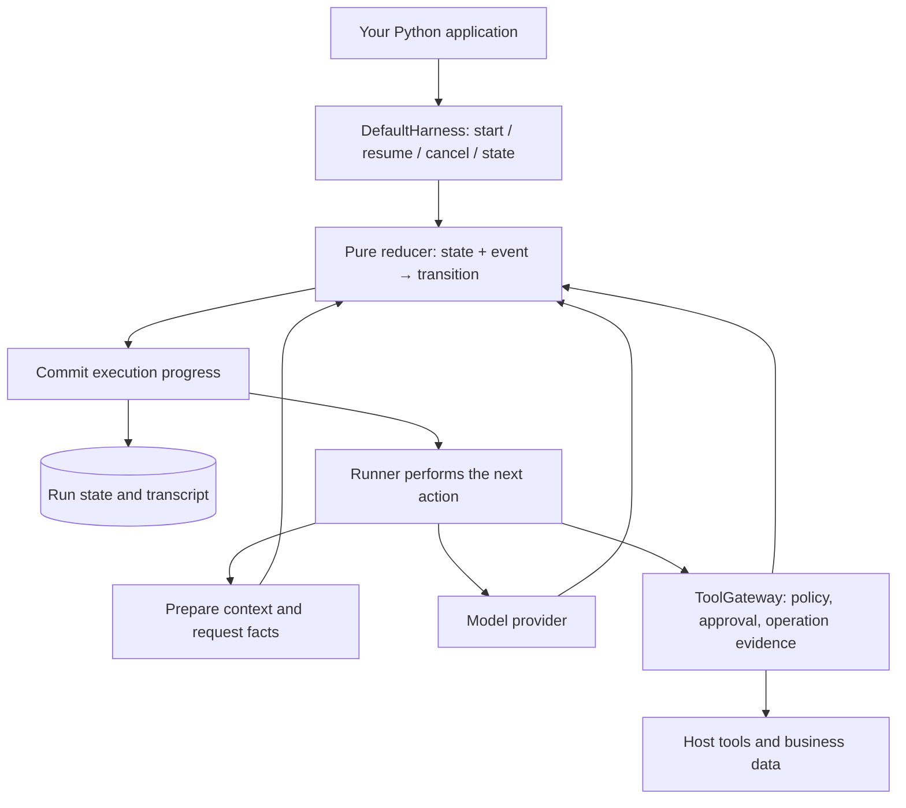

# Yanxu Harness

English | [简体中文](https://github.com/SZWzz/yanxu-harness/blob/v0.4.0a1/README.zh-CN.md)

**An embeddable Python agent runtime with durable execution, tool approvals, and recovery backed by operation evidence.**

Build agents inside your application while keeping control of permissions, data, and business operations. Yanxu tracks execution progress, settles tool calls individually, and separates the full conversation from the context sent to the model. The base package has **zero third-party runtime dependencies**.

> **Alpha · Python 3.10+ · MIT.** The release target is `0.4.0a1`. APIs and persisted formats may change; see the [public contract](https://github.com/SZWzz/yanxu-harness/blob/v0.4.0a1/docs/contract.md) and [verification record](https://github.com/SZWzz/yanxu-harness/blob/v0.4.0a1/docs/verification.md).

[Quickstart](#quickstart) · [Scope and limits](#scope-and-current-limits) · [Documentation](https://github.com/SZWzz/yanxu-harness/blob/v0.4.0a1/docs/README.md) · [Report a bug](https://github.com/SZWzz/yanxu-harness/issues)

## Why Yanxu?

An agent can stop after a tool has changed your data but before its result has been saved. Continuing that run requires knowing what happened outside the model conversation.

Yanxu makes those execution boundaries explicit:

- **Recover with evidence.** Reuse confirmed tool results. Pause for reconciliation when an operation's outcome cannot be proven.
- **Keep business authority in your application.** The host establishes identity, grants permissions, records approvals, and supplies tools. Model output and skill text cannot grant authority.
- **Understand each run.** Inspect persisted progress, waiting reasons, tool evidence, context decisions, and usage through a read-only API or CLI.
- **Embed in an existing Python stack.** Inject your provider, tools, persistence, and policy through explicit interfaces. SQLite reference implementations are included.

Useful for application agents that edit business data, wait for approval, or need to continue after a process restart. Bring your own tools and workspace when building a coding agent.

## Quickstart

### Install from PyPI

```bash
python -m pip install 'yanxu-harness==0.4.0a1'
```

This is an alpha pre-release; specify the version or use `--pre`. During release preparation, use the source or local wheel until the package-index upload completes. Optional adapters can be installed with `python -m pip install 'yanxu-harness[yaml,pydantic,mcp]==0.4.0a1'`.

### Install from source

```bash
git clone https://github.com/SZWzz/yanxu-harness.git
cd yanxu-harness
python -m venv .venv
source .venv/bin/activate
python -m pip install .
```

On Windows, activate with `.venv\Scripts\Activate.ps1` in PowerShell. Optional adapters: `python -m pip install '.[yaml,pydantic]'` adds local `SKILL.md` front-matter parsing and Pydantic tool argument models.

### See recovery work — no API key needed

```bash
python examples/01_basic_dialogue.py
python examples/07_partial_batch_recovery.py
```

The recovery example starts a real child process, completes tool A, crashes inside tool B, and leaves tool C unstarted. A fresh harness reads the saved state and operation ledger. It waits for evidence about B, then finishes C after a host reconciler supplies that evidence.

Output, abridged:

```text
step: crash
  A settled and was committed; B is open; C never ran
step: recover-barrier
  resumed, then stopped: B is unproven, so A was not re-run and C was not started
step: evidence
step: finish
  A replayed, B proven by evidence, C run exactly once; the model saw all three
OK: a partially settled batch was recovered call by call
```

The model responses and the reconciler's sample evidence are scripted. The harness, tools, SQLite stores, process failure, and recovery are real; this demonstrates execution behavior, not model quality. In an application, the reconciler must obtain evidence from the business system. Temporary state is cleaned up after the example.

### Optional MCP client adapter

MCP (Tools, stdio, Streamable HTTP) lives in the `mcp` extra and is never imported by
a base install:

```bash
python -m pip install '.[mcp]'
```

The first release pins protocol revisions `2025-11-25` and `2026-07-28` and SDK
`mcp==2.3.0`, with real-service tests across all four cells. MCP tools run through the
existing `ToolDefinition` → `core_tool` → `ToolGateway` → single operation ledger, and
one admission sends at most one remote `tools/call`. See the
[MCP client guide](https://github.com/SZWzz/yanxu-harness/blob/v0.4.0a1/docs/mcp-client.zh-CN.md) (Chinese), the
[MCP00 ADR](https://github.com/SZWzz/yanxu-harness/blob/v0.4.0a1/docs/mcp-client-sdk-baseline.zh-CN.md) and the
[delivery report](https://github.com/SZWzz/yanxu-harness/blob/v0.4.0a1/docs/mcp-client-delivery-report.zh-CN.md).

### Optional extension packs

A host can assemble an explicitly bound pack of tools, skills and (optionally) MCP tools
without adding a second loop, gateway or operation ledger:

```python
plan = plan_extensions(manifests=[document], factories={"example.pack": host_factory},
                       bindings=[host_binding], local_tools=host_tools)
async with open_extensions(plan) as deployment:
    gateway = ToolGateway(registry=deployment.registry, policy=host_policy,
                          approvals=host_approvals, backend=host_backend)
    harness = deployment.bind_harness(
        stream_fn=stream_fn, gateway_bindings=GatewayBindings(gateway=gateway, context=context),
        persistence=persistence,
    )
```

Manifests are bounded data, not authority: they cannot name a Python path, grant a
tool or contain a credential. The host supplies the factory and the binding; assembly
validates every contribution, publishes one frozen registry/skill view atomically, and
rolls back a failed batch. A revoked/closed deployment refuses old tool, skill and
harness references before a new intent. A changed extension version, binding revision
or scope is refused on resume by the existing arrangement comparison; the same logical
deployment reconstructs the same digest in a new process. Standard-library packs and
the optional MCP helper are both supported. See the
[extension guide](https://github.com/SZWzz/yanxu-harness/blob/v0.4.0a1/docs/extensions.zh-CN.md)
(Chinese), the [ADR](https://github.com/SZWzz/yanxu-harness/blob/v0.4.0a1/docs/extensions-adr.zh-CN.md)
and the [E0–E3 delivery report](https://github.com/SZWzz/yanxu-harness/blob/v0.4.0a1/docs/extensions-delivery-report.zh-CN.md).

### Install a local release wheel

If you have the verified local artifact bundle, install its wheel and check the version:

```bash
python -m pip install /path/to/yanxu_harness-0.4.0a1-py3-none-any.whl
python -c "import yanxu_harness; print(yanxu_harness.__version__)"
```

The bundle includes `SHA256SUMS` and verification reports. The base wheel needs no third-party runtime dependencies; optional adapters require their corresponding extras.

### Connect your model

Set `YANXU_BASE_URL` to your OpenAI-compatible endpoint's base URL, `YANXU_MODEL` to its model name, and `YANXU_API_KEY` to your credential in your application's environment. This example makes a real network request:

```python
import asyncio
import os
import uuid

from yanxu_harness.providers import (
    CoreStreamBridge,
    OpenAICompatibleProvider,
    ProviderConfig,
    SecretReference,
)
from yanxu_harness.runtime import (
    DefaultHarness,
    Principal,
    RunContext,
    RunIdentity,
    RunRequest,
)
from yanxu_harness.storage import SqlitePersistence


async def main():
    provider = OpenAICompatibleProvider(
        ProviderConfig(
            model=os.environ["YANXU_MODEL"],
            base_url=os.environ["YANXU_BASE_URL"],
            api_key=SecretReference("model-key"),
        ),
        secrets={"model-key": os.environ["YANXU_API_KEY"]},
    )
    store = SqlitePersistence("runs.db")
    try:
        harness = DefaultHarness(
            stream_fn=CoreStreamBridge(provider),
            persistence=store,
            system_prompt="Be concise and explain the basis for your answer.",
            max_runtime_seconds=60,
        )
        context = RunContext(
            identity=RunIdentity(
                namespace="demo", session_id="s1",
                run_id=uuid.uuid4().hex, attempt_id="a1",
            ),
            principal=Principal(subject="local-user"),
        )
        outcome = await harness.start(
            RunRequest(prompt="What makes an agent recoverable?", max_turns=3),
            context,
        )
        print(outcome.status.value, outcome.stop_code)
        print(outcome.final_text)
    finally:
        store.close()


asyncio.run(main())
```

This minimal run has no tools. Add tools through `ToolDefinition` → `ToolGateway` → `core_tool`; the [approved-edit example](https://github.com/SZWzz/yanxu-harness/blob/v0.4.0a1/examples/05_durable_approved_edit.py) shows the complete wiring. The [real-model edit example](https://github.com/SZWzz/yanxu-harness/blob/v0.4.0a1/examples/optional/real_model_edit.py) uses the same deployment with a configured endpoint.

## What is implemented

| Capability | What it gives your application |
| --- | --- |
| Explicit execution state | A pure state reducer and one Runner; versioned snapshots and commits before model/tool dispatch |
| Tool execution and recovery | Bounded concurrency, per-call settlement, stable operation identities, receipt reuse, and reconciliation barriers |
| Durable approvals | Preview and approval bindings tied to arguments, target versions, policy, and expiry; pause and resume across processes |
| Managed context | Separate transcript and request view, dependency-aware history selection, request budgets, output references, and optional bounded summaries |
| Provider integration | Neutral streaming protocol, OpenAI-compatible transport, cancellation, and host-supplied credentials |
| Skills and decision routing | On-demand skill metadata/body/resources; optional rule or model routers, within host permissions |
| Durable task orchestration | Persistent inboxes, bounded local scheduling, task deadlines, shared budgets, and recoverable parent/child tasks |
| Optional MCP tools | stdio and Streamable HTTP clients, explicit host bindings, and recovery through the same tool gateway and operation ledger |
| Extension packs | Atomic tools/skills/MCP composition, explicit host bindings, frozen deployment identity, revocation, and real recovery |
| Read-only diagnostics | JSON/Markdown reports with provenance, waiting reasons, tool evidence, stage timings, and usage coverage |
| Offline task evaluation | Frozen cases, independent verifiers, failure injection, and comparison of matching cases |

## How execution works

The core decides the next action; the Runner performs it and returns an input event. Durable execution through `DefaultHarness` commits progress before dispatching external work.



The full transcript, the model's request view, and operation receipts have distinct roles. The Gateway or delegated host owns operation evidence; a saved conversation or a model's claim of completion cannot substitute for it. See the [current architecture](https://github.com/SZWzz/yanxu-harness/blob/v0.4.0a1/docs/current-harness-architecture.zh-CN.md) and [recovery guide](https://github.com/SZWzz/yanxu-harness/blob/v0.4.0a1/docs/recovery.md).

## Pause, approve, and resume

Run the complete offline approval demo:

```bash
python examples/05_durable_approved_edit.py
```

To inspect a paused run yourself, choose a fresh state directory and start it separately:

```bash
python examples/05_durable_approved_edit.py --state build/approval-demo start --task "Update the welcome text"
python examples/05_durable_approved_edit.py --state build/approval-demo status --run edit-1
```

The output includes the preview and approval binding key. Use that key with the example's `approve` command, then its `resume` command; see [the example's instructions](https://github.com/SZWzz/yanxu-harness/blob/v0.4.0a1/examples/05_durable_approved_edit.py). Approval is a trusted host operation. Passing `{"approved": true}` to `resume()` does not authorize a write.

Run outcomes distinguish `completed`, `suspended`, `usage_limited`, `cancelled`, `failed`, and `rejected`. Recovery checks the stored configuration baseline; instructions, tools, or policy drift can refuse a resume before dispatch. See the [lifecycle contract](https://github.com/SZWzz/yanxu-harness/blob/v0.4.0a1/docs/contract.md).

## Inspect and evaluate

Inspect the saved approval demo without executing tools or resuming the run:

```bash
python -m yanxu_harness.diagnostics inspect \
  --runs build/approval-demo/runs.db \
  --operations build/approval-demo/operations.db \
  --namespace example-project --session session-1 --run-id edit-1 --format markdown
```

See a [diagnostic report](https://github.com/SZWzz/yanxu-harness/blob/v0.4.0a1/docs/samples/partial-recovery-report.md) for a partially recovered batch. Reports distinguish actual, estimated, and unknown measurements; missing usage is not counted as zero.

Run the frozen offline task suite:

```bash
python -m yanxu_harness.evals run --root build/evals --out build/eval-report
python -m yanxu_harness.evals --help
```

The suite exercises defect location, implementation fixes, diff review, approval, recovery, refusal, and context cancellation. Independent verifiers check results. These scripted-model cases measure harness behavior; they do not establish real-model task performance. See the [evaluation samples and comparison](https://github.com/SZWzz/yanxu-harness/blob/v0.4.0a1/docs/samples/evals/README.md).

## Scope and current limits

- **Alpha compatibility:** persisted formats are versioned. Unknown versions and older states that lack evidence required for safe recovery are refused.
- **External effects:** arbitrary tools and hooks do not get a blanket exactly-once guarantee. Reliable recovery needs durable receipts, idempotency, or host-provided business evidence; an uncertain outcome remains blocked.
- **Host integration:** the host owns authentication, permission grants, business transactions, and sandboxing. A custom operation ledger must implement the recovery capabilities the harness needs.
- **Task deployment:** durable inboxes, local scheduling, and parent/child tasks are implemented as libraries driven explicitly by the host. Distributed worker pools, a remote subagent protocol and production sandboxing are not provided. Extensions are a **library-level, host-explicit** mechanism: there is no plugin marketplace, arbitrary plugin-directory scan, remote install, dependency solver or capability sandbox.
- **Evidence:** model quality and platform support must be checked against the recorded version and environment. See [verification](https://github.com/SZWzz/yanxu-harness/blob/v0.4.0a1/docs/verification.md), [support](https://github.com/SZWzz/yanxu-harness/blob/v0.4.0a1/SUPPORT.md), and the [diagnostics/evaluation delivery report](https://github.com/SZWzz/yanxu-harness/blob/v0.4.0a1/docs/runtime-diagnostics-evaluation-delivery-report.zh-CN.md).

## Examples and documentation

| Start here | Purpose |
| --- | --- |
| [Basic dialogue](https://github.com/SZWzz/yanxu-harness/blob/v0.4.0a1/examples/01_basic_dialogue.py) | One model turn, streaming events, and a transcript |
| [Approved data edit](https://github.com/SZWzz/yanxu-harness/blob/v0.4.0a1/examples/02_approved_data_edit.py) | Tool definitions, policy, and approval |
| [Cross-process recovery](https://github.com/SZWzz/yanxu-harness/blob/v0.4.0a1/examples/03_cross_process_recovery.py) | Reopen persisted execution in another process |
| [Tools, skills, and decisions](https://github.com/SZWzz/yanxu-harness/blob/v0.4.0a1/examples/04_nonfiction_tools_skills_decisions.py) | Combine the optional layers |
| [Durable approved edit](https://github.com/SZWzz/yanxu-harness/blob/v0.4.0a1/examples/05_durable_approved_edit.py) | Preview → pause → approve → resume |
| [Managed-context edit](https://github.com/SZWzz/yanxu-harness/blob/v0.4.0a1/examples/06_managed_context_edit.py) | Run a coding task with a bounded request view |
| [Partial-batch recovery](https://github.com/SZWzz/yanxu-harness/blob/v0.4.0a1/examples/07_partial_batch_recovery.py) | Crash → reconcile → finish the remaining work |
| [Durable input redelivery](https://github.com/SZWzz/yanxu-harness/blob/v0.4.0a1/examples/08_durable_input_redelivery.py) | Persist inputs and consume them once across recovery |
| [Fair task scheduling](https://github.com/SZWzz/yanxu-harness/blob/v0.4.0a1/examples/09_fair_task_scheduling.py) | Schedule bounded local work and release slots while waiting |
| [Parent/child recovery](https://github.com/SZWzz/yanxu-harness/blob/v0.4.0a1/examples/10_parent_child_recovery.py) | Recover child results and continue the parent across processes |
| [MCP over stdio](https://github.com/SZWzz/yanxu-harness/blob/v0.4.0a1/examples/11_mcp_stdio.py) | Discover and call a real local MCP server; requires the `mcp` extra |
| [MCP HTTP recovery](https://github.com/SZWzz/yanxu-harness/blob/v0.4.0a1/examples/12_mcp_http_recovery.py) | Reconcile an uncertain remote write; requires the `mcp` extra |
| [Extension tools and skills](https://github.com/SZWzz/yanxu-harness/blob/v0.4.0a1/examples/13_extension_tools_skills.py) | Assemble a standard-library pack and run one real tool call |
| [Extension MCP recovery](https://github.com/SZWzz/yanxu-harness/blob/v0.4.0a1/examples/14_extension_mcp_recovery.py) | Pause on an MCP write, restart and resume; requires the `mcp` extra |

Use the [documentation index](https://github.com/SZWzz/yanxu-harness/blob/v0.4.0a1/docs/README.md) for integration guides, current architecture, release evidence, and historical implementation/review records. Start with the [public API contract](https://github.com/SZWzz/yanxu-harness/blob/v0.4.0a1/docs/contract.md), [adapter guide](https://github.com/SZWzz/yanxu-harness/blob/v0.4.0a1/docs/adapters.md), and [recovery semantics](https://github.com/SZWzz/yanxu-harness/blob/v0.4.0a1/docs/recovery.md).

## Contributing

Integration feedback, small runnable failure cases, adapter improvements, and documentation fixes are useful contributions. Include expected behavior and the relevant environment; remove credentials and private data. For security reports, follow [SECURITY.md](https://github.com/SZWzz/yanxu-harness/blob/v0.4.0a1/SECURITY.md).

```bash
python -m pip install -e '.[dev,yaml,pydantic]'
python -m pytest -q tests
python scripts/ci_check.py --prepare-wheelhouse build-wheelhouse
python scripts/ci_check.py --offline --wheelhouse build-wheelhouse
```

The wheelhouse preparation step uses the network; the subsequent gate installs and verifies artifacts offline. See [CONTRIBUTING.md](https://github.com/SZWzz/yanxu-harness/blob/v0.4.0a1/CONTRIBUTING.md) for the full workflow.

## License and acknowledgements

[MIT](https://github.com/SZWzz/yanxu-harness/blob/v0.4.0a1/LICENSE). The core's message types, event vocabulary, and parts of its loop behavior derive from **pi-agent-core**. Yanxu adds an explicit execution state machine, one Runner, durable commit boundaries, and its application integration layers. Attribution and the upstream MIT license are retained in [THIRD_PARTY_NOTICES.md](https://github.com/SZWzz/yanxu-harness/blob/v0.4.0a1/THIRD_PARTY_NOTICES.md) and [LICENSES/](https://github.com/SZWzz/yanxu-harness/tree/v0.4.0a1/LICENSES/).
