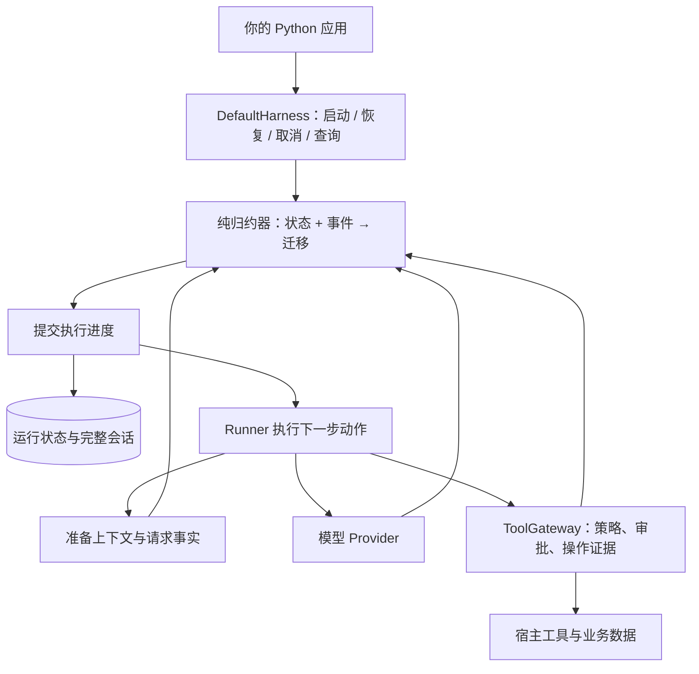

# Yanxu Harness

[English](README.md) | 简体中文

**可嵌入 Python 应用的 Agent 执行框架，支持持久化运行、工具审批和基于操作证据的故障恢复。**

在自己的应用里构建 Agent，继续掌握权限、数据和业务操作。Yanxu 管理执行进度，逐个结算工具调用，并将完整会话与发送给模型的上下文分开管理。基础包**没有第三方运行时依赖**。

> **Alpha · Python 3.10+ · MIT。** 本次发布目标为 `0.4.0a1`。API 和持久化格式仍可能调整，详见[公开契约](docs/contract.md)与[验证记录](docs/verification.md)。

[快速开始](#快速开始) · [使用边界](#使用边界与当前限制) · [文档索引](docs/README.md) · [问题反馈](https://github.com/SZWzz/yanxu-harness/issues)

## 为什么使用 Yanxu？

工具已经修改了数据，结果还没来得及保存，Agent 进程就退出了。继续这个任务，需要知道模型会话之外究竟发生了什么。

Yanxu 将这些执行边界明确下来：

- **依据证据恢复。** 复用已确认的工具结果；无法证明结果的操作暂停等待核对。
- **业务控制权留在应用。** 宿主建立身份、授予权限、记录审批并提供工具。模型输出和 Skill 文本不能授予权限。
- **解释一次运行。** 通过只读 API 或 CLI 查看持久化进度、等待原因、工具证据、上下文选择和用量。
- **接入现有 Python 系统。** 通过明确接口注入模型、工具、存储和策略，内置 SQLite 参考实现。

适合修改业务数据、等待人工审批，或需要在进程重启后继续任务的应用 Agent。构建 Coding Agent 时，可以接入自己的工具与工作区。

## 快速开始

### 从 PyPI 安装

```bash
python -m pip install 'yanxu-harness==0.4.0a1'
```

这是 Alpha 预发布版本，安装时请明确指定版本，或使用 `--pre`。发布准备期间、包索引上传完成前，请从源码或本地 wheel 安装。可选适配器可通过 `python -m pip install 'yanxu-harness[yaml,pydantic,mcp]==0.4.0a1'` 安装。

### 从源码安装

```bash
git clone https://github.com/SZWzz/yanxu-harness.git
cd yanxu-harness
python -m venv .venv
source .venv/bin/activate
python -m pip install .
```

Windows PowerShell 使用 `.venv\Scripts\Activate.ps1` 激活环境。需要解析本地 `SKILL.md` 前言或使用 Pydantic 工具参数模型时，安装可选适配器：`python -m pip install '.[yaml,pydantic]'`。

### 先看恢复演示，无需 API Key

```bash
python examples/01_basic_dialogue.py
python examples/07_partial_batch_recovery.py
```

恢复示例启动真实子进程：工具 A 完成，进程在工具 B 内退出，工具 C 尚未启动。新 Harness 从持久化状态与操作账本中读取进度，先等待 B 的证据，再由宿主核对器提供证据，最后完成 C。

输出节选：

```text
step: crash
  A settled and was committed; B is open; C never ran
step: recover-barrier
  resumed, then stopped: B is unproven, so A was not re-run and C was not started
step: evidence
step: finish
  A replayed, B proven by evidence, C run exactly once; the model saw all three
OK: a partially settled batch was recovered call by call
```

示例中的模型回答和核对器的示例证据由脚本提供；Harness、工具、SQLite 存储、进程退出和恢复均真实执行。这展示的是执行行为，不代表模型能力。实际接入时，核对器需要从业务系统取得证据。示例结束后自动清理临时状态。

### 可选 MCP Client 适配器

MCP（Tools、stdio、Streamable HTTP）在 `mcp` extra 里，基础安装不会导入它：

```bash
python -m pip install '.[mcp]'
```

首版 pin 协议 `2025-11-25` 与 `2026-07-28`、SDK `mcp==2.3.0`，四格都有真实服务测试。
MCP 工具经过既有 `ToolDefinition` → `core_tool` → `ToolGateway` → 唯一操作账本，
一次准入最多一次远端 `tools/call`；用法与边界见 [MCP Client 使用说明](docs/mcp-client.zh-CN.md)，
锁定与验证证据见 [MCP00 ADR](docs/mcp-client-sdk-baseline.zh-CN.md) 与
[交付报告](docs/mcp-client-delivery-report.zh-CN.md)。

### 可选扩展包

宿主可以把一组显式绑定的 tools、skills 和（可选）MCP 工具装配进同一个 Harness，
不增加第二个循环、Gateway 或操作账本：

```python
plan = plan_extensions(manifests=[document], factories={"example.pack": host_factory},
                       bindings=[host_binding], local_tools=host_tools)
async with open_extensions(plan) as deployment:
    gateway = ToolGateway(registry=deployment.registry, policy=host_policy,
                          approvals=host_approvals, backend=host_backend)
    harness = deployment.bind_harness(
        stream_fn=stream_fn, gateway_bindings=GatewayBindings(gateway=gateway, context=context),
        persistence=persistence,
    )
```

清单是有界数据，不是授权：它不能命名 Python 路径、授予工具、标记只读/幂等或包含
凭据。工厂与 binding 由宿主显式提供；装配层校验实际贡献后一次发布冻结的 registry
与 skill 视图，任一项失败整批回滚。撤权/关闭后，旧的 tool、skill、Harness 引用在
新调用之前拒绝；扩展版本、binding revision 或 scope 变化由既有 arrangement 比较
拒绝恢复；相同逻辑部署在新进程中重建相同摘要。标准库包与可选 MCP 辅助都支持。
详见[扩展开发指南](docs/extensions.zh-CN.md)、[ADR](docs/extensions-adr.zh-CN.md) 与
[E0–E3 交付报告](docs/extensions-delivery-report.zh-CN.md)。

### 安装本地发行包

取得已验证的本地发行包后，安装其中的 wheel 并确认版本：

```bash
python -m pip install /path/to/yanxu_harness-0.4.0a1-py3-none-any.whl
python -c "import yanxu_harness; print(yanxu_harness.__version__)"
```

发行目录包含 `SHA256SUMS` 和验证报告。基础 wheel 不需要第三方运行时依赖；可选适配器需要安装对应 extras。

### 接入自己的模型

在应用环境中设置：`YANXU_BASE_URL` 为 OpenAI 兼容端点的基础 URL，`YANXU_MODEL` 为模型名，`YANXU_API_KEY` 为凭据。下面代码会发起真实网络请求：

```python
import asyncio
import os
import uuid

from yanxu_harness.providers import (
    CoreStreamBridge,
    OpenAICompatibleProvider,
    ProviderConfig,
    SecretReference,
)
from yanxu_harness.runtime import (
    DefaultHarness,
    Principal,
    RunContext,
    RunIdentity,
    RunRequest,
)
from yanxu_harness.storage import SqlitePersistence


async def main():
    provider = OpenAICompatibleProvider(
        ProviderConfig(
            model=os.environ["YANXU_MODEL"],
            base_url=os.environ["YANXU_BASE_URL"],
            api_key=SecretReference("model-key"),
        ),
        secrets={"model-key": os.environ["YANXU_API_KEY"]},
    )
    store = SqlitePersistence("runs.db")
    try:
        harness = DefaultHarness(
            stream_fn=CoreStreamBridge(provider),
            persistence=store,
            system_prompt="回答简洁，说明结论的依据。",
            max_runtime_seconds=60,
        )
        context = RunContext(
            identity=RunIdentity(
                namespace="demo", session_id="s1",
                run_id=uuid.uuid4().hex, attempt_id="a1",
            ),
            principal=Principal(subject="local-user"),
        )
        outcome = await harness.start(
            RunRequest(prompt="Agent 怎样才能在故障后恢复？", max_turns=3),
            context,
        )
        print(outcome.status.value, outcome.stop_code)
        print(outcome.final_text)
    finally:
        store.close()


asyncio.run(main())
```

这个最小示例没有注册工具。接入工具使用 `ToolDefinition` → `ToolGateway` → `core_tool`，[持久审批编辑示例](examples/05_durable_approved_edit.py)包含完整接线。[真实模型编辑示例](examples/optional/real_model_edit.py)复用同一部署，改用配置的模型端点。

## 已实现能力

| 能力 | 为应用提供什么 |
| --- | --- |
| 显式执行状态 | 纯状态归约器与唯一 Runner，版本化快照，在派发模型或工具前提交进度 |
| 工具执行与恢复 | 有界并发、逐调用结算、稳定操作身份、回执复用与核对屏障 |
| 持久审批 | 绑定参数、目标版本、策略和有效期的预览与审批，支持跨进程暂停、续跑 |
| 上下文工程 | 完整历史与请求视图分离、按依赖选择历史、请求预算、输出引用及可选受限摘要 |
| 模型接入 | 中立流式协议、OpenAI 兼容传输、取消及宿主提供的凭据 |
| Skills 与决策路由 | 按需读取 Skill 元数据、正文和资源；在宿主权限内使用可选规则或模型路由 |
| 持久任务编排 | 持久 inbox、有界本地调度、任务期限、共享预算与可恢复父子任务 |
| 可选 MCP 工具 | stdio 与 Streamable HTTP 客户端、宿主显式绑定，沿用同一工具网关和操作账本恢复 |
| 扩展包 | tools/skills/MCP 原子装配、宿主显式绑定、冻结部署身份、撤权与真实恢复 |
| 只读诊断 | 带来源的 JSON/Markdown 报告，解释等待原因、工具证据、阶段耗时和用量覆盖度 |
| 离线任务评测 | 冻结案例、独立验收器、故障注入及相同案例的结果对比 |

## 执行原理

Core 决定下一步动作，Runner 执行动作，再将结果作为输入事件送回。通过 `DefaultHarness` 持久化运行时，执行进度先提交，外部工作随后派发。



完整会话、模型请求视图和操作回执各有用途。操作证据由 Gateway 或受委托的宿主管理；保存的聊天记录和模型的“已完成”声明不能代替操作证据。详见[当前架构](docs/current-harness-architecture.zh-CN.md)与[恢复语义](docs/recovery.md)。

## 暂停、审批与恢复

运行完整离线审批演示：

```bash
python examples/05_durable_approved_edit.py
```

想手动查看暂停状态时，选择一个新的状态目录，分步启动：

```bash
python examples/05_durable_approved_edit.py --state build/approval-demo start --task "更新欢迎语"
python examples/05_durable_approved_edit.py --state build/approval-demo status --run edit-1
```

输出包含真实预览和审批绑定键。将该键交给示例的 `approve` 命令，再执行 `resume` 命令，详见[示例说明](examples/05_durable_approved_edit.py)。审批必须来自宿主的可信入口；给 `resume()` 传入 `{"approved": true}` 不会授权写入。

运行结局区分 `completed`、`suspended`、`usage_limited`、`cancelled`、`failed` 和 `rejected`。恢复时核对已保存的配置基线；指令、工具或策略发生漂移，可能在派发前拒绝续跑。详见[生命周期契约](docs/contract.md)。

## 诊断与评测

只读查看上面的审批示例，不执行工具、不恢复运行：

```bash
python -m yanxu_harness.diagnostics inspect \
  --runs build/approval-demo/runs.db \
  --operations build/approval-demo/operations.db \
  --namespace example-project --session session-1 --run-id edit-1 --format markdown
```

也可以直接阅读[部分批次恢复诊断报告](docs/samples/partial-recovery-report.md)。报告区分实测、估算和未知值，缺失的用量不会算成零。

运行冻结的离线任务集：

```bash
python -m yanxu_harness.evals run --root build/evals --out build/eval-report
python -m yanxu_harness.evals --help
```

任务集覆盖缺陷定位、实现修复、差异审阅、审批、恢复、拒绝和上下文取消，由独立验收器检查结果。脚本模型案例衡量 Harness 行为，不证明真实模型的任务表现。详见[评测样例与对比](docs/samples/evals/README.md)。

## 使用边界与当前限制

- **Alpha 兼容性：** 持久化格式独立版本化；未知版本，以及缺少安全恢复所需证据的旧状态，会被拒绝。
- **外部副作用：** 不对任意工具和钩子承诺恰好执行一次。可靠恢复需要持久回执、幂等能力或宿主业务证据；不确定结果继续阻塞。
- **宿主职责：** 身份认证、权限授予、业务事务和沙箱由宿主管理。自定义操作账本需实现恢复所依赖的能力。
- **任务部署：** 持久 inbox、本地调度和父子任务已经实现，由宿主显式驱动。当前不提供跨主机 worker 池、远程 subagent 协议和生产沙箱。扩展是**库级、宿主显式**机制：不提供插件市场、任意插件目录扫描、远程安装、依赖求解器或能力沙箱。
- **验证范围：** 模型效果和平台支持需结合具体版本及运行环境判断，见[验证记录](docs/verification.md)、[支持范围](SUPPORT.md)和[诊断与评测交付报告](docs/runtime-diagnostics-evaluation-delivery-report.zh-CN.md)。

## 示例与文档

| 从这里开始 | 内容 |
| --- | --- |
| [基础对话](examples/01_basic_dialogue.py) | 单轮模型调用、流式事件与会话记录 |
| [审批数据编辑](examples/02_approved_data_edit.py) | 工具定义、策略与审批 |
| [跨进程恢复](examples/03_cross_process_recovery.py) | 在新进程中读取持久化执行状态 |
| [工具、Skills 与决策](examples/04_nonfiction_tools_skills_decisions.py) | 组合使用可选能力 |
| [持久审批编辑](examples/05_durable_approved_edit.py) | 预览 → 暂停 → 审批 → 恢复 |
| [受管上下文编辑](examples/06_managed_context_edit.py) | 在请求预算内运行代码编辑任务 |
| [部分批次恢复](examples/07_partial_batch_recovery.py) | 崩溃 → 核对 → 完成剩余工作 |
| [持久输入重投](examples/08_durable_input_redelivery.py) | 保存输入，恢复后只消费一次 |
| [公平任务调度](examples/09_fair_task_scheduling.py) | 有界本地调度，等待时释放执行槽位 |
| [父子任务恢复](examples/10_parent_child_recovery.py) | 跨进程恢复子结果并继续父任务 |
| [MCP stdio](examples/11_mcp_stdio.py) | 发现并调用真实本地 MCP 服务；需安装 `mcp` extra |
| [MCP HTTP 恢复](examples/12_mcp_http_recovery.py) | 核对结果不确定的远端写入；需安装 `mcp` extra |
| [扩展 tools/skills](examples/13_extension_tools_skills.py) | 装配标准库参考包并运行一次真实工具调用 |
| [扩展 MCP 恢复](examples/14_extension_mcp_recovery.py) | 在 MCP 写入前暂停，重启后恢复；需安装 `mcp` extra |

通过[文档索引](docs/README.md)查看接入指南、当前架构、发行证据与历史实施/审查记录。接入开发先读[公开 API 契约](docs/contract.md)、[适配器指南](docs/adapters.md)和[恢复语义](docs/recovery.md)。

## 参与贡献

欢迎提供接入反馈、可运行的最小故障案例、适配器改进和文档修正。反馈时说明预期行为与运行环境，并移除凭据和私有数据。安全问题请遵循 [SECURITY.md](SECURITY.md)。

```bash
python -m pip install -e '.[dev,yaml,pydantic]'
python -m pytest -q tests
python scripts/ci_check.py --prepare-wheelhouse build-wheelhouse
python scripts/ci_check.py --offline --wheelhouse build-wheelhouse
```

准备 wheelhouse 时联网，后续门禁离线安装并验证构建产物。完整流程见 [CONTRIBUTING.md](CONTRIBUTING.md)。

## 许可与致谢

[MIT](LICENSE)。Core 的消息类型、事件词汇和部分循环行为源自 **pi-agent-core**；Yanxu 在此基础上增加显式执行状态机、唯一 Runner、持久提交边界和应用接入层。来源声明与上游 MIT 许可保留在 [THIRD_PARTY_NOTICES.md](THIRD_PARTY_NOTICES.md) 和 [LICENSES/](LICENSES/)。
