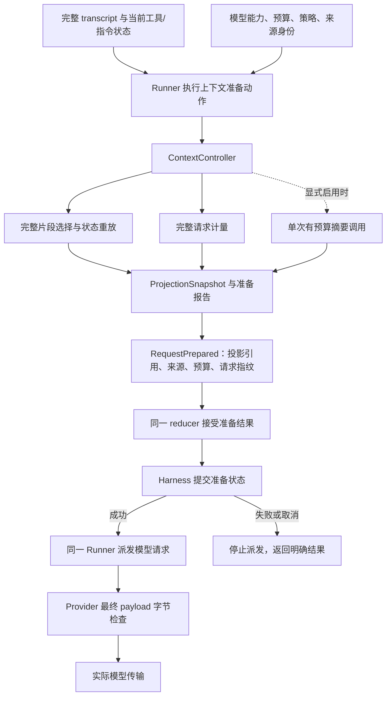

# 上下文工程实施计划：从字符窗口到可验证的请求准备

日期：2026-10-15。参考提交：`81a2f05`。状态：**实施计划，尚未开发**。

所属路线：[Harness 四方向开发路线图](harness-evolution-roadmap.zh-CN.md)。优先级：当前持久提交缺陷验收后，首先推进本计划 C0–C3。

## 1. 目标、前置条件与范围

目标：每次请求模型前，构造一个满足预算、保留必要信息与协议关系、可以解释来源的上下文视图；完整历史和执行证据保持可读取。

分两次交付：

- **第一版 C0–C3**：计量、完整片段选择、必要系统/工具状态、真实请求接线与结构化超限。不依赖摘要模型。
- **第二版 C4–C6**：大输出原文引用、任务笔记、可选受控摘要、恢复与任务效果评测。

前置：先完成 [持久提交修复](harness-durable-commit-fix-plan.zh-CN.md)，核对修复后的 transcript 权威来源、提交接口与暂停/终态语义。当前 `runtime/default_harness.py` 和进程测试正在被修改，不得覆盖。

纯计量/片段选择可提前开发；真实 Harness 接线、投影状态持久化、恢复验收必须基于通过前置门禁的版本。

本轮不实现：向量数据库、全仓库索引、跨会话长期记忆、自动权限判定、通用任务规划器、subagent 和第二套模型—工具循环。代码仓库检索策略属于 CodingAgent 应用侧，本层提供可容纳检索材料的通用接口。

## 2. 当前能力与已核对的缺口

### 2.1 直接复用的能力

| 现有落点 | 已有内容 | 本轮处理 |
| --- | --- | --- |
| `context/policy.py` | `ContextWindow`、`ContextPolicy`、`TranscriptArchive`、`ContextProjector`、摘要类型/接口与发布校验 | 复用并补完整契约 |
| `context/archive.py` | 内存追加归档、`WindowedProjector`、`ProjectionSnapshot`、source_head 与缓存 | 建立结构化投影，明确兼容路径 |
| `core/loop_config.py` | transform/convert/project hooks 与预算接入缝 | 明确谁真正执行，不保留无消费者的假接线 |
| `core/runner.py::_request_model` | 请求转换、投影闭包、`ContextProjected` 事件 | 新模式分离请求视图与原始历史 |
| `providers/core_bridge.py` | Core transcript 到 `ProviderRequest` 的构建 | 使用同一实际构建路径计量与派发 |
| `providers/openai_compat.py` | 最终 body 序列化后的同步 `PayloadGate` | 保留最终字节拒绝，不在线程里执行异步压缩 |
| `runtime` / `storage` | 运行身份、租约/CAS、快照、事件与恢复 | 在已有提交路径保存投影引用与必要元数据 |

### 2.2 本次核对证据

命令 `.venv/bin/python -m pytest -q tests/test_context.py tests/test_context_archive.py`：**20 passed**。

另用 `TranscriptEntry + WindowedProjector` 做了四个最小边界探针，结果如下。现有 20 条测试没有覆盖这些组合：

| 输入 | 当前结果 | 目标 |
| --- | --- | --- |
| system 在前，最近 user 可放入窗口，`keep_system_entries=True` | system 仍被移除 | 有效系统/工具声明必须能重建；参数不得静默无效 |
| 唯一一条消息长 40 字符，`char_budget=10` | 40 字符全部保留 | 必需内容超限时明确失败，不能报告“已满足预算” |
| 非空消息，`capacity=0` | 仍保留 1 条 | 不派发非空超限请求 |
| assistant 工具调用 + tool result，窗口只够最后的 `ok` | 仅保留 toolResult | 调用与结果不能被裁成孤立消息 |

另外已确认：

- `WindowedProjector` 的 `capacity` 与 `char_budget` 直接取最小值，估算 token 为字符数除以 4；它没有完整请求计量，也没有明确区分 token 容量与字符容量。
- `CoreStreamBridge` 当前不消费 `_project_context_for_budget`。Core 放入 options 的闭包，不等于内置 Provider 路径已运行压缩策略。
- 当前 `project_context` 的返回会进入 `view.persist`，随后通过 `ContextProjected` 替换活动对话。新的归档/投影模式不能沿用这条路径去删除原始历史。
- 现有摘要接口和校验不等于已有完整的摘要生成、预算、存储与恢复流程。

以上是开发基线；实施者开工时重新复现，不把文档中的代码状态当作覆盖工作区的理由。

## 3. 必须冻结的上下文契约

### 3.1 三种数据分开

1. **原始会话历史**：Harness 接纳的消息及其来源，按顺序保存。它不等于业务系统的全部原始数据，也不一定包含被上游工具预先截断的输出。
2. **模型请求投影**：本次实际发送的消息、系统指令、工具声明和材料。允许少于完整历史，不能被当作新的原始历史。
3. **执行/授权证据**：审批、operation、receipt、unknown 等保持在现有权威存储中。摘要和任务笔记只能引用，不能改写证据。

第一版优先复用持久提交修复后确定的完整 transcript（通常为 `RunRecord.messages`）作为唯一会话来源；`TranscriptArchive` 可以提供读取视图，不额外建一份需要双写的历史真相。

新增请求投影不会删减 `ExecutionState.messages` / `RunRecord.messages`。若后续需要把大历史移到追加表，再单独设计原子 append、head 引用与格式迁移，本轮不顺手重构整套存储。

### 3.2 协议结构必须合法

- 工具调用与对应结果按调用关联组成不可随意拆分的片段，不能留下孤立 result 或未解释的调用。
- 调用关联至少限定在所属模型动作/assistant 消息范围，不能假设 tool_call_id 在所有运行和历史中全局唯一。
- 并行结果保持源消息要求的关系与顺序；选择窗口不改变工具参数、结果状态、错误标记或 receipt 对应关系。
- 等待审批/unknown 的未完成批次不能为“凑齐上下文”伪造结果；原有暂停规则先于下一模型请求。
- 当前用户输入与正在处理的工具往返必须保留。若保留它们后仍超限，返回明确限额结果。

### 3.3 系统指令与工具声明保持语义

- 使用现有 transcript 重放函数处理 `content`、`sections`、`tools_added`、`tools_removed`，不另写一套简化状态。
- 若移除早期历史，在保留窗口起点构造等价的系统/工具基线，再应用窗口内的更新；最终有效状态必须与原历史一致。
- 不把“最终工具集”放在最前面后，又重放旧工具增删，导致被撤回工具重新出现。
- provider 不支持中途 system 时，继续通过现有 capability/normalize/resolve 路径转换；支持时保留必要的时间顺序。
- 系统指令、工具 schema 的体积也计入预算。必需指令/声明放不下时拒绝，不静默截断或删除工具。

### 3.4 摘要与笔记是派生材料

用户/宿主明确提供的目标、约束，与模型提取的任务笔记区分来源和版本。任务笔记不能将“模型猜测”升级为已完成事实、审批或权限。

工具输出和摘要中的指令文本不获得 system 权限。生成摘要不自动改变真实工具集、审批绑定或操作结果。

## 4. 目标结构与接入边界



名称是建议，应与接手时现有类型合并，不照名称创建重复概念。

### 4.1 ContextController

一个异步准备协调器，组合计量、确定性片段选择和可选摘要；它不拥有模型—工具循环，不调用业务写工具。

建议输入包含：scope、稳定模型动作引用、原始历史快照/head、当前工具/指令状态、模型/transport 能力、预算策略、取消令牌与显式摘要适配器。

建议输出复用/扩展 `ProjectionSnapshot`：

```text
projection_id / projection_schema_version
scope + source_head + selected_ranges + source_fingerprints
policy_version + estimator_id/version + model/transport identity
messages 或可重建引用、summary/artifact 引用
effective_system/tool_fingerprint
request_budget_report + final_request_fingerprint
kept/dropped/truncated 的数量与原因
```

只将需要恢复或核对的纯数据保存。密钥、callable、数据库连接、provider 对象和 tokenizer 实例不进入状态。

### 4.2 新模式与旧 hooks 的兼容

- 未配置受管上下文时保持现有 API 和默认行为；配置方式建议为显式 `context_controller=` 或等价依赖注入。
- 新模式默认只生成请求视图，不调用 `ContextProjected` 去替换完整历史。
- 旧 `persist_transformed_context=True`、旧 `project_context` 与新控制器的组合必须有确定规则。第一版建议拒绝有歧义的组合并给出错误，避免静默运行两次压缩。
- 若允许 `transform_context` / `convert_to_llm` 与控制器共存，冻结唯一调用顺序和次数；计量必须覆盖最终实际转换结果，不能估算原消息后发送另一个视图。
- 将准备结果作为显式输入交回同一 reducer，再经提交端口确认后派发。可将现有模型动作拆为“准备请求”和“发送已准备请求”，不新增循环。
- 当前 `_project_context_for_budget` 不能继续作为无人消费的核心接线。实现真实消费者或提供明确弃用/适配路径，并以实际请求验证。

主模型轮次仍按既有模型请求契约计数；上下文准备本身不增加工具执行轮次。摘要模型使用单独的预算和 usage 分类。

准备失败也必须有明确出口：预算不足通过可辨认的准备结果输入交给 reducer，形成限额结果；不能被 `Agent` 的通用异常分支改写为模型失败。名称可为 `ContextPreparationRefused` 或复用等价类型。配置组合错误则在派发前明确拒绝，存储提交错误继续保留存储错误性质。

## 5. 完整请求预算与计量

### 5.1 单位与公式

字符、UTF-8 字节、token 分别命名；现有 `char_budget` 保持字符含义，不把它改名不改算法。

当模型窗口 `L` 已知时：

```text
R = max(策略要求的输出预留, 本次请求实际 max_output_tokens)
C = max(0, L - R - safety_margin_tokens)
T = system + tool schemas + selected messages/materials + protocol overhead 的 token 计量
发送条件：T <= C；同时满足独立的 max_payload_bytes
```

输出预留只扣一次。如果增加“未来工具结果余量”，必须是额外、显式、可解释的策略，不能混入未知扣减。

若请求没有显式输出上限，应先解析真实 Provider/模型配置的默认值；无法确定时标记未知，不把缺失值当 0 后宣称余量充足。

### 5.2 计量端口

建议增加可替换的 `TokenEstimator` 与 `TokenEstimate`，预算继续复用 `ContextWindow` / `ContextPolicy`。

- 输入是实际 provider 可表达的请求结构，包含 system、全部工具 schema、文本/图片、协议开销和输出配置。
- 输出包含数值或 unknown、计量方法、覆盖范围、模型/估算器版本；无法计量的图片等不能默认为 0。
- 默认标准库估算器明确标为 heuristic；外部 tokenizer 属于可选适配器。
- tokenizer 对文本片段精确，不自动意味着 provider 对整份请求的计费 token 精确；不能做无依据的精度声明。
- 窗口未知继续报告 unknown。宿主可显式选择允许未知或严格拒绝；不得把未知当无限或伪造使用百分比。
- heuristic 加安全余量只能降低超限风险，不能承诺 provider 永不报 context overflow。

### 5.3 两个不同的检查点

1. 异步准备阶段：组装、选择、计量、可选摘要，得到最终候选请求。
2. Provider 实际发送前：检查最终序列化字节上限与请求一致性；超限时传输调用次数为 0。

复用同一请求/body 构建函数，避免“估算一个 payload，实际发送另一个”。最终 bytes 检查不等于精确 token 检查。

现有 `PayloadGate` 在线程中同步执行，不能在这里运行异步摘要、另建事件循环或递归重发。压缩在派发前完成，最终 gate 只验证/拒绝。

## 6. 确定性投影算法

第一版不依赖模型判断重要性。算法建议如下：

1. 校验 scope、原始消息与当前执行阶段，冻结待投影的 source_head。
2. 根据消息顺序与工具关联构造完整片段，保持原顺序；系统/工具更新参与片段依赖分析。
3. 标出不可移除集合：有效指令基线、当前用户输入、当前工具往返、宿主明确要求保留的任务约束。
4. 从最新完整片段向前选择。容量不足时移除最旧可移除片段，不从片段中间切断调用关系。
5. 在选择窗口起点重放有效 system/sections/tools 基线，保留窗口内变化，并验证最终状态等价。
6. 使用真实 provider 转换结构重新计量。超限时继续移除可移除的完整片段，次数受片段数量上限约束，不循环调用模型。
7. 最小必需集合仍超限则返回明确失败；单个巨大工具输出走 C4 的投影视图策略，不能截断工具参数 JSON。
8. 输出投影来源、保留/移除理由、估算方法和最终请求指纹，原始历史保持不变。

同一输入、策略、估算器与能力配置产生同一投影。复杂度应可解释：避免每轮反复序列化整个前缀、对所有候选重复调用昂贵 tokenizer。

可缓存条目/片段计量，但缓存必须有条数或字节上限。第一版仍在现有完整 transcript 上工作，不宣称已经解决任意长度历史的内存/存储扩展问题。

## 7. 大工具输出、任务笔记与摘要

### 7.1 大输出只压缩模型视图

- 保留 Harness 实际接纳的原消息；更完整的外部结果若只存在 receipt/业务存储中，使用真实引用，不假称归档中已有全部原文。
- 模型视图可使用有界头尾/错误片段与 `artifact_ref`，明确标记截断、原长度、内容指纹和来源范围。
- 不修改 tool_call_id、tool_name、is_error、执行状态、审批/receipt 事实或工具调用参数。
- 原文读取通过受限的只读适配器/工具走现有 Gateway；引用不是任意文件路径，也不授予读取权限。
- 如需新增 blob 存储，仅保存不可变内容，不拥有第二份操作状态；引用提交与原文可用性有恢复规则。
- 原文未保存成功时，不能用不可读取的引用替代唯一正文。

第一版 C0–C3 可以在巨大必需输出超限时明确拒绝；C4 才增加原文引用与读取闭环。

### 7.2 任务笔记

优先提供一个有界、带来源的任务状态视图：目标、约束、已完成工作、阻塞点、下一步候选。

- 目标和约束来源于用户/宿主的明确输入；模型建议和推断单独标记。
- “测试通过”“修改完成”等事实引用具体工具结果与版本；无法核对时保留为待确认。
- 文件/资源变化后重新验证相关事实，不能把旧文件片段或摘要当当前版本。
- 新用户输入可更新任务目标；不能因为旧目标已被 pinned，就压掉后来指令。
- 它不承担通用任务调度器、授权服务或业务完成记录的职责。

### 7.3 受控摘要

复用现有 `Summarizer` / `SummaryResult` / `SummaryArtifact`，分别明确生成结果与已验证发布物的职责，不再增加语义相同的摘要类型。

- 只摘要已经稳定的较旧片段，保留最新用户输入及当前工具往返原文。
- 摘要记录 source_range、对应内容指纹、scope、模型/提示策略版本、base projection 与生成 usage。
- 摘要模型由宿主显式配置；每次仅做摘要请求，不配置业务工具，不递归调用本 Agent Loop。
- 限制调用次数、输入/输出、耗时及总预算。达到阈值不等于每轮必调摘要模型。
- 缓存与 single-flight 有明确 scope 和容量；失败后不在同一请求准备中无限重试。
- 摘要失败、超时、取消或被拒绝时保留原始数据。回退到合法的确定性投影；仍不满足预算则停止派发。
- 摘要 usage 与主模型分开记录；缺失成本不填 0。进程在摘要请求后退出时，不假称该请求未计费，也不无条件恢复摘要额度。

### 7.4 摘要发布与前缀复用

保留现有 `validate_publication` 默认严格 head 校验的兼容语义，不能仅删除校验以提高命中率。

第一实现可以严格要求当前 head 与生成时一致。若支持“历史前缀摘要 + 新 tail”复用，则必须显式验证：

1. scope、策略、模型与来源身份匹配；
2. 摘要覆盖的完整 source_range 仍存在，指纹逐字一致；
3. 新增 tail 追加到当前投影，不能被旧结果覆盖；
4. base projection/generation 与当前发布位置的 CAS 一致；
5. 原 lease/执行权已失效的生成者不能发布新结果。

不能证明任一条件则拒绝复用。摘要缓存命中不等于其内容已经过业务真实性验证。

## 8. 持久化、缓存与恢复

### 8.1 投影保存什么

优先给现有运行记录增加可选、独立版本化的 `context_state` 或等价字段：保存 source_head、投影 manifest、摘要/原文引用、策略/估算器身份、请求指纹与摘要预算事实。

完整 transcript 仍是唯一会话来源。若不保存完整投影正文，必须能由不可变来源与引用精确重建；重建失败时停止派发，不能悄悄发一个不同请求。

新增字段与派发前状态在同一现有提交边界保存；不新增一个“先写摘要库、再改 run 状态、假称原子”的流程。独立 blob 存储使用不可变对象 + 引用提交，失败留下的孤立对象可清理。

### 8.2 缓存与失效

投影缓存至少关联 scope、source_head/范围指纹、任务输入版本、系统/工具状态指纹、模型/transport 能力、策略、计量器与输出配置。

缓存不得跨 namespace、越过可见性边界，或在工具撤销/指令变化后复用旧视图。摘要文本相同不足以判断来源相同。

可保持稳定的请求前缀与顺序，减少不必要变化；不承诺特定 provider 的缓存命中率，只有实际 usage 能支持对应结论。

### 8.3 恢复和格式兼容

- 恢复前重新校验来源、配置、工具与审批指纹，沿用现有身份和 lease/CAS；投影存在不授予执行权。
- 新 attempt 不重置主运行预算或摘要预算；没有确认的 usage 保持未知。
- 已准备但尚未发送的请求，可在验证后重建；已开始发送但没有终态的请求不假装可续传原 TCP 流。
- 原始历史不完整或旧版本曾破坏性压缩过时，只能声明“可见历史”，不能迁移出从未保存的数据。
- 老记录没有 context_state 时，按旧模式读取或从确实存在的历史重新准备；未知/损坏的 context schema 明确拒绝。
- 明确旧程序能否读取新记录，不把“忽略可选字段”当作旧程序理解新执行语义的保证。

## 9. 错误、取消与诊断

建议沿用 `BudgetExceeded`、`RunStatus.USAGE_LIMITED` 等现有词汇，新增稳定的细分原因而非新造一套状态：

| 情况 | 处理要求 |
| --- | --- |
| 最小必需上下文仍超限 | `context_budget_exceeded`，不请求模型，不记作任务完成或 max_turns |
| 计量/窗口未知 | 明确 unknown；按宿主配置继续或拒绝，不伪造百分比 |
| 输入协议关系已损坏 | 可辨认的上下文/契约错误，不伪造工具结果修复 |
| 摘要失败/超时 | 有界回退；原文与已发布投影保持不变 |
| 来源/lease/CAS 漂移 | 拒绝旧准备结果，不用旧摘要覆盖新输入 |
| 准备期间取消 | 不派发主模型，不发布迟到摘要，按已有取消语义收尾 |
| Provider 实际报 context overflow | 保留 provider 失败种类，与本地预算拒绝区分；不默认自动重发 |

最小公开诊断包括：projection_id、source 指纹、策略/估算器、保留/移除数量、估算/实际 usage、准备/摘要耗时、拒绝或回退原因。完整消息、签名、密钥和原始输出不进入公开报告。

## 10. 分阶段任务、验收与建议提交

### C0：冻结基线与兼容矩阵

工作：复跑当前上下文测试与四个边界探针；确认实际持久提交修复状态；登记 hooks 调用顺序、未知预算语义、legacy 破坏性投影与 Provider 接线缺口。

验收：已存在能力与待实现能力有清单；每个准备修复的边界有先失败用例；实际执行命令和数量被记录。

建议提交：`test: characterize context preparation boundaries`。

### C1：完整请求计量与明确预算

工作：计量协议与默认适配器、system/tools/多模态覆盖、输出预留、未知计量策略、最终字节门禁及诊断。纯请求构建不发送网络。

验收：工具 schema 大于聊天内容时也会被计入；中文/代码/多模态不假装按字符除以 4 精确；容量为 0 时无模型传输。

建议提交：`feat: measure complete model request budgets`。

### C2：依赖完整的确定性投影

工作：片段分组、系统/工具基线重放、必需集合、完整片段裁剪、输入不可变、计量缓存上限。明确 `WindowedProjector` 的保留、修正或弃用方案，不静默改变 char_budget 单位。

验收：四个基线边界现象被处理；工具调用关系与最终有效工具状态等价；相同输入产生相同结果；原始历史不变。

建议提交：`feat: preserve transcript dependencies in context projections`。

### C3：接入单一 Runner 与真实 Harness/Provider

工作：显式准备动作/完成事件、派发前提交投影事实、新旧模式冲突校验、真实 bridge 接线、结构化超限和取消。复用 G0 确定的完整历史规则。

验收：从 `DefaultHarness.start/resume` 到真实 loopback HTTP 都经过同一准备路径；准备/提交失败不会发主模型请求；原始历史不因投影变短；没有第二套模型循环。

建议提交：`feat: prepare managed context before model dispatch`。

**C0–C3 完成后可交付第一版，并用最小 CodingAgent 试跑；不等待摘要功能。**

### C4：大输出引用与任务笔记

工作：有界工具结果视图、不可变原文引用及受控读取、带来源任务笔记、资料版本变化时的失效规则。

验收：大输出不会淹没关键上下文；原文可在权限内取回；引用失效有明确错误；任务笔记无法伪造审批或业务完成状态。

建议提交：`feat: retain evidence behind compact tool output views`。

### C5：预算内摘要与发布

工作：显式摘要适配器、预算/超时/single-flight、来源范围、发布 CAS、旧结果拒绝、摘要失败回退。先实现严格 head 版本；前缀复用若实现，单列其额外测试。

验收：摘要可关闭；未配置时不发任何辅助模型请求；迟到摘要不覆盖新输入；同一准备的辅助调用次数受限；恢复不无限补充摘要额度。

建议提交：`feat: compact stable history with bounded summaries`。

### C6：恢复、诊断、评测与文档收尾

工作：真实进程故障窗口、格式迁移/拒绝、缓存隔离、公开诊断、长对话 fixture、可选真实任务对比；更新公共契约、接线文档和架构图。

验收：第 11 节有实际证据；安装产物在源码树外可用；未执行项明确登记。真实模型的质量结论与确定性协议测试分开报告。

建议提交：`test: verify managed context across recovery boundaries` 和必要文档提交。

## 11. 必需验收矩阵

以下是目标用例，不表示已经新增或通过。按阶段逐步进入门禁，避免复制同一断言凑测试数量。

| 编号 | 场景 | 验收证据 |
| --- | --- | --- |
| E01 | 预算单位、零容量、单条超大输入 | 无静默超限；必需集合放不下时网络次数为 0 |
| E02 | system、工具 schema、输出上限、协议开销 | 完整请求报告覆盖各部分，预留不重复扣减 |
| E03 | 中文、代码、图片及未知窗口 | 计量方法/unknown 如实呈现，严格模式可拒绝 |
| E04 | 单工具与并行工具历史裁剪 | 无孤立调用/结果，不改关联、源顺序、错误与状态 |
| E05 | 早期系统 sections 与工具增删被裁掉 | 投影末尾的有效指令/工具状态与原历史一致，撤回工具不复活 |
| E06 | 当前输入、任务约束与未完成批次 | 必需信息保留；暂停批次不伪造结果、不进入主请求 |
| E07 | 相同消息重复出现、合法重复内容 | 不按文本去重；原始消息条数、顺序和内容指纹不变 |
| E08 | 可变 dict/list、缓存过期、模型/策略变更 | 外部修改不污染已准备视图；不复用错误配置的缓存 |
| E09 | DefaultHarness + CoreStreamBridge + loopback | 控制器实际调用；计量的请求与实际 wire 一致 |
| E10 | 准备/提交/最终 gate 各自失败 | 均无主模型传输；错误种类可辨认；provider 不自行重试 |
| E11 | 巨大工具输出与原文引用 | 视图有界、截断明确，授权内可读原文，receipt 与错误事实不变 |
| E12 | 任务笔记过期、模型误报成功 | 来源/版本可核对，不能改变授权或已提交操作结果 |
| E13 | 摘要关闭、超时、失败、预算耗尽 | 辅助模型调用符合配置上限，回退有界且不丢原文 |
| E14 | 摘要生成期间到达新输入/工具变化/lease 失效 | 旧发布被拒，或者按已验证前缀规则组合最新 tail，不覆盖新输入 |
| E15 | 已发布摘要/投影后退出，另一进程恢复 | 原始历史仍完整，引用可读，可重建相同投影或明确拒绝 |
| E16 | 准备已提交但主请求前退出；请求中退出 | 不虚构主响应，预算与请求状态可解释，不宣称续传半截流 |
| E17 | namespace/run 隔离与摘要缓存容量 | 跨身份无法命中私有材料；缓存上限实际生效 |
| E18 | 取消、迟到辅助结果、监听器失败 | 不新派发、不复活运行；已提交记录可补读 |
| E19 | 老记录无上下文字段、未知/损坏 schema | 兼容范围明确，未知版本拒绝，不伪造历史 |
| E20 | legacy hooks 与新模式、旧入口与结构化入口 | 调用顺序/次数确定；冲突组合明确拒绝；均复用同一 Runner |
| E21 | 安装产物与公开报告 | 树外接线可运行；日志无凭据/私有续传数据/未经授权原文 |

E09/E10 需要实际 HTTP fixture 和请求计数；E15/E16 至少包括真实子进程与 SQLite。不能只测控制器纯函数后宣称接线和持久恢复已完成。

## 12. 长任务评测与发布门槛

先构造可确定验收的长历史 fixture：早期约束、工具声明变更、多个工具往返、大日志、新用户修正、最终验收问题。

确定性门槛：消息协议合法率 100%；来源与原历史可核对；声明预算拒绝时传输次数 0；同配置投影可重建；已有执行与审批契约不回归。

语义效果另外评测：固定仓库、任务、模型、工具版本和预算，对比未启用、确定性投影、启用摘要三种模式。报告任务验收、约束遗漏、引用可回溯、主/摘要 usage、耗时及人工介入；不预填“节省多少 token、成功率提高多少”。

真实模型未执行时，只交付协议和恢复结论，不宣称已证明编码质量提升。

## 13. 文件落点、门禁与交付

建议修改/新增位置：

| 位置 | 内容 |
| --- | --- |
| `context/policy.py`、`context/archive.py` | 复用预算/来源类型，明确旧投影器兼容与边界 |
| `context/measurement.py`、`context/projection.py` | 建议的计量与片段选择实现，名称可调整 |
| `context/controller.py`、`context/compaction.py` | 准备协调与可选摘要，避免与现有类型重复 |
| `core/execution.py`、`transitions.py`、`runner.py`、`loop_config.py` | 显式准备与派发边界，保持纯 reducer 与单 Runner |
| `runtime/default_harness.py`、`runtime/harness.py` | 可选接线、投影元数据的同边界提交与恢复 |
| `providers/core_bridge.py`、实际 Provider gate | 同一请求构建与最终发送检查 |
| `tests/test_context*.py` 与必要集成测试 | E01–E21 的真实证据 |
| `docs/contract.md`、`adapters.md`、`verification.md` | 公共契约、接线、版本、实测与未完成项 |

文件名是建议，不要求为每个概念创建一个文件。

阶段内先跑对应目标测试。完整交付运行：

```bash
.venv/bin/python -m pytest -q tests/test_context.py tests/test_context_archive.py
.venv/bin/python -m pytest -q tests/test_provider_core_bridge.py tests/test_runtime_execution_snapshot.py tests/test_runtime_resume.py
.venv/bin/python scripts/ci_check.py --offline --wheelhouse build-wheelhouse
```

新增测试按实际文件加入目标命令。完整门禁已涵盖全套包测试和安装示例；通过后不为凑次数重复跑。公共格式/接线变更需保存 wheel/sdist 的树外验证记录。

接手时核对 Python/平台/wheelhouse；远程 CI、真实模型和其他平台分别记录，不能沿用旧轮次结果冒充本轮执行。

交付报告至少列出：C0–C6 状态、E01–E21 对应测试、当前真实请求路径图、预算计量局限、版本兼容、恢复窗口、代表任务结果，以及未实施项。

## 14. 可直接交给实施者的提示

> 请按本计划实施上下文工程，先核对当前持久提交修复的最终版本与工作区。第一批只完成 C0–C3：先复现四个投影边界，建立完整请求计量与依赖完整的投影，再接入真实 DefaultHarness/CoreStreamBridge/Provider，并证明准备状态在派发前提交、原始历史不因投影丢失。保持单一 Runner、Gateway 账本和标准库基础依赖，明确新模式与旧 hooks 的兼容。第一版验收后再做 C4–C6 的原文引用、任务笔记和受控摘要。使用 E01–E21 登记实际证据，不把接口存在、测试总数或计划图当成已实现；保留外部运行限制与来源声明。
