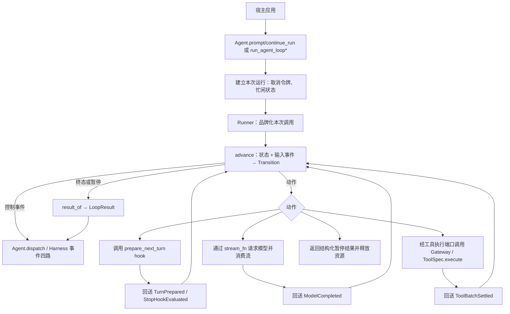

# 当前 Agent Core 执行骨架：原理图与说明

核对日期：2026-10-15（S3 后更新）。本文描述当前代码；尚未实现的部分会写明，不把计划当成已完成。

## 1. 总体结构

执行骨架由有状态的 `Agent`、显式 reducer（`core/transitions.py`）、单一驱动器（`core/runner.py#Runner`）、注入的模型流和工具批次执行器组成。只有一个模型循环、一个驱动器；`core/agent_loop.py` 只是重新导出同一对象的兼容模块。



此图展示调用关系。模型的文本输出和没有工具调用的回答也会产生消息事件；并非只有工具路径产生事件。底层 `run_agent_loop` 也可以绕过 `Agent` 包装被宿主直接调用，此时由宿主提供上下文和事件接收函数。

## 2. 状态机如何推进

```mermaid
flowchart TD
    Created[CREATED：收到 PromptSubmitted/ContinueRequested] --> Poll[COLLECTING：读取 steering]
    Poll --> Request[REQUESTING_MODEL：声明工具集变化 → 请求模型]
    Request --> Error{模型终态}
    Error -->|error/aborted| FinishErr[FINISHED：FAILED/CANCELLED]
    Error -->|deferred| Suspend[WaitForExternal：SUSPENDED]
    Error -->|有工具调用| Batch[RUNNING_BATCH：执行批次]
    Error -->|无工具调用| TurnEnd[发出 TurnEnd]
    Batch --> Partition{批次分区}
    Partition -->|awaiting/unknown| Suspend
    Partition -->|其余| TurnEnd
    TurnEnd --> StopHook[AWAITING_STOP_HOOK：should_stop_after_turn]
    StopHook -->|命中| FinishStop[FINISHED：COMPLETED/STOP_HOOK]
    StopHook -->|轮次耗尽| FinishBudget[FINISHED：USAGE_LIMITED]
    StopHook -->|否则| Boundary[COLLECTING(TURN_BOUNDARY)：读 steering]
    Boundary -->|有消息或批次续跑| Prepare[AWAITING_PREPARE]
    Boundary -->|无| AfterInner[COLLECTING(AFTER_INNER)：读 follow-up]
    Prepare --> Request
    AfterInner -->|有消息| Prepare
    AfterInner -->|无| Finish[FINISHED：COMPLETED 或 CANCELLED]
    Suspend -.新输入唤起新调用.-> Created
```

说明：首次请求的 `AgentStart`/`TurnStart` 与随后的 `TurnEnd`/`AgentEnd` 由 reducer 产出，Runner 按顺序投递；流式帧与工具执行事件由 Runner 在执行时发出。每个模型请求计一轮；同轮中的多个工具调用不会各自增加轮次。停止条件命中后直接结束，不再取出 follow-up。

### 一次请求内的步骤

1. 首轮之后由 reducer 产出 `PrepareTurn` 动作（无 hook 则短路）/ 可选 `prepare_next_turn` 可提供下一轮上下文、消息、模型和思考级别。
2. 合入已排队的 steering 与准备消息，将可执行工具集与历史声明的差异记录为 system 消息（`messages.declare_tool_changes`，时间戳由事件的 `at_ms` 提供）。
3. 可选执行 `transform_context`，再通过 `convert_to_llm` 或默认转换生成模型请求上下文。`stream_fn` 必须显式注入。
4. 消费模型流，投递消息开始、增量和结束事件，并取得最终 `AssistantMessage`；随后回送 `ModelCompleted`。
5. 模型返回 error 或 aborted 时立即收尾；存在工具调用时执行工具批次（并发上限由 `max_concurrent_tools` 显式配置）。模型输出被 length 截断时，整批工具不执行，返回对应错误结果。
6. 将工具结果加入上下文，执行可选的批次完成 hook，发出 `TurnEnd`，检查停止 hook 与轮次预算，再读取 steering。

工具批次默认触发下一轮，让模型读取工具结果。批次判定终止时可结束工具续跑；但如果此时还有 steering，仍会继续下一轮。批次终止条件是非空且每个已收尾结果的 `terminate` 都为 true。

### 内层与外层在状态机里的位置

旧实现的「内层/外层」双层循环在 S3 已经拆成 reducer 的两个位置：`COLLECTING(TURN_BOUNDARY)` 与 `COLLECTING(AFTER_INNER)`。

批次续跑与 steering 决定是否进入下一轮；两者都没有时读取 follow-up；也没有则发出 `AgentEnd` 并结束。`advance` 不会阻塞等待未来的消息。

队列只是内存能力，不会持续阻塞等待未来任务；循环已经退出后到达的消息，需要宿主再次调用入口推进。
## 3. 三种输入的区别

| 输入方式 | 当前含义 | 处理时机 |
| --- | --- | --- |
| `prompt()` | 发起新一轮用户输入 | Agent 忙时拒绝 |
| `steer()` | 将运行中的插话放入队列 | 在循环的轮次边界读取，不会立即打断正在执行的工具 |
| `follow_up()` | 将追加消息放入队列 | 当前工作（批次续跑与 steering）自然耗尽后读取；显式 continue 也有相应取队列规则 |

队列支持每次取一条或一次取全部；两种队列都只是内存能力，不是持久任务队列，也没有独立的后台 worker。

`continue_run()` 使用已有历史继续运行：若历史尾部是 assistant，需要先取得 steering 或 follow-up；若历史为空或只有 system，拒绝继续。它复用同一模型循环，不创建另一套执行实现，也不等于跨进程恢复。

## 4. 工具批次执行原理

```text
确定串行/并行策略
  → 查找工具
  → prepare_arguments
  → 可选 argument_validator
  → before_tool_call
  → 取消检查
  → ToolSpec.execute
  → after_tool_call
  → 工具结束事件与 ToolResultMessage
```

- 配置要求串行，或批次中任一已找到工具声明串行时，整批串行执行。
- 并行路径先按模型给出的顺序完成准备，再通过 `asyncio.gather` 执行；`max_concurrent_tools`（`None` = 不限）限制同时执行的调用数，不影响事件与结果消息的顺序。工具结束事件按完成顺序发出，最终结果消息按原调用顺序排列。
- 参数、hook 或执行异常通常被归一为工具错误结果，让模型能看到本次调用结果；Core 目前主要通过 `is_error` 和结果内容表达它们。
- 工具执行函数由宿主注入。Core 这条路径直接调用 `ToolSpec.execute`；仓库已提供
  `tools/core_bridge.py`，它把 `ToolDefinition` 适配成经 `ToolGateway` 执行的 `ToolSpec`
  （校验、策略、审批绑定、intent/receipt 都在网关侧），统一 Harness 与 `examples/05`
  走的就是它。但绕过 Harness 直接调低层循环的宿主仍可能自己接工具，因此
  “所有 Core 工具调用都经过网关”不是 Core 自身的保证，而是接线方式的结果。

因此，已有的版本绑定审批、intent/receipt、SQLite 操作记录只对走桥接的调用成立。

## 5. 状态与事件

`Agent` 保存历史消息、当前流式消息、待执行工具 ID、错误信息以及本次运行引用。`dispatch()` 根据事件更新这些内存状态，并按订阅顺序等待监听器。

```text
AgentStart
  → TurnStart
  → MessageStart / MessageUpdate / MessageEnd
  → 可选工具开始 / 更新 / 结束，以及工具结果消息
  → TurnEnd
  → 下一轮，或 AgentEnd
```

`AgentEnd` 表示本次循环结束。结束原因与等待状态已有结构化契约（不再需要从消息文本、最后一条消息的 role 或事件数量去猜）：

- `LoopResult`（`core/outcome.py`）带 `RunStatus`（`completed`/`failed`/`cancelled`/`suspended`/`usage_limited`/`rejected`）与
  `LoopStop`（自然回答、批次终止、stop hook、`max_turns`、模型失败、`internal_error`、取消、暂停）；
- 结构化入口 `run_agent_loop_result` / `run_agent_loop_continue_result`、`Agent.prompt_result` / `Agent.continue_run_result` 返回它，
  `Agent.last_result` 可取最近一次结果；`Agent.prompt()` / `continue_run()` 的签名不变（仍返回 `None`），暂停时抛
  `LoopSuspended`（携带同一个可读结果），失败时仍合成为终态 assistant 消息；
- 旧列表入口 `run_agent_loop` / `run_agent_loop_continue` 仍返回消息列表，但遇到暂停会抛 `LoopSuspended`，不再静默冒充完成；
- 模型以 `stop_reason=deferred` 结束一轮、或批次里有 `awaiting_approval`/`deferred`/`unknown` 时，结果是
  `SUSPENDED` 加 `pending_interaction`，不会写入伪成功的工具结果、也不会再发一次模型请求。

仍待演进的是**内部结构**：这些迁移/停止判定目前仍是 `_run_loop` 的隐式局部控制流，显式状态与纯迁移函数属于
[执行状态机计划](core-state-machine-implementation-plan.zh-CN.md) 的 S2/S3。

默认请求转换不会重写原历史；配置了 `persist_transformed_context` 或上下文投影 hook 时，活动上下文可能变化。该机制本身不提供持久归档，不能据此推导已经具备断电恢复。

取消通过显式令牌传给模型流、工具和 hook，依赖下游配合。`abort()` 请求取消；它不代表已经撤销外部写入。运行清理和事件监听器完成后，Agent 才恢复 idle。

## 6. 当前骨架的范围

| 能力 | 当前是否在此骨架中实现 |
| --- | --- |
| 模型与工具多轮往返 | 是 |
| steering、follow-up | 是，内存队列 |
| 工具串行/并行、hook、轮次上限 | 是 |
| 内存状态、事件、协作取消 | 是 |
| 结构化结果与明确的结束/暂停原因 | 是（`LoopResult` / `RunStatus` / `LoopStop`） |
| 具体 `Harness.start/resume/cancel/state` 实现 | 是（`runtime/default_harness.py#DefaultHarness`；`runtime/harness.py#Harness` 仍是 Protocol） |
| `OpenAICompatibleProvider` 自动接入 Core | 是（`providers/core_bridge.py` 适配流接口） |
| Core 工具自动经过 ToolGateway | 是，但仅在走 `tools/core_bridge.py` 接线时（见 §4） |
| 完整运行的持久审批和跨进程恢复 | 是（`examples/05` 与 `tests/test_runtime_*.py` 覆盖） |
| 显式 ExecutionState + 纯迁移函数 + 单一 Runner | 是（S2/S3）：`core/execution.py` / `core/transitions.py` / `core/runner.py` |
| 多任务编排、subagent 调度 | 尚未实现 |

## 7. 对照源码

- [Agent 状态、入口与事件分发](../src/yanxu_harness/core/agent.py)
- [执行状态、输入事件与动作](../src/yanxu_harness/core/execution.py)
- [纯迁移函数 advance / result_of](../src/yanxu_harness/core/transitions.py)
- [单一 Runner 与公开入口](../src/yanxu_harness/core/runner.py)
- [循环配置与 hook 入参](../src/yanxu_harness/core/loop_config.py)
- [兼容导出（旧路径）](../src/yanxu_harness/core/agent_loop.py)
- [工具批次执行器](../src/yanxu_harness/core/tool_execution.py)
- [Core 消息与工具类型](../src/yanxu_harness/core/types.py)
- [Core 事件](../src/yanxu_harness/core/events.py)
- [内存消息队列](../src/yanxu_harness/core/queues.py)
- [取消令牌](../src/yanxu_harness/core/cancellation.py)
- [Harness 生命周期协议](../src/yanxu_harness/runtime/harness.py)

以上结构源自 pi-agent-core 的 Python 重实现及本项目的定向调整，归属见 [第三方来源说明](../THIRD_PARTY_NOTICES.md)。
