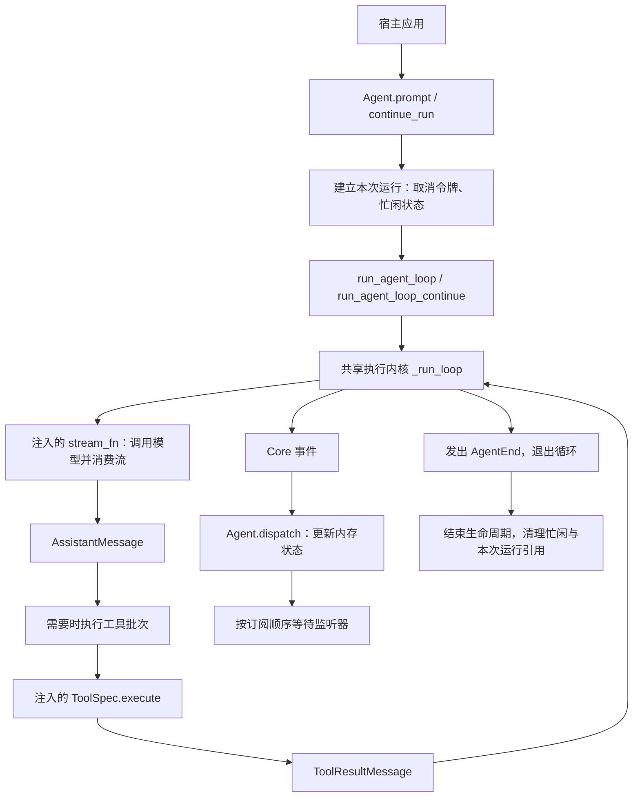
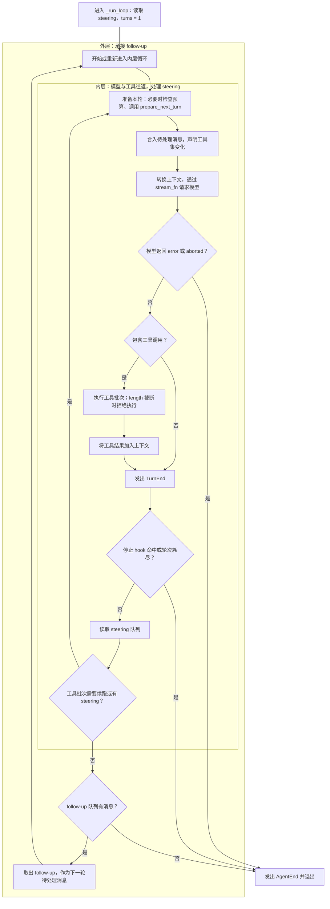

# 当前 Agent Core 执行骨架：原理图与说明

核对日期：2026-10-15。本文描述核对时的现有代码，不代表后续实施计划已经完成。

## 1. 总体结构

执行骨架由有状态的 `Agent`、共享模型循环 `_run_loop`、注入的模型流和工具批次执行器组成。模型循环只有一套实现，内部采用双层循环：内层处理工具续跑与 steering，外层处理 follow-up。



此图展示调用关系。模型的文本输出和没有工具调用的回答也会产生消息事件；并非只有工具路径产生事件。底层 `run_agent_loop` 也可以绕过 `Agent` 包装被宿主直接调用，此时由宿主提供上下文和事件接收函数。

## 2. 双层循环如何推进



说明：外层实际从 `Reset` 节点进入。首次请求的 `AgentStart` 和 `TurnStart` 由入口函数发出，后续 `TurnStart` 由共享循环发出。每个模型请求计一轮；同轮中的多个工具调用不会各自增加轮次。停止条件检查命中后直接结束，不再取出 follow-up。

### 内层循环

一次迭代大致完成以下步骤：

1. 首轮之后检查轮次预算，并执行可选的 `prepare_next_turn`。该 hook 可以提供下一轮上下文、消息、模型和思考级别。
2. 合并已排队的 steering 和准备消息，将可执行工具集与历史声明的差异记录为 system 消息。
3. 可选执行 `transform_context`，再通过 `convert_to_llm` 或默认转换生成模型请求上下文。`stream_fn` 必须显式注入。
4. 消费模型流，投递消息开始、增量和结束事件，并取得最终 `AssistantMessage`。
5. 模型返回 error 或 aborted 时立即收尾；存在工具调用时执行工具批次。模型输出被 length 截断时，整批工具不执行，返回对应错误结果。
6. 将工具结果加入上下文，执行可选的批次完成 hook，发出 `TurnEnd`，检查停止 hook 与轮次预算，再读取 steering。

工具批次默认触发下一轮，让模型读取工具结果。批次判定终止时可结束工具续跑；但如果此时还有 steering，内层仍可继续。批次终止条件是非空且每个已收尾结果的 `terminate` 都为 true。

### 外层循环

内层没有工具续跑和 steering 后，外层读取 follow-up。有追加消息就重新进入内层，没有就发出 `AgentEnd` 并退出。

外层只是检查内存队列，不会持续阻塞等待未来任务；循环已经退出后到达的消息，需要宿主再次调用入口推进。

## 3. 三种输入的区别

| 输入方式 | 当前含义 | 处理时机 |
| --- | --- | --- |
| `prompt()` | 发起新一轮用户输入 | Agent 忙时拒绝 |
| `steer()` | 将运行中的插话放入队列 | 在循环的轮次边界读取，不会立即打断正在执行的工具 |
| `follow_up()` | 将追加消息放入队列 | 内层自然结束后读取；显式 continue 也有相应取队列规则 |

队列支持每次取一条或一次取全部。两种队列都是内存能力，不是持久任务队列，也没有独立的后台 worker。

`continue_run()` 使用已有历史继续运行：若历史尾部是 assistant，需要先取得 steering 或 follow-up；若历史为空或只有 system，拒绝继续。它复用同一模型循环，不创建另一套执行实现，也不等于跨进程恢复。

## 4. 工具批次执行原理

```text
确定串行/并行策略
  → 查找工具
  → prepare_arguments
  → 可选 argument_validator
  → before_tool_call
  → 取消检查
  → ToolSpec.execute
  → after_tool_call
  → 工具结束事件与 ToolResultMessage
```

- 配置要求串行，或批次中任一已找到工具声明串行时，整批串行执行。
- 并行路径先按模型给出的顺序完成准备，再通过 `asyncio.gather` 执行。工具结束事件按完成顺序发出，最终结果消息按原调用顺序排列。
- 参数、hook 或执行异常通常被归一为工具错误结果，让模型能看到本次调用结果；Core 目前主要通过 `is_error` 和结果内容表达它们。
- 工具执行函数由宿主注入。Core 这条路径直接调用 `ToolSpec.execute`，尚未自动接入仓库中的 `ToolGateway`。

因此，已有的版本绑定审批、intent/receipt、SQLite 操作记录不能自动视为所有 Core 工具调用的保障。宿主需要提供桥接；统一 Harness 的整合属于后续计划。

## 5. 状态与事件

`Agent` 保存历史消息、当前流式消息、待执行工具 ID、错误信息以及本次运行引用。`dispatch()` 根据事件更新这些内存状态，并按订阅顺序等待监听器。

```text
AgentStart
  → TurnStart
  → MessageStart / MessageUpdate / MessageEnd
  → 可选工具开始 / 更新 / 结束，以及工具结果消息
  → TurnEnd
  → 下一轮，或 AgentEnd
```

`AgentEnd` 表示本次循环结束。当前 Core 的事件本身尚未完整区分“自然完成”和“轮次耗尽”等结束原因；`Agent.prompt()`/`continue_run()` 也没有返回结构化 `RunOutcome`。这一点是后续 Harness 整合需要补齐的边界。

默认请求转换不会重写原历史；配置了 `persist_transformed_context` 或上下文投影 hook 时，活动上下文可能变化。该机制本身不提供持久归档，不能据此推导已经具备断电恢复。

取消通过显式令牌传给模型流、工具和 hook，依赖下游配合。`abort()` 请求取消；它不代表已经撤销外部写入。运行清理和事件监听器完成后，Agent 才恢复 idle。

## 6. 当前骨架的范围

| 能力 | 当前是否在此骨架中实现 |
| --- | --- |
| 模型与工具多轮往返 | 是 |
| steering、follow-up | 是，内存队列 |
| 工具串行/并行、hook、轮次上限 | 是 |
| 内存状态、事件、协作取消 | 是 |
| 具体 `Harness.start/resume/cancel/state` 实现 | 否，当前仍为 Protocol |
| `OpenAICompatibleProvider` 自动接入 Core | 否，需要适配流接口 |
| 所有 Core 工具自动经过 ToolGateway | 否，需要执行适配 |
| 完整运行的持久审批和跨进程恢复 | 模块已有，统一执行链路尚未接通 |
| 多任务编排、subagent 调度 | 尚未实现 |

## 7. 对照源码

- [Agent 状态、入口与事件分发](../src/yanxu_harness/core/agent.py)
- [共享模型循环与上下文处理](../src/yanxu_harness/core/agent_loop.py)
- [工具批次执行器](../src/yanxu_harness/core/tool_execution.py)
- [Core 消息与工具类型](../src/yanxu_harness/core/types.py)
- [Core 事件](../src/yanxu_harness/core/events.py)
- [内存消息队列](../src/yanxu_harness/core/queues.py)
- [取消令牌](../src/yanxu_harness/core/cancellation.py)
- [Harness 生命周期协议](../src/yanxu_harness/runtime/harness.py)

以上结构源自 pi-agent-core 的 Python 重实现及本项目的定向调整，归属见 [第三方来源说明](../THIRD_PARTY_NOTICES.md)。
