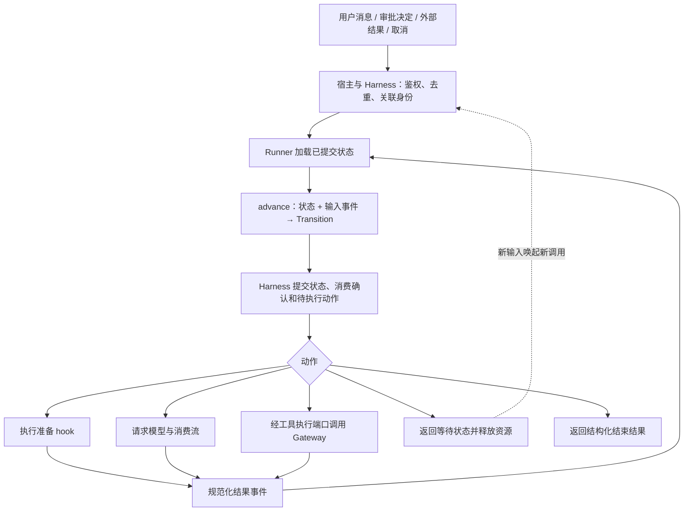

# Agent Core 执行骨架演进计划：Luna 接手任务书

日期：2026-10-15。本文是实施计划，尚未实现或验证其中的新架构。

## 1. 目标、基线与先后顺序

将当前双层循环逐步演进为“显式执行状态 + 输入事件 + 下一步动作 + 单一 Runner”。保留现有可观察行为，让运行能够在明确边界暂停、保存和恢复，并为未来任务编排提供稳定的执行接口。

当前参考 HEAD 为 `9b16841`。核对时 Provider/Core 和 Gateway/Core 桥接、流式线程桥正在工作区开发中，具体 Harness 仍为协议。Luna 开始时必须重新检查 HEAD、工作区、仓库指令和实际实现；这些描述不是可覆盖他人工作的授权。

与 [下一版 Alpha 计划](alpha-implementation-plan.zh-CN.md) 的关系：

- Alpha 计划继续负责独立安装、具体 Harness、业务示例、恢复与发布验证。
- 本计划负责 Core 执行结构及其与 Harness 的契约，不再另外实现一套完整 Harness。
- 本计划 S0 和 S1 可先推进，供 Harness 使用结构化结果。S2 及以后的主重构，应建立在模型—工具桥接和审批恢复链路已有可重复基线之后。
- 如果接手时 Alpha 已实现本计划中的部分能力，直接复用并补缺，不退回旧基线，也不增加语义相同的第二套类型、Runner 或状态字段。
- 最终只保留一个执行内核。迁移期间保留旧入口适配，不允许旧入口和新入口长期维护两套独立模型循环。

本轮完成的标志：旧 API 行为有兼容证据，新 Runner 能在模型完成、工具结算、等待外部输入等边界恢复；状态机本身可独立测试，真实恢复路径通过进程与 SQLite 验证。

## 2. 范围和约束

本轮实现：结构化结果、显式状态机、单一驱动器、消息消费规则、工具结果桥接、暂停恢复边界、取消与事件隔离、兼容迁移。

本轮不实现：任务 DAG、subagent 调度、分布式队列、通用事件溯源平台、插件市场、生产沙箱或 Web 控制台。持久快照加必要的有序事件足够，不强制采用完整 event sourcing。

继续使用标准库运行时，支持 Python 3.10–3.12。不直接使用只有 Python 3.11 才有的 TaskGroup 等接口，不靠新增基础依赖完成重构。

保留 pi 的来源和许可证文件。对实际改写部分更新来源描述，记录本项目新增设计；不要将历史衍生关系因重构而删除。

## 3. 目标结构



图中的持久提交属于 Harness/存储职责；Core 状态机不导入数据库。内存调用方可使用同一驱动器的内存提交实现，但必须明确不具备跨进程恢复能力。

职责分工：

| 组件 | 职责 | 不承担 |
| --- | --- | --- |
| Core reducer | 根据显式状态和输入计算迁移、下一步动作与语义事件 | 网络、SQLite、审批授权、读取系统时钟 |
| Core Runner | 执行动作、消费模型流、调度有界工具批次、投递结果、管理清理 | 另建审批/操作账本、批准业务写入 |
| Harness | 身份、恢复、输入持久消费、状态提交、租约/CAS、运行级事件发布 | 复制 Core 的模型决策循环 |
| Gateway | 工具校验、策略、审批绑定、intent/receipt 与副作用状态 | 驱动模型循环 |
| 宿主 | 认证、权限来源、业务目标版本与原子写入、具体模型配置 | 依靠模型输出建立权限 |

## 4. 先冻结契约，避免边改边猜

### 4.1 三种状态必须分开

1. **执行阶段**：当前处于等待输入、准备下一轮、等待模型、处理工具批次、等待外部决定或已结束。
2. **运行结束原因**：完成、显式停止、轮次耗尽、取消、模型/内部失败等。与最终 Harness 的 RunStatus 映射保持一致，不将 hook 主动停止自动等同于任务完成。
3. **工具操作结果**：executed、replayed、awaiting_approval、deferred、denied、invalid_args、failed、cancelled、unknown。unknown 始终是操作证据状态，不能当成“可安全重试”的执行阶段。

执行阶段是内部进度；运行结果和工具结果有各自契约，不能用一组字符串混装三种含义。

### 4.2 建议接口形状

以下名称是设计建议，接手时与已存在类型合并，不照名字重复造类。

```text
advance(state: ExecutionState, event: InputEvent) -> Transition
Transition = next_state + actions + semantic_events
drive_until_boundary(...) -> ExecutionResult
ExecutionResult = phase/reason + new_messages + turns_used + pending_work
```

- `advance` 同步、确定性，不执行 hook、模型或工具；时钟、ID、配置快照等由输入显式提供。
- `drive_until_boundary` 执行推进，遇到等待外部输入或结束即返回，不在 Core 内长期轮询。
- 异步准备 hook 作为明确动作由 Runner 执行，完成后输入准备结果事件。不能为了 reducer 纯净而偷偷删除现有 hook。
- 每个模型请求同一时刻只有一个有效待完成动作；工具动作可受控并发，完成事件按已记录顺序处理，工具结果消息仍按模型调用顺序组装。
- 动作描述可序列化，不保存协程、callable、数据库连接、工具实例或密钥。实际实现由宿主配置的端口/注册表解析。
- 状态保存逻辑事实，不保存 provider 每一帧输出的完整副本。流式进度可单独投递；最终模型响应作为后续工具调度的持久依据。

### 4.3 ExecutionState 最小内容

- schema 版本、逻辑调用/运行身份、当前阶段、状态版本；attempt 属于执行权信息，不能成为稳定操作 ID 的一部分。
- 已提交消息、当前模型动作 ID、已接收的最终响应及调用批次。
- 工具批次的完整调用顺序，每个调用对应的待执行/运行中/已结算/等待审批/未知状态，operation/receipt/interaction 引用。
- 已消费输入 ID、消费位置，或等价的宿主持久 inbox 引用；不得靠内存 pop 代表持久确认。
- 已使用轮次、剩余额度和当前停止原因；配置、工具、策略、指令和可见性指纹。
- 与持久层明确区分的临时流状态，不把私有 provider 材料直接放进公开 payload。

没有当前用途的 subagent 字段先不加。身份、执行端口、预算与取消保留可扩展边界即可。

### 4.4 消息、预算与终态规则

- `prompt()` 忙时拒绝；steering 在安全轮次边界消费，follow-up 仅在当前内层工作自然完成后消费，保留 one-at-a-time/all 模式。
- steering 不撤销正在执行的写入；追加消息也不自动使旧审批适用于新参数。
- 已结束运行不靠后台循环自行复活；后到消息需要新的明确入口调用。持久 inbox 不等于自动实现后台 worker。
- 初始 prompt、steering、follow-up 都有确定的接纳与消费边界。持久模式下，将输入确认与对应状态迁移一起提交；崩溃不会丢输入或再次追加同一消息。
- 一个模型请求计一轮，工具数量不增加轮数。保留“最后获准轮次的当前工具批次按契约结算，然后不再请求下一轮”的既有语义。
- 记录逻辑 invocation 的预算，恢复同一逻辑调用不能通过新 attempt 清零额度。后续全新 prompt 的额度重置遵循现有 API，并与可选 run 总预算区分。
- 正常结束、模型错误、length 截断、工具 batch terminate、显式 stop hook、max_turns、取消及等待交互的优先级写成表并测交叉情况。
- 保持 length 截断整批不执行；保持 batch terminate 的现有规则。不要因新状态机改变这些已测试行为。
- 一个逻辑运行只产生一条持久终态事实；暂停可多次发生，不等同于完成。明确一次 drive 调用结束与整个逻辑 run 结束的不同。

## 5. 分阶段实施

### S0：核对现状，冻结行为和迁移表

工作：

1. 读取 [当前执行骨架说明](core-execution-current.zh-CN.md)、现有 Core 测试、Alpha 实现及两个 bridge 的实际状态。报告已存在能力和缺口。
2. 在隔离环境运行基线，记录命令、真实数量、跳过和既有失败。保护接手时未提交文件，不能通过 reset/覆盖处理交接问题。
3. 将旧循环各分支映射为“输入、原状态、动作、输出事件、返回结果”的契约表，覆盖 hooks 与消息消费顺序。
4. 新增缺失的行为测试，先把待改问题复现出来；已有行为直接复用测试，不复制整套断言。
5. 明确旧 API 返回类型、事件字段、等待语义、状态持久版本与源码引用的兼容策略，保存到设计文档。

验收：迁移表可逐项对应旧源码和测试；未解释的行为差异为零。S0 不改生产执行逻辑。

建议提交：`test: characterize core execution boundaries`。

### S1：提供结构化执行结果，补齐暂停出口

工作：

1. 复用 Alpha 已有结果类型；缺少时新增 ExecutionResult/结束原因，覆盖所有退出路径。禁止根据消息文本、最后消息 role 或事件数量猜测结束原因。
2. 增加结构化结果入口，让 Harness 能获知等待审批、外部结果和未知核对。待审批不能先写成已经完成的工具结果再交给模型继续。
3. 保留 `run_agent_loop`/`run_agent_loop_continue` 对已有调用场景的列表返回契约，由薄包装调用同一个内部内核。
4. 旧列表 API 无法表达新暂停时，明确抛出携带可读取结果的专用控制异常，或提供显式不支持该组合的入口校验；不得静默返回普通列表冒充完成。该方案必须在 Core 之外正确映射，不能被通用异常捕获改成模型失败。
5. 旧 `Agent.prompt()` 的调用习惯可保留，新增可取得结构化结果的接口/属性；不要无说明地改变现有签名。
6. 明确拒绝、invalid_args、failed 是否以真实已结算工具结果继续给模型；awaiting_approval/deferred/unknown 必须通过结构化等待路径处理。

验收：各停止路径有唯一、可断言的结果；原有 API 与事件顺序测试保持通过；一次审批等待不产生额外模型请求。

建议提交：`feat: expose explicit core execution outcomes`。

### S2：提取显式状态与纯迁移函数

工作：

1. 建立最小 ExecutionState、InputEvent、Action、Transition 类型和状态迁移函数，替代 `_run_loop` 里隐式的局部位置控制。
2. 借助 S0 的迁移表，将准备、模型完成、工具批次推进、steering/follow-up 消费、等待和终态逐项迁移。
3. 对状态不匹配、重复或乱序事件明确分类：相同重复可幂等忽略并返回原因，内容冲突必须拒绝；未知事件类型不得静默改变状态。
4. 相同状态和输入产生相同迁移；不得读取 wall clock、创建随机 ID、修改外部列表、调用工具或写存储。
5. 不保存全部历史状态的多份副本，不因抽象增加无界内存。深浅拷贝约定必须清楚，外部修改输入不能无声改动已提交状态。
6. 新旧共存期间，新 reducer 先用确定性测试检验；不得发布第二个可独立运行的正式循环。配置开关仅可作为短期迁移手段，并写明删除点。

验收：给定记录过的规范化事件，能重建同一逻辑状态；无效迁移和重复结果不会重复创建模型/工具动作。Core 不新增存储或网络依赖。

建议提交：`refactor: make core transitions explicit`。

### S3：接入单一 Runner，替换旧循环主体

工作：

1. Runner 驱动 reducer，执行准备、模型、工具动作，将完成结果重新送回 reducer。请求与工具实际执行代码复用现有 bridge 和批次能力。
2. 将旧循环入口和 Agent 包装层接到同一个 Runner，删除已替代的双层业务判断，保留必要包装函数。
3. 工具并发额度显式配置。保留 start/preflight 源顺序、end 完成顺序、结果消息源顺序；并发数不影响消息关联正确性。
4. 混合批次遇到审批暂停时，停止派发新调用，已运行调用有界收尾并记录真实结果。未运行、已完成、等待和未知必须各有证据，不用一个 is_error 代替。
5. 流式 delta 走专用进度路径，模型 final/工具结算事件走控制路径。控制事件和终态不能因 UI 缓冲满而丢失；慢消费者采用有界背压或明确合并策略，不能创建无界 task。
6. 明确监听器两类用途：必须等待的持久提交由提交端口负责，观察进度的监听器按既有顺序契约处理。消费者失败不回滚已提交事实；事件可补读。
7. 保持 prepare/transform/convert/before/after/stop hook 的调用位置、次数和失败语义；任何刻意改变都要有版本说明和测试。

验收：旧入口、结构化入口和 Harness 都使用同一 Runner；不存在两套模型请求调度；原有 Core、Provider 和 Gateway 契约测试通过。

建议提交：`refactor: drive all core entrypoints through one runner`。

### S4：接入持久暂停与恢复，明确副作用边界

工作：

1. 复用具体 Harness 和 Persistence，补提交/恢复端口。原子提交本地状态、输入消费确认、checkpoint 引用、必要语义事件和可重建的待执行动作。
2. 模型最终响应先进入已提交状态，再派发其工具调用。流式半截消息不能当作完整调用依据，尤其不能执行尚未完成的参数。
3. 恢复时根据状态和已有 Gateway intent/receipt 判断下一步；复用 receipt、保留 unknown、仅派发可证明尚未执行的调用。
4. 模型请求中断单独记录，不等同于工具副作用 unknown。重试策略显式且有预算，未记录完整响应的工具调用绝不执行；本轮不自动恢复 provider 的半截 TCP 流。
5. 已生成动作 ID 跨 attempt 稳定。namespace/run/call 等复合键无歧义，不能因重新恢复产生新的 operation_id 绕过去重。
6. 恢复校验当前 namespace、权限、配置和审批指纹。原动作结果可由新执行者读取证据后关联；不能盲目接受旧 attempt 的迟到回调，也不能丢弃合法的既有持久回执。
7. Gateway 仍拥有操作账本；待执行动作记录只负责调度意图，不能替代 Gateway 的业务 intent/receipt。多库不能假称共享事务，需逐窗口验证补齐逻辑。
8. lease/CAS 在派发前和状态提交时生效。租约丢失停止新派发；已有外部调用按实际证据结算，不能声称 fencing 能撤回所有远程副作用。
9. 等待审批、deferred 和 reconciliation 返回明确 pending_work。只有可信宿主确认结果事件才能解除等待，模型文本或任意客户端布尔值不能当作审批事实。

验收：真实新进程可恢复每个承诺的边界；输入不丢不重复；已执行工具不因恢复重跑；任一不可证明结果都保留等待核对。

建议提交：`feat: resume explicit core state at durable boundaries`。

### S5：取消、运行隔离和资源生命周期

工作：

1. 核对 Alpha 已有取消桥接并复用。取消令牌、provider 流、工具任务、更新任务、父子传播任务和线程桥有明确所有者及清理期限。
2. 已取消时不新派发动作；运行中取消不会自动回滚写入。真实回执与未知证据不因通用 CancelledError 被丢弃。
3. reducer 更新前校验 run/attempt/action 关联。终态或暂停后，旧回调不能向新状态或下一次运行写入。
4. 标准库线程中的阻塞 I/O 不能假装被协程取消强制停止。通过连接关闭、超时和晚到结果隔离形成可说明的清理边界。
5. 同一事件循环可同时运行多个独立 Agent；一个慢流或慢观察者不能无界阻塞所有任务。进度缓冲、队列和并发均有可配置上限及明确超限行为。
6. 保留首次取消原因与取消作用域；挂起期间取消应可持久记录，并在恢复前被识别。

验收：取消和异常后没有悬挂异步任务、未关闭流或继续提交的旧执行者；运行身份互相隔离；UI 慢消费者不丢终态。

建议提交：`fix: bound cancellation and isolate stale execution events`。

### S6：兼容收尾、文档与交接

工作：

1. 完成旧 API 到新 Runner 的兼容映射，删除迁移专用开关和重复业务判断。`Agent`、低层函数、Harness 使用一致的结束原因。
2. 为 ExecutionState 和 checkpoint 格式声明版本；已发布/已使用格式需提供真实迁移或明确拒绝。不要只把 SUPPORTED 版本列表扩展就声称兼容。
3. 私有恢复状态与公开事件分别编码；测试递归嵌套的签名、headers 和测试密钥不会经消息块泄漏，保留必要的私有续传数据。
4. 更新 Core 公共导出、契约、恢复文档和 [当前骨架说明](core-execution-current.zh-CN.md)，补最终结构图。当前说明只有在新架构验收后才能改成已实现。
5. 更新第三方来源说明以反映真实衍生范围和本项目新增设计，保留许可证与归属；不以改名、Python 重写或状态机重构消除来源记录。
6. 运行完整本地门禁、wheel/sdist 源目录外安装验证及 Alpha 端到端示例。远程 CI、真实模型、不同平台单列实际结果。

验收：从安装产物调用任意公开入口均走单一执行内核；文档与实现一致，清楚说明等待、恢复、取消、输入幂等和不确定副作用的限制。

建议提交：`docs: document the explicit core execution model`。

## 6. 必需验收矩阵

| 编号 | 用例 | 关键断言 |
| --- | --- | --- |
| C01 | 普通对话、工具多轮、无工具回答 | 轮次、消息、hook 和事件顺序与基线一致 |
| C02 | steering 与 follow-up 同时存在 | 保留优先级和 one-at-a-time/all；输入只消费一次 |
| C03 | 达到预算时仍有排队消息 | 不多请求、不提前丢消息、不伪报完成；恢复不重置同一逻辑预算 |
| C04 | length、stop hook、batch terminate 与取消交叉 | 停止优先级有明确结果，截断参数不执行 |
| C05 | await approval/deferred/unknown | 不写伪成功工具消息，不请求下一轮，返回准确等待位置 |
| C06 | 批次中一项已完成、一项待批、一项未知 | 状态分区完整，回放关联原调用，未知项不进入可重试集合 |
| C07 | 相同输入/动作结果重复或内容冲突 | 相同重复无新增动作；冲突明确拒绝 |
| C08 | 模型请求前、半截流中、完整响应落盘后崩溃 | 按承诺边界恢复；半截调用不执行；完整响应不被遗漏 |
| C09 | Gateway intent/effect/receipt 三个故障窗口 | 不能从未结算 intent 推断未执行；已有 receipt 不重跑 |
| C10 | 输入出队后、状态提交前崩溃 | 输入仍可恢复，不重复追加已提交消息 |
| C11 | 提交成功、消费者发布失败 | 通过 cursor 补事件，无重复副作用或第二条持久终态 |
| C12 | 旧 attempt 迟到、同名 ID 跨 namespace | 更新前隔离，不串状态/审批/回执 |
| C13 | 两进程恢复、租约失效、过期持有者返回 | 只有有效执行者可新派发和提交，不夸大远程副作用保护 |
| C14 | 取消发生在模型、工具、等待和清理阶段 | 有界清理，真实 effect 状态不丢，终态不重复 |
| C15 | 并发额度与慢消费者 | 实测活跃数不超过额度，缓冲有界，最终控制结果可达 |
| C16 | reducer 纯净和可重放 | 相同规范化输入得到相同结果，不读网络/存储/时钟 |
| C17 | 旧函数、Agent、Harness 三种入口 | 同一 Runner，无双实现，旧约定按兼容计划成立 |
| C18 | future/corrupt schema 与敏感信息 | 未支持版本明确拒绝，公开出口无私有数据 |

故障用真实子进程和明确同步点触发，不能只用异常 mock 或随机 sleep。副作用用业务存储、回执和调用计数共同验证。所有异步/进程测试有超时与资源回收。

不为了数量增加测试；已有 Alpha 用例覆盖的场景直接复用或扩展，并在报告中关联证据。

## 7. 接手入口与文件建议

优先读取：`core/agent_loop.py`、`core/agent.py`、`core/tool_execution.py`、`core/types.py`、`core/events.py`、`core/cancellation.py`、`core/queues.py`；随后读取实际 Provider/Gateway bridge、runtime/checkpoint、Persistence 和相应测试。

可按职责新增 `core/execution.py`（状态和动作）、`core/transitions.py`（迁移）、`core/runner.py`（驱动）、`core/codec.py`（必要序列化）。这些只是组织建议：同一职责已有合适模块就扩展现有模块，不为文件名增加空壳。

验证命令沿用 Alpha 计划和仓库最新 CONTRIBUTING。先针对改动运行 Core/bridge/runtime 测试；阶段完成后运行 `python -m pytest -q tests`，最终运行本地 CI 和安装产物验证。不要假定旧测试数量或远程 CI 状态仍然有效。

每阶段交接报告必须包含：

- 完成范围及对应提交；尚未完成的内容。
- 行为迁移表中新增或变化的条目、原因和兼容策略。
- 命令、退出状态、测试摘要、跳过原因及故障窗口证据。
- 新状态格式、公开 API 和来源声明的变化。
- 下阶段前置条件，以及接手时需保留的其他开发者工作。

## 8. 直接交给 Luna 的启动提示词

> 请读取 `docs/core-state-machine-implementation-plan.zh-CN.md` 和仓库指令，检查当前 HEAD、未提交改动及 Alpha/Harness 的实际进度。先完成 S0 的行为核对，再按 S1–S6 推进；模型与工具桥接、审批恢复链路已有基线后才开始主状态机重构。保留一个执行内核，旧 API 通过兼容包装接入，复用现有桥接、Gateway 和持久化能力。每次行为修改先用有意义的测试复现，不删测试、不放宽断言、不把等待或 unknown 当作成功。分阶段提交和报告真实验证结果；不要覆盖其他开发者工作，不实现 subagent/DAG，不改变私有性或账单，不自动公开发布。保留 pi 归属及许可证。最终交付单一 Runner、明确执行状态和结果、可恢复边界、兼容文档及通过安装产物验证的证据；未完成事项如实列出。
