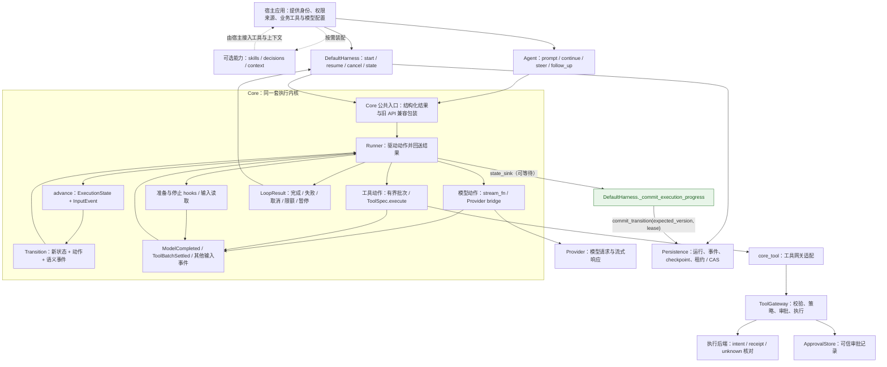
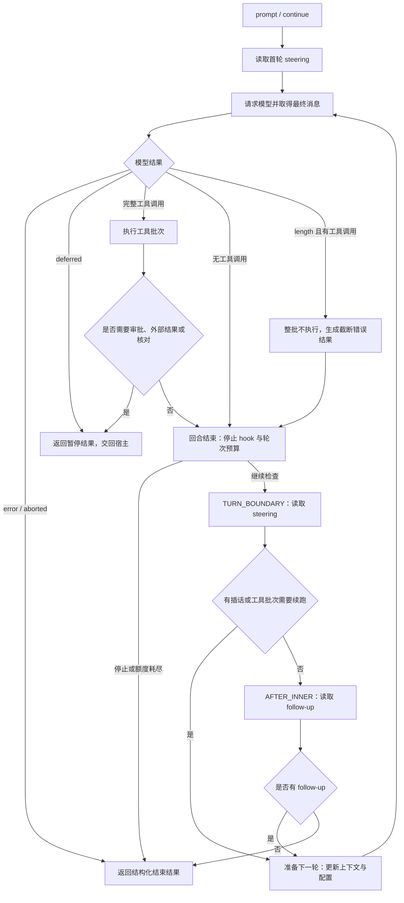

# 当前 Harness 架构与循环说明

**2026-10-20 版本状态：`0.3.0a1`。** 除本文的 Core/恢复路径外，持久 inbox、有界本地调度、
共享预算和父子任务已交付，见[任务契约](tasks-contract.zh-CN.md)；可选 MCP Tools 客户端已交付，
见[使用指南](mcp-client.zh-CN.md)。最新验证范围以[发行记录](release-0.3.0a1.zh-CN.md)为准。
下文保留各路径最初核对时的基线与修复证据。

核对日期：2026-10-16。代码基线：`8b60eed`（逐工具结算与恢复 T0–T5 已合入）。本文描述该基线的实际实现，以及同日的派发前持久提交接线修复。

**当前状态：显式状态机与单一 Runner 已接入；Persistence 的提交端口已真正接到 `DefaultHarness`；工具批次按调用逐项结算与恢复。**
派发前的快照提交由 `Runner` 等待的同一个回调完成（见第 4 节）；“无法证明的外部操作如何收敛为 executed/failed”在内置账本上已实现并有证据（见下文「逐工具结算与恢复」与 [验证记录](verification.md) T37），宿主自有账本需要实现等价的 `RecoverableLedger` 能力。
本文不把计划中的行为画成已经实现。后续修复提交应重新核对下述提交路径。

已复现缺陷的执行任务书见 [Harness 派发前持久提交修复方案](harness-durable-commit-fix-plan.zh-CN.md)，实测证据见 [验证记录](verification.md)。

设计与实施过程见[四方向路线图](harness-evolution-roadmap.zh-CN.md)与[上下文工程实施计划](context-engineering-implementation-plan.zh-CN.md)。其中已交付部分以当前契约与验收记录为准；[文档索引](README.md)区分接入指南与历史方案。

## 1. 整个 Harness 如何连接



- `Agent` 和 `DefaultHarness` 是不同入口：前者管理进程内对话状态与消息队列，后者管理运行生命周期与持久恢复。两者使用同一个 Core Runner。
- `core/agent_loop.py` 仅重新导出配置和 Runner 入口，没有第二套循环实现。
- 走 `tools/core_bridge.py` 的工具才接入 Gateway。直接提供自定义 `ToolSpec.execute` 的低层宿主，需要自行承担对应执行契约。
- reducer 不调用模型、工具、数据库或系统时钟；Runner 执行动作，再把结果作为事件送回 reducer。
- 图中的持久存储不代表运行库、审批库与操作库共享同一事务。具体宿主可以使用不同数据库，恢复依赖已记录事实与回执。
- 本地有界任务调度（`tasks/scheduler.py`）与本地父子任务控制面（`tasks/children.py`）已实现，但它们是宿主显式调用的库，不画成常驻组件。跨主机 worker 池、远程 subagent 协议、CodingAgent 工作区工具仍属于后续扩展。

## 2. 当前一次执行如何推进



此图展示主要业务路径，省略贯穿运行的取消处理、流式进度、工具 hooks 与异常清理。各分支由纯迁移函数决定，全部动作由同一 Runner 驱动。

`length` 分支只表示：截断消息中的工具调用不执行。它不表示整个运行一定结束；后续仍按停止条件和预算处理。

暂停不是后台等待循环。宿主在外部条件满足后显式调用恢复入口；目前不能承诺从任意中断位置自动继续。steering 与 follow-up 仍为内存队列，没有持久任务 inbox 或自动唤醒 worker。

## 3. 原来的双层循环还在吗

**原来的双层嵌套控制结构已经删除，两种继续执行的行为仍然保留。**

| 旧实现 | 当前落点 | 保留的行为 |
| --- | --- | --- |
| 内层循环：模型与工具往返，处理 steering | reducer 的工具结果迁移与 `COLLECTING(TURN_BOUNDARY)` | 工具结果进入下一轮；在轮次边界接纳插话 |
| 外层循环：当前工作结束后检查 follow-up | reducer 的 `COLLECTING(AFTER_INNER)` | 有追加消息时继续，无消息时结束 |
| 两层循环中的局部变量和分支位置 | `ExecutionState`、`InputEvent`、`Action`、`Transition` | 用显式状态表示进度与下一步 |
| 旧 `_run_loop` | `Runner._drive` | 单一驱动器消费事件、调用 reducer、执行动作 |

“单一 Runner”指模型与工具的调度只有一套实现，不表示源码只有一条循环语句。Runner 本身仍有驱动循环，模型流读取与工具遍历也各有必要的循环。

## 4. 派发前持久提交：修复后的接线

修复前的缺陷：`DefaultHarness._state_sink` 只做内存替换（
`holder["record"] = replace(record, execution=...)`），没有调用 `Persistence.commit_transition`，
因此 Runner 等待到的只是“内存更新完成”，不是数据库事务提交成功。

修复后的接线：

```python
async def sink(state):
    holder["last_state"] = state
    if state.phase in worth_capturing:
        await self._commit_execution_progress(holder, state)   # 内部 await commit_transition
```

`Runner._drive` 在**执行该迁移的动作之前**等待这个回调，所以“模型响应已提交”先于“工具调用被派发”，而不是靠注释保证。
候选记录以 `proposed=` 传入：只有事务提交成功后才成为驱动的权威视图；提交失败会抛出 `StorageConflict`，运行停止派发。

| 边界 | 数据库里必须可读的事实 | 提交者 |
| --- | --- | --- |
| 请求模型之前 | 请求阶段、已有上下文（含 system 与既有消息）、`model_action_id`、逻辑预算（`turns_used`/`max_turns`） | `_commit_execution_progress`（`REQUESTING_MODEL` 等执行中相位） |
| 完整模型响应之后、工具派发之前 | 最终 assistant 消息、完整工具调用声明、`RUNNING_BATCH` 相位、已用轮次 | 同上（`RUNNING_BATCH`） |
| 已结算批次之后、下一次请求之前 | 真实工具结果与消息顺序、批次分区 | 同上（`AWAITING_STOP_HOOK` / `AWAITING_PREPARE` / 下一次 `REQUESTING_MODEL`） |
| 对外宣告暂停之前 | `status=suspended`、`execution.phase=suspended`、批次分区、`pending_interaction`、消息与暂停事件，**同一事务** | 同上（`SUSPENDED`）；hook 只收集事实，不再自行提交 |
| 对外宣告最终完成之前 | 终态状态、结束原因、消息、预算与唯一一条终态事件 | `_commit_final`（唯一负责者；sink 不写 `FINISHED`） |

其他要点：

- 进度提交只写执行中相位；`COLLECTING` 无外部效果不写库，终态由 `_commit_final` 写，避免同一事实提交两次。
- transcript 只有一条规则：`RunRecord.messages` 与已提交的 `ExecutionState.messages` 一致；中断（取消/超时）路径只追加“已宣告但尚未提交”的消息，不按内容去重。
- `expected_version` 与 lease 随每次提交一起校验：并发取消、租约过期或 CAS 冲突都会让本次派发停止，不会覆盖更新的版本或已有的终态。

实测结果（F01–F10 的完整矩阵、命令与数字见 [验证记录](verification.md)）：真实 `DefaultHarness + SqlitePersistence` 路径下，工具内 `os._exit(9)` 后新进程能读到 `running_batch` 快照、最终 assistant、声明 `c1` 与已用轮次；工具边界提交失败时 handler 调用为 0；审批暂停在驱动收尾前已自洽；多轮与恢复后的消息各只保存一次。

### 受管上下文准备：同一个提交边界里的请求视图（C3–C5）

配置 `DefaultHarness(context_controller=...)` 后，“请求模型”变成两个显式步骤，仍在同一个 Runner 里：

```text
PrepareRequest（无网络）
  → ContextController.prepare_async(prior=已提交的 context_state)
      → FragmentProjector.plan：完整片段选择 → 丢弃片段的指令/工具重放为基线 → 状态等价校验
          → 单个巨大工具结果：bounded_tool_output（先存原文再写引用；易失存储可被拒绝）
          → （仅在“丢过片段”且宿主注入了 summarizer 时）SummaryCompactor.compact
              → 发布校验（scope + head + source 指纹）→ 失败/超时/迟到即回退确定性投影
  → RequestPrepared(view, context_state, refused)（输入事件）
  → 提交端口提交（state_sink，带 request_view / context_state）→ SendModelRequest（真正发请求）
```

| 边界 | 数据库里必须可读的事实 | 提交者 |
| --- | --- | --- |
| 发送已准备请求之前 | `execution.request_view`（派生的请求视图）、`execution.context_state`（scope、source/request 指纹、估算器身份、容量与输出预留来源、保留/丢弃片段与理由、`bounded_outputs` 工件引用与其存储持久性、`summary` 调用次数/字符数/usage/是否未知）、`RunRecord.context_state` | 同一个 `_commit_execution_progress`（`REQUESTING_MODEL`） |
| 预算拒绝 | `status=usage_limited`、`error_code=context_budget_exceeded`、`stop_code=context_budget_exceeded`、`context_state.refused`（含 detail 与容量） | `_commit_final`（终态唯一负责者） |

要点：

- `ExecutionState.messages`（权威对话）与 `request_view`（派生视图）是**两个字段**；受管路径不发 `ContextProjected`，所以投影永远不会删减历史。
- 拒绝是结果而不是异常：准备阶段返回 `refused`，最终字节闸抛出的 `BudgetExceeded` 也在 `SendModelRequest` 内归一成同一种预算拒绝；provider 自己的 context overflow 失败种类不受影响。
- `prepare_context` 与 `transform_context` / `persist_transformed_context=True` 同时配置会在派发前被拒绝（避免静默跑两次压缩）；旧的 `project_context` 闭包与字段已移除。
- 恢复时重新准备：投影是派生物，不授予执行权；已准备但未发送的请求不需要“续传半截流”。
- 工件引用只指向已落盘的原文（先存后引用）；持久存储在进程退出后仍可解析（子进程崩溃后父进程按引用读回原文，见验证记录 T31），易失存储由 `store_durability` 如实记录，宿主可用 `require_durable` 直接拒绝。
- 摘要永远不进 system 提示（以 user 消息形式携带），预算与 usage 随 facts 持久化，恢复不会刷新额度。额度按逻辑运行（`namespace/session/run`）隔离：预算检查与预留先于任何外部 `await`，`CompactionResult` 携带本次准备不可变的 usage 快照，同运行的共享调用只预留/结算一次。外部取消与运行期限是控制信号：结算已发生调用、回收辅助任务后继续传播，不派发主模型；中断时的已发生摘要开销由 `summary_facts(scope)` 随终态记录保存（已实现，见 [验收复核](context-engineering-acceptance-review.zh-CN.md)）。

真实链路的实测（loopback HTTP + SQLite）：“投影事实在字节发出前已落盘”由闸门自己开一个新连接读库并与即将发送的 body 逐条比对证明；准备拒绝与字节闸拒绝的传输次数均为 0；真实子进程在已准备请求中 `os._exit` 后，另一进程能读到视图、facts 与 `requesting_model` 相位，并按提交的工件引用读回原文。见 [验证记录](verification.md) 的 T28/T29/T30/T31、`tests/test_context_wiring.py`、`tests/test_context_durability.py` 与 [上下文准备基线](context-preparation-baseline.zh-CN.md)。

### 逐工具结算与恢复（T0–T6）

工具批次不再是「整批 gather 完成才回到 Core」：

```text
SendModelRequest 完成 → reducer 声明分区（身份/源顺序/参数摘要）→ state_sink 提交
  → Runner 建立有界批次会话（并发上限 + 有界观察队列）
      → 每个调用一份观察（ToolCallObserved）→ advance → state_sink 提交
      → 串行批次等驱动确认上一条提交后才派发下一条
  → FinishToolBatch → 结果消息按声明顺序追加 → 批次 hooks → 下一模型请求
```

- 调用身份是 `namespace/session/run/model_action/tool_call_id`：默认 `operation_id` 就是这五段
  拼接（显式给定则不重新生成），`logical_ref()` 是同一身份的版本化指纹，`model_action_id` 同时随调用
  进入账本供绑定核对——三者都在真实执行路径上接线，两个回合复用同一个 call id 是两个操作而不是一次重放。
- 账本核对是**只读**能力（`RecoverableLedger.observe`）：`absent / open / receipt /
  unavailable` 四类不可合并；`admit` 在同一个事务里完成「检查 + 记录」，是唯一允许执行的信号。
- 恢复按调用分类：结果复用、receipt 补入（不跑 handler）、open/unknown 建核对交互并保持
  uncertain、可证明 absent 者经原子准入后执行；**存在 uncertain 时先保存已确认事实并暂停**，不新增派发。
- `unknown → succeeded/failed` 由宿主 reconciler 提供业务证据，账本先提升、Run 后提交；旧 unknown 回调不能覆盖。
- 取消/期限：停止新派发、保留已确认结果、未证明者保持 uncertain，不请求下一次模型。

R1–R3 修复后（2026-10-16，`dccf06b` / `e652656` / `1ee55c9`）这三点在真实恢复路径上成立：

```text
恢复的部署基线：ExecutionState.arrangement（schema 3+，首次派发前提交）
  恢复从该已提交基线重建批次 → 与当前部署比较 → 漂移即拒绝（不派发、不请求模型）
  无基线（schema 1/2）→ 明确拒绝，不用当前值补齐后宣称通过
一次恢复 = 一次受限可取消的驱动（分类 / reconciler / 剩余调用 / 后续模型同一 deadline）
  剩余调用交回同一个 Runner 的批次恢复会话（已删掉手工执行分支）
  暂停在受限驱动之外提交（超时不丢已证明的证据）
账本已确认的失败（failed/denied/invalid_args/cancelled）按业务分类收敛
  unknown / deferred 仍阻塞，交给宿主

### 仍未支持或仍需核对的窗口

| 窗口 | 现状 |
| --- | --- |
| 宿主自有账本（`ownership == "host"`）的自动恢复 | 需要宿主实现等价的只读核对与原子准入；未提供时恢复明确阻塞并说明原因，普通执行路径不受影响。 |
| RUNNING 孤儿的配置/策略漂移 | **已修复（`dccf06b`）**：部署基线在首次派发前提交（`ExecutionState.arrangement`），恢复从已提交基线重建批次再做漂移比较，instructions/config/tools/policy 四个维度在两个入口都覆盖；schema 1/2 的旧记录没有基线，恢复**拒绝**而不是回填当前值。policy 维度只对显式声明 policy 指纹的宿主有效（既有语义，未放宽）。 |
| 崩在模型请求中（`model_request_outstanding`） | 恢复会给出 reconciliation 暂停并说明“响应未提交、不可能有工具调用被派发”。该暂停没有批次，因此**不会自动重开请求**；宿主需重新提交为新运行或自行记录证据。 |
| 崩在工具派发窗口（`batch_outcome_unknown`） | 保留证据、列出声明的调用，查 Gateway 账本后再决定；不自动重放、不伪造结果。 |
| 恢复工作是否受运行期限/取消约束 | **已修复（`e652656`）**：分类、reconciler、剩余调用与后续模型请求处于同一次受限可取消的驱动内；暂停在该驱动之外提交，超时不会丢掉已证明的证据。不承诺强制终止拒绝协作取消的任意第三方协程或已发出的外部请求。 |
| `unknown -> executed/failed` 的收敛 | **内置账本已实现**：宿主 reconciler 提供指名来源的业务证据，账本先做受控提升（只允许未证明行 → succeeded/failed），Run 后提交；崩溃在两者之间时按账本重读而不是重问。仍未完成的是宿主自有账本缺少该能力时的**通用**规则与面向操作者的审计入口，以及公开 API 契约化；证据不足时继续保持 unknown。见 [验证记录](verification.md) T37。 |

### 修复前后的真实进程对照

修复前（基线 `81a2f05`）：

```text
child_exit = 9
effect_exists = true
stored_status = running
stored_execution = null
stored_messages_count = 0
stored_batch = null
```

修复后（同一探针，`tests/fault_windows.py` 的 `harness-effect-then-die`）：

```text
child_exit = 9
effect_exists = true
stored_status = running
stored_execution.phase = running_batch
stored_execution.pending_work.declared = [c1]
stored_messages = [system, user, assistant(toolCall c1)]
stored_batch = null
ledger_state = running（intent 已记录、未结算）
```

两个结果的差别就是本轮修复的全部内容：数据库在工具开始前已经有完整模型响应、声明与执行位置。

### 运行诊断与任务评测（D0–D3 / E0–E2）

两条新线都在既有的 Runner / 提交边界 / 账本之外，**只读或只驱动既有路径**：

```text
已提交的 Run / 事件 / 账本  ──► diagnostics（只读连接）
                                 reader.facts()  ──► 纯投影 project_report()
                                 ──► 版本化 RunDiagnosticReport ──► JSON（事实）/ Markdown（同一报告的视图）
冻结的 EvalCase（任务/夹具/验收器/预算/故障）──► evals.runner
                                 ──► 真实 Harness + 真实 SQLite + 真实 Gateway（每案例独立目录）
                                 ──► 独立验收器读工作区/存储/夹具自带测试 ──► passed/failed/infra_error/invalid_result
                                 ──► compare_reports（按 case/fixture/verifier 摘要匹配）
```

- 诊断的读取**不执行任何动作**：不 start/resume/cancel、不领租约、不调工具、不跑 reconciler、不推进 reducer；
  `SqlitePersistence(..., read_only=True)` / `SqliteExecutionBackend(..., read_only=True)` 用 `mode=ro` 打开，
  拒绝所有写路径，仍然**校验** schema 版本（更新的库被拒绝而不是误读）。run_id 不等于读取权限：
  记录与身份必须同 namespace/session，账本行按 namespace **和** run 过滤。
- 来源分级写死在对象里：已提交记录 / 权威回执 / 本进程观测 / 派生解释 / 缺失 / 冲突 / 不支持。
  **未知不写成 0**（unknown 不带 amount 且必须写原因），**缺起点不造耗时**（跨度需要两个端点且同一单调时钟），
  旧事件没有 attempt 就标 `unknown`/`legacy`，不借用读取者的 attempt。
- 计量按真实**请求实例**去重（流式累计值不会与最终值相加），摘要用量与主模型分开，
  请求体大小带估算器名，费用在缺少宿主价格表时是 unknown 而不是在线查询。
- 评测的两类分开说明：离线确定性评测（脚本化模型 + 真实 Harness，默认 CI 入口，衡量协议）与
  真实模型任务评测（显式适配器/模型/重复次数/预算；无适配器时案例为 `not_run`，绝不用脚本顶替）。
  验收器与真值在 Agent 不可写边界；`infra_error` / `invalid_result` 与任务失败分开统计，
  比较器拒绝比较不同问题，成本只报已知小计与覆盖度，不发明加权总分。

### 持久输入与子结果等待（RF1–RF3）

两项修复都没有新增执行路径，只在同一个 Core 上补齐明确的迁移：

```text
输入待处理查询（read_inputs 全量历史 / poll_pending_inputs 待处理）
   └── PersistentInputReader ──► InputsPolled（含 input_refs/inbox_revision）
         └── 同一事务：Run 快照 + input applied + 事件   （require_no_pending_inputs 在同一事务拒绝完结）

子任务活动时的父 Run 终结候选
   └── finish_barrier（只读控制事实，不跑模型/工具）
         └── ExternalWaitRequested：FINISHED → SUSPENDED（保留 turns_used/max_turns/arrangement）
               └── 可信 Runtime 重读 relation/父子 Task/子 Run/完成通知 ── read_child_result
                     └── ExternalResultResolved（事件 id 进 consumed，只应用一次）
                           └── 原 Runner 继续：max_turns/turns_used 继承，deadline ∩ max_runtime 取小
```

- 待处理输入按 **state+kind+sequence** 有界读取（`poll_pending_inputs`），`read_applied_watermark` 只作观测：
  水位不是连续消费前缀，不能决定哪些输入仍可消费。终结屏障在最终写事务内同时校验 revision 与未处理对话输入。
- 子结果等待是一个**合法的 SUSPENDED 快照**，不是把已终态快照改个 phase；旧形态（suspended + finished 快照）
  在 arrangement/预算/transcript 均可验证时才经 reducer 迁移，否则以结构化原因拒绝。只有正常 completed 候选进入 join；
  `usage_limited`/failed/cancelled 不被改成等待，其子任务由 worker 的 `child_stop` 记录取消意图并结算。
- 恢复时汇集**所有**所属待应用子结果（每条稳定 `result_id` 进 `consumed`，可部分重试），先核对原配置基线与可信结果是否就绪；
  未就绪/不一致/漂移零派发，原等待保留；`resolution` 只是审计提示。预算从快照继承，绝不因恢复刷新。
  结果事件提交后进程退出时，`Runner.resume_committed` 重做已提交相位欠下的动作（`REQUESTING_MODEL` 除外，保留 reconciliation）。

## 5. 源码与验证入口

- [Core Runner](../src/yanxu_harness/core/runner.py)
- [纯状态迁移](../src/yanxu_harness/core/transitions.py)
- [显式状态与事件类型](../src/yanxu_harness/core/execution.py)
- [旧入口兼容模块](../src/yanxu_harness/core/agent_loop.py)
- [DefaultHarness 与提交接线](../src/yanxu_harness/runtime/default_harness.py)
- [工具网关](../src/yanxu_harness/tools/gateway.py)
- [可选 MCP Client 适配（extra）](../src/yanxu_harness/integrations/mcp/client.py) · [使用说明](mcp-client.zh-CN.md) · [SDK 基线 ADR](mcp-client-sdk-baseline.zh-CN.md) · [交付报告](mcp-client-delivery-report.zh-CN.md)
- [提交边界回归矩阵（F01–F10）](../tests/test_runtime_commit_boundaries.py)
- [只读运行诊断](../src/yanxu_harness/diagnostics/)
- [诊断事实清单](diagnostics-facts.zh-CN.md)
- [离线任务评测](../src/yanxu_harness/evals/)
- [诊断样例](samples/partial-recovery-report.md) · [评测样例](samples/evals/summary.md)
- [恢复缺陷验收复核（含修复记录）](per-tool-settlement-recovery-acceptance-review.zh-CN.md)
- [原实施计划](core-state-machine-implementation-plan.zh-CN.md)
- [阶段记录与验收矩阵](core-state-machine-migration.zh-CN.md)
- [现有验证记录](verification.md)
- [后续开发路线图](harness-evolution-roadmap.zh-CN.md)

修复前基线的本地门禁为 773 passed / 1 skipped，6/6 检查通过；派发前持久提交的缺口不能用门禁全绿代替该窗口的验收。修复后同一门禁为 793 passed / 1 skipped，6/6 检查通过，另加 20 个提交边界测试（先红后绿）。

本轮（R0–R3 / D0–D3 / E0–E2）结束时的门禁为 **1045 passed / 1 skipped**，6/6 检查通过；三项恢复缺陷先以红测固定（`tests/test_runtime_recovery_gaps.py` 在修复前的树上失败），修复后转绿。源码树外安装后除原有示例外，还会跑一次离线评测案例与只读诊断 CLI。未执行项与未支持边界见 [验证记录](verification.md)。
