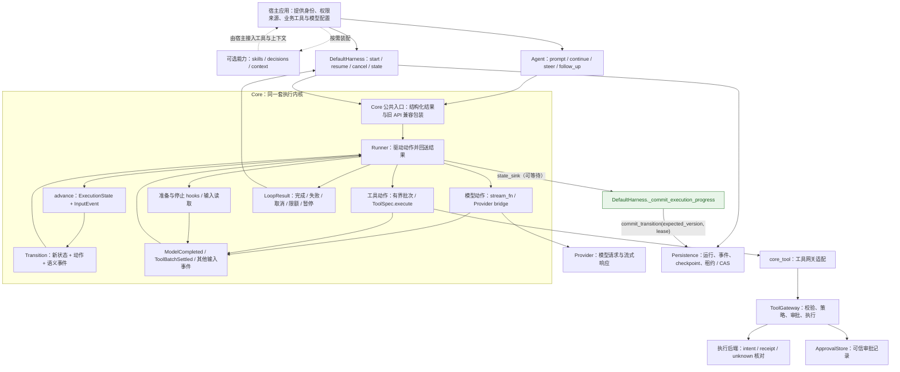
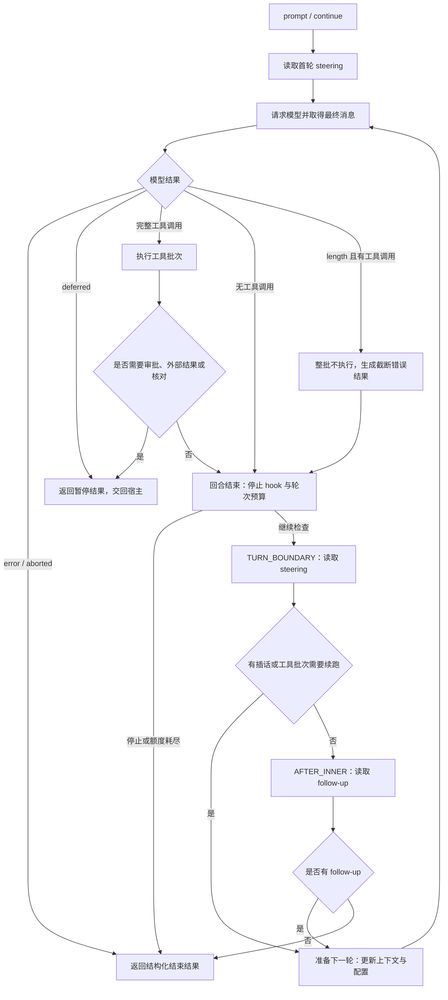

# 当前 Harness 架构与循环说明

核对日期：2026-10-15。代码基线：`81a2f05`。本文描述该提交的实际实现，以及同日的派发前持久提交接线修复。

**当前状态：显式状态机与单一 Runner 已接入；Persistence 的提交端口已真正接到 `DefaultHarness`。**
派发前的快照提交现在由 `Runner` 等待的同一个回调完成（见第 4 节），但“无法证明的外部操作如何收敛为 executed/failed”仍是独立 P0，不属于本轮完成范围。
本文不把计划中的行为画成已经实现。后续修复提交应重新核对下述提交路径。

已复现缺陷的执行任务书见 [Harness 派发前持久提交修复方案](harness-durable-commit-fix-plan.zh-CN.md)，实测证据见 [验证记录](verification.md)。

后续升级见 [四方向路线图](harness-evolution-roadmap.zh-CN.md) 与 [上下文工程实施计划](context-engineering-implementation-plan.zh-CN.md)。两份文档均为计划，不代表当前已有能力。

## 1. 整个 Harness 如何连接



- `Agent` 和 `DefaultHarness` 是不同入口：前者管理进程内对话状态与消息队列，后者管理运行生命周期与持久恢复。两者使用同一个 Core Runner。
- `core/agent_loop.py` 仅重新导出配置和 Runner 入口，没有第二套循环实现。
- 走 `tools/core_bridge.py` 的工具才接入 Gateway。直接提供自定义 `ToolSpec.execute` 的低层宿主，需要自行承担对应执行契约。
- reducer 不调用模型、工具、数据库或系统时钟；Runner 执行动作，再把结果作为事件送回 reducer。
- 图中的持久存储不代表运行库、审批库与操作库共享同一事务。具体宿主可以使用不同数据库，恢复依赖已记录事实与回执。
- 多任务调度、subagent、CodingAgent 工作区工具属于后续扩展，未画成当前已有组件。

## 2. 当前一次执行如何推进



此图展示主要业务路径，省略贯穿运行的取消处理、流式进度、工具 hooks 与异常清理。各分支由纯迁移函数决定，全部动作由同一 Runner 驱动。

`length` 分支只表示：截断消息中的工具调用不执行。它不表示整个运行一定结束；后续仍按停止条件和预算处理。

暂停不是后台等待循环。宿主在外部条件满足后显式调用恢复入口；目前不能承诺从任意中断位置自动继续。steering 与 follow-up 仍为内存队列，没有持久任务 inbox 或自动唤醒 worker。

## 3. 原来的双层循环还在吗

**原来的双层嵌套控制结构已经删除，两种继续执行的行为仍然保留。**

| 旧实现 | 当前落点 | 保留的行为 |
| --- | --- | --- |
| 内层循环：模型与工具往返，处理 steering | reducer 的工具结果迁移与 `COLLECTING(TURN_BOUNDARY)` | 工具结果进入下一轮；在轮次边界接纳插话 |
| 外层循环：当前工作结束后检查 follow-up | reducer 的 `COLLECTING(AFTER_INNER)` | 有追加消息时继续，无消息时结束 |
| 两层循环中的局部变量和分支位置 | `ExecutionState`、`InputEvent`、`Action`、`Transition` | 用显式状态表示进度与下一步 |
| 旧 `_run_loop` | `Runner._drive` | 单一驱动器消费事件、调用 reducer、执行动作 |

“单一 Runner”指模型与工具的调度只有一套实现，不表示源码只有一条循环语句。Runner 本身仍有驱动循环，模型流读取与工具遍历也各有必要的循环。

## 4. 派发前持久提交：修复后的接线

修复前的缺陷：`DefaultHarness._state_sink` 只做内存替换（
`holder["record"] = replace(record, execution=...)`），没有调用 `Persistence.commit_transition`，
因此 Runner 等待到的只是“内存更新完成”，不是数据库事务提交成功。

修复后的接线：

```python
async def sink(state):
    holder["last_state"] = state
    if state.phase in worth_capturing:
        await self._commit_execution_progress(holder, state)   # 内部 await commit_transition
```

`Runner._drive` 在**执行该迁移的动作之前**等待这个回调，所以“模型响应已提交”先于“工具调用被派发”，而不是靠注释保证。
候选记录以 `proposed=` 传入：只有事务提交成功后才成为驱动的权威视图；提交失败会抛出 `StorageConflict`，运行停止派发。

| 边界 | 数据库里必须可读的事实 | 提交者 |
| --- | --- | --- |
| 请求模型之前 | 请求阶段、已有上下文（含 system 与既有消息）、`model_action_id`、逻辑预算（`turns_used`/`max_turns`） | `_commit_execution_progress`（`REQUESTING_MODEL` 等执行中相位） |
| 完整模型响应之后、工具派发之前 | 最终 assistant 消息、完整工具调用声明、`RUNNING_BATCH` 相位、已用轮次 | 同上（`RUNNING_BATCH`） |
| 已结算批次之后、下一次请求之前 | 真实工具结果与消息顺序、批次分区 | 同上（`AWAITING_STOP_HOOK` / `AWAITING_PREPARE` / 下一次 `REQUESTING_MODEL`） |
| 对外宣告暂停之前 | `status=suspended`、`execution.phase=suspended`、批次分区、`pending_interaction`、消息与暂停事件，**同一事务** | 同上（`SUSPENDED`）；hook 只收集事实，不再自行提交 |
| 对外宣告最终完成之前 | 终态状态、结束原因、消息、预算与唯一一条终态事件 | `_commit_final`（唯一负责者；sink 不写 `FINISHED`） |

其他要点：

- 进度提交只写执行中相位；`COLLECTING` 无外部效果不写库，终态由 `_commit_final` 写，避免同一事实提交两次。
- transcript 只有一条规则：`RunRecord.messages` 与已提交的 `ExecutionState.messages` 一致；中断（取消/超时）路径只追加“已宣告但尚未提交”的消息，不按内容去重。
- `expected_version` 与 lease 随每次提交一起校验：并发取消、租约过期或 CAS 冲突都会让本次派发停止，不会覆盖更新的版本或已有的终态。

实测结果（F01–F10 的完整矩阵、命令与数字见 [验证记录](verification.md)）：真实 `DefaultHarness + SqlitePersistence` 路径下，工具内 `os._exit(9)` 后新进程能读到 `running_batch` 快照、最终 assistant、声明 `c1` 与已用轮次；工具边界提交失败时 handler 调用为 0；审批暂停在驱动收尾前已自洽；多轮与恢复后的消息各只保存一次。

### 仍未支持或仍需核对的窗口

| 窗口 | 现状 |
| --- | --- |
| 崩在模型请求中（`model_request_outstanding`） | 恢复会给出 reconciliation 暂停并说明“响应未提交、不可能有工具调用被派发”。该暂停没有批次，因此**不会自动重开请求**；宿主需重新提交为新运行或自行记录证据。 |
| 崩在工具派发窗口（`batch_outcome_unknown`） | 保留证据、列出声明的调用，查 Gateway 账本后再决定；不自动重放、不伪造结果。 |
| `unknown -> executed/failed` 的收敛 | **独立 P0，未完成**：判定责任人、可信证据来源、核对入口与审计规则仍未确定；证据不足时继续保持 unknown。本轮通过 F01–F10 不等于关闭该事项。 |

### 修复前后的真实进程对照

修复前（基线 `81a2f05`）：

```text
child_exit = 9
effect_exists = true
stored_status = running
stored_execution = null
stored_messages_count = 0
stored_batch = null
```

修复后（同一探针，`tests/fault_windows.py` 的 `harness-effect-then-die`）：

```text
child_exit = 9
effect_exists = true
stored_status = running
stored_execution.phase = running_batch
stored_execution.pending_work.declared = [c1]
stored_messages = [system, user, assistant(toolCall c1)]
stored_batch = null
ledger_state = running（intent 已记录、未结算）
```

两个结果的差别就是本轮修复的全部内容：数据库在工具开始前已经有完整模型响应、声明与执行位置。

## 5. 源码与验证入口

- [Core Runner](../src/yanxu_harness/core/runner.py)
- [纯状态迁移](../src/yanxu_harness/core/transitions.py)
- [显式状态与事件类型](../src/yanxu_harness/core/execution.py)
- [旧入口兼容模块](../src/yanxu_harness/core/agent_loop.py)
- [DefaultHarness 与提交接线](../src/yanxu_harness/runtime/default_harness.py)
- [工具网关](../src/yanxu_harness/tools/gateway.py)
- [提交边界回归矩阵（F01–F10）](../tests/test_runtime_commit_boundaries.py)
- [原实施计划](core-state-machine-implementation-plan.zh-CN.md)
- [阶段记录与验收矩阵](core-state-machine-migration.zh-CN.md)
- [现有验证记录](verification.md)
- [后续开发路线图](harness-evolution-roadmap.zh-CN.md)

修复前基线的本地门禁为 773 passed / 1 skipped，6/6 检查通过；派发前持久提交的缺口不能用门禁全绿代替该窗口的验收。修复后同一门禁为 793 passed / 1 skipped，6/6 检查通过，另加 20 个提交边界测试（先红后绿）。
