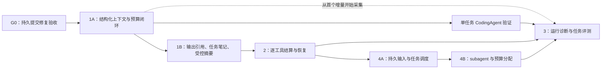

# Harness 开发路线图：执行基础、MCP 与扩展装配

最初编制：2026-10-15，历史参考提交 `81a2f05`。当前状态更新：2026-10-21。

**当前基线：`0.3.0a1` 已交付上下文、逐工具恢复、诊断评测、持久任务编排与可选 MCP 客户端。**
发行和实际验证边界见 [0.3.0a1 记录](release-0.3.0a1.zh-CN.md)。本分支已升为
[0.4.0a1 候选](release-0.4.0a1.zh-CN.md)：[扩展装配 E0–E3](extensions-implementation-plan.zh-CN.md)
已实施，EXT-R1–R7 全部独立复验关闭；AC38 本地 Python 3.10.22 实跑已通过，最终发布 CI 进行中。
下文 §§1–7 保留原分阶段设计和对应历史状态，不将早期“未开始”当作当前源码结论。

本文将四个升级方向排成可独立验收的增量，不把计划当作已有能力。上下文工程的详细任务书见 [上下文工程实施计划](context-engineering-implementation-plan.zh-CN.md)。

## 1. 前置条件与交付顺序

当前工作区正在修改 `runtime/default_harness.py`、进程测试夹具，并新增 `tests/test_runtime_commit_boundaries.py`。这些属于正在进行的 [持久提交修复](harness-durable-commit-fix-plan.zh-CN.md)，不是本路线图的实现；接手时必须重新核对状态，不能覆盖。

编号对应升级方向，实际开发允许“3”的最小诊断能力随“1”一起落地；无需等工具恢复全部完成才观察运行。

G0 的门禁：真实 `DefaultHarness + SQLite` 路径证明派发前状态已提交；提交失败不派发；暂停、终态、预算、transcript 不重复。未通过时可以编写上下文纯算法与测试，不把依赖持久化的集成能力标为完成。

## 2. 共同架构约束

- 继续只有一套 Core Runner。上下文准备、逐工具结果与任务输入都通过明确事件/动作接入，不复制模型—工具循环。
- Gateway 继续拥有 intent/receipt 与审批执行契约。新增状态只记录调度事实与回执引用，不新增第二份操作账本。
- 原始会话、模型请求投影、公开诊断分别有明确用途。投影和摘要不能取代业务授权、审批或执行证据。
- 每轮先冻结可观察行为，再修改实现。公开 API、持久格式、事件词汇的改变必须记录版本与兼容路径。
- 标准库基础安装保持可用；tokenizer、外部观测后端、向量检索与远程调度均通过可选适配器接入。

## 3. 方向一：上下文工程

### 1A：先把请求准备做正确

工作：

1. 明确字符、字节、token 的单位；引入可替换的完整请求计量适配器，复用既有 `ContextWindow` / `ContextPolicy`。
2. 以工具调用依赖和完整会话片段为单位选择历史，保护当前输入与必要系统/工具声明。
3. 将原始完整历史与模型请求视图分开，接通真实 Harness、Core、Provider 路径。
4. 请求投影及其来源、策略、预算在派发前可核对；上下文不足有结构化结果。

交付：无需摘要模型即可工作的结构化投影器、准备接口、真实 wire 集成测试，以及模型请求诊断。

验收：不出现孤立 tool result、不丢失有效工具撤销、不把字符当 token；必需上下文超限时不发请求；开启投影后运行历史仍完整。

### 1B：再提高长任务的信息效率

工作：大工具输出的原文引用、带来源的任务笔记、可选摘要、摘要预算与陈旧结果拒绝、恢复后的投影重建。

验收：摘要失败/超时不会破坏原始历史；旧来源摘要不会覆盖新输入；恢复不重复追加历史；能够解释每段上下文为何被保留或移除。

详细阶段 C0–C6、接口建议和验收矩阵均在 [专项计划](context-engineering-implementation-plan.zh-CN.md)。

**实施状态（2026-10-15）**：C0–C6 已按该计划落地，第一篇验收记录在 [上下文准备基线](context-preparation-baseline.zh-CN.md)，证据矩阵在 [验证记录](verification.md) 的 T25–T31。已交付的能力与仍**未**验证的事项都在那里逐条登记：未执行的是真实模型质量评测、远程 CI、3.10/3.11 与其他平台；`unknown → executed/failed` 收敛当时仍是独立 P0，现已在方向二的内置账本路径落地（见下文与 [当前 Harness 架构](current-harness-architecture.zh-CN.md)）。方向三、四尚未开始。

## 4. 方向二：逐工具结算与恢复

目的：缩小“整批尚未返回，因此 Core 不知道部分结果”的进度盲区。

**详细实施计划（2026-10-16）**：[逐工具结算与恢复实施计划（DeepSeek 接手）](per-tool-settlement-recovery-implementation-plan.zh-CN.md)。包含 T0–T6、调用身份、账本核对与原子准入、部分提交、真实进程恢复、兼容和验收矩阵。

**实施状态（2026-10-16）**：T0–T6 已按该计划落地，提交 `5cd274f`（T0–T3）、`efb4ae9`（T1 账本能力）、`2f0608a`（T4 恢复）、`8b60eed`（T5 兼容）与本轮交付提交。已交付：逐调用观察与有界批次会话、调用级持久提交、账本的 `absent/open/receipt/unavailable` 只读核对与原子准入、`unknown → succeeded/failed` 证据收敛（含账本提升）、真实进程的部分批次恢复与保守屏障、跨进程示例 `examples/07_partial_batch_recovery.py`。证据在 [验证记录](verification.md) 的 T32–T38 与 `tests/test_runtime_partial_settlement.py`、`tests/test_runtime_partial_recovery.py`、`tests/test_tools_ledger_recovery.py`、`tests/test_runtime_recovery_compat.py`。

仍未验证/未支持（不得写成已完成）：生产多进程竞争下的准入压力测试（只有两连接竞争与单进程故障窗口）、真实远程 CI 与 Python 3.10 运行、宿主自有账本的自动恢复（需要宿主实现同等 `RecoverableLedger` 能力）、RUNNING 孤儿记录的配置/策略漂移核对（没有记录的基线指纹），以及“任意钩子恰好一次”。

### T0：冻结现有工具批次契约

记录 start/preflight 源顺序、end 完成顺序、结果消息源顺序、串行覆盖、审批暂停与 batch terminate 规则。复用当前测试，不借本轮改变对外语义。

### T1：增加调用级调度事实

- 使用稳定的模型动作引用 + tool_call_id 关联单次调用，明确各 attempt 的执行权。
- 执行器向 Runner 提供有界的调用级完成输入，reducer 更新调用状态、结果/receipt 引用和批次剩余工作。
- 已结算调用及时提交。工具真实副作用状态仍由 Gateway 确认，不能用“协程返回/取消”代替 receipt。
- 正常批次仍在结果齐备后交给模型；增加调用级记录不自动允许模型读取不完整批次。

### T2：按证据恢复批次

- 复用已确认结果；仅执行有充分依据且符合 replay 策略的剩余调用。
- 一项卡住、失败或取消时，其余已结算结果保留；unknown 不自动重试。
- lease 丢失后停止新派发，晚到结果按身份与账本证据处理。

主要落点：`core/tool_execution.py`、`core/execution.py`、`core/transitions.py`、`core/runner.py`、`runtime/batch.py` 与 Harness 的提交/恢复接线。

验收：真实进程在部分调用完成后退出，另一个进程仍读到已确认结果；并发上限和结果顺序不变；重复结果不重复提交或触发下一模型请求；不同 namespace/run/attempt 不串状态。

## 5. 方向三：运行诊断与任务评测

**实施计划与状态（2026-10-16）**：[恢复缺陷修复、运行诊断与任务评测](runtime-diagnostics-evaluation-implementation-plan.zh-CN.md)——
**已实施**。三项复核缺陷（PTR-R1/R2/R3）分别由 `dccf06b`、`e652656`、`1ee55c9` 修复并各自带回归证据；
来源与计量事实（D0/D1，`0a0d99f`、`4e861f4`）、只读诊断与 CLI（D2/D3，`b96b8ea`）、
离线任务与版本比较（E0–E2，`07683d2`）随后交付。独立复核记录已就地补上第 7 节，保留修复前事实。

### O1：先能解释一次运行 —— 已交付

- 串起 run、attempt、模型动作、工具调用、operation/receipt、context projection 的稳定引用：
  `RunDiagnosticReport` 明确区分 origin attempt 与观察者 attempt，逻辑模型动作与**真实请求实例**分开，
  operation 只以引用指向账本。
- 只读诊断接口与 CLI：`RunInspector.inspect_run(...)` 与
  `python -m yanxu_harness.diagnostics inspect ... --format json|markdown`，展示结局、等待原因、
  漂移/期限/预算拒绝、逐调用分区与证据、耗时与用量覆盖；读取不执行任何动作、不领租约、不初始化缺失库。
- 耗时区分阶段：请求/工具调用各自单调时长（reducer 不读时钟），批次只给墙钟跨度且不与调用耗时相加；
  估算 token 带估算器身份，provider 实报 usage 按真实请求实例去重，缺失写 unknown 并说明原因。
- 公开边界：字段白名单输出，嵌套非标量不发布，Markdown 转义记录中的自由文本；原文只给受控引用。

### O2：再衡量真实任务 —— 离线闭环已交付，真实模型未执行

- 五个冻结案例（修错实现、审批暂停恢复、部分批次与失败证据、恢复拒绝与期限）覆盖定位/修改/审阅/恢复四类，
  每个案例有独立验收器与初始状态前提。
- 固定夹具（包内自带）、工具/策略配置、轮次/时长预算、允许的故障注入与模型标识；案例与夹具、验收器都有摘要，
  比较器按摘要匹配，不比较不同问题。
- 结果分开报告：协议/恢复正确性、任务验收、停止原因、人工决定次数、成本/耗时（已知小计 + 覆盖度）。
- 模型宣称完成不算成功：验收器自己读工作区、存储与夹具自带测试；`infra_error`/`invalid_result` 与任务失败分开。

验收：能定位失败任务的具体边界（样例 `docs/samples/partial-recovery-report.md`）；
离线回放只重建状态、不执行工具（诊断测试逐字节比对存储与账本）；同一冻结案例的新旧实现有可解释比较
（`docs/samples/evals/comparison.md`：失败仍记为失败，变化行给出 before/after 与协议差异）。
**未执行**：真实模型任务评测（无适配器，案例记为 `not_run`），历史 `2c8a324` checkout 的
eval 对照（只读诊断层本身属于本轮，新运行器无法在该源码上执行），以及远程 CI / Python 3.10–3.11 / Linux / Windows。

## 6. 方向四：持久输入与任务编排

**详细实施计划（2026-10-16，核对基线 745fb3b）**：[持久输入、任务编排与诊断评测缺陷修复实施计划](durable-input-orchestration-implementation-plan.zh-CN.md)。将独立验收的四项 P2 纳入 F0–F4 前置修复，再按 Q0–Q6 交付持久 inbox、同一 Core 消费、多任务调度、共享预算、subagent 和诊断评测。各阶段有独立退出门禁。

**交付状态（2026-10-16）：** F0–F4 与 Q0–Q6/V 已交付并各自提交（F 四项红绿测试、持久 inbox 与控制存储、同一 Core 原子消费、有界本地调度、任务期限与共享预算、可恢复父子任务、只读任务诊断、三个示例与发行验证）；交付记录见[交付报告](durable-input-orchestration-delivery-report.zh-CN.md)。本节原计划的 Q2“多任务调度”对应交付计划的 Q3，Q3“subagent 与结构化等待”对应 Q5；实际接口与事务边界以 [任务契约](tasks-contract.zh-CN.md) §7–§12 为准，不以本节早期草案为准。后续 MCP 接入见 §8。

### Q0：定义任务与输入边界

区分 conversation/session、task、run、attempt 和当前内存消息队列。先定义取消、重复提交、延迟输入、父任务结束后的子任务归属等契约。

### Q1：持久 inbox 与原子消费

- 宿主提交具有稳定 input_id 的输入；同 ID 同内容幂等，不同内容冲突拒绝。
- 接纳、消费确认与执行状态迁移通过明确事务或可验证恢复协议连接，不用内存 pop 代表持久确认。
- worker 的唤醒、领取、lease、取消与积压上限有明确所有者；已结束任务不因旧输入自动复活。
- 保留原 steering/follow-up 的处理时机，显式区分持久入口与原进程内 API。

### Q2：多任务调度

基于现有 Harness.start/resume 调度独立任务；增加并发上限、公平性、优先级与全局资源预算。先做简单队列，不先引入通用 DAG 语言。

### Q3：subagent 与结构化等待

- 父任务通过显式动作启动、等待、取消与验收子任务；每个子任务复用同一 Core 实现。
- 子任务有独立身份、上下文、工作区与受限权限配置；预算预留/结算和取消传播可持久恢复。
- 子任务结果作为带来源的数据回到父任务，不能授予新权限或直接替代人工审批。
- 检测重复启动、等待环、孤儿任务与父任务取消；已发生副作用按证据结算。

验收：父子任务在新进程恢复后不重复启动；父取消停止新派发并保留已完成结果；子任务不能突破宿主配置；全局预算不会被多 attempt/子任务重新初始化。

## 7. 阶段完成后的决策门禁

| 阶段 | 应提供的证据 | 下一步 |
| --- | --- | --- |
| G0 | 真实提交边界的先红后绿测试 | 接入上下文的持久准备路径 |
| 1A | 真实请求投影、预算拒绝、历史完整性 | 运行单任务 coding agent 验证 |
| 1B | 压缩/摘要失败与跨进程恢复证据 | 根据任务结果决定压缩策略 |
| 2 | 部分完成批次的真实故障恢复 | 支持更长工具任务 |
| 3 | 可复现任务集与可读诊断 | 用证据选择下一项优化（**已提供**：`docs/samples/partial-recovery-report.md`、`docs/samples/evals/`；真实模型评测仍未执行） |
| 4A/4B | inbox 原子消费与父子任务恢复 | 再评估更复杂编排 |

不要以新文件数、接口数或测试总数作为阶段完成依据。每个阶段更新实际命令、结果、限制与代表性任务记录。

## 8. MCP 接入：已随 0.3.0a1 交付

**2026-10-20 更新：** MCP 客户端和五项独立复核修复已交付、升版并合入 main，
具体代码/故障证据见 [独立复核](mcp-client-independent-review.zh-CN.md)，构建与宿主固定 wheel
验证见 [发行记录](release-0.3.0a1.zh-CN.md)。以下保留早期排期与设计原则。

**2026-10-18 更新：** 基于 `20731b1` / `0.2.0a1` 制定 [MCP Client 接入实施计划（Luna 接手）](mcp-client-implementation-plan.zh-CN.md) 与 [Luna 交接说明](mcp-client-luna-handoff.zh-CN.md)。按 MCP00–MCP08 推进可选 Tools 客户端、stdio/Streamable HTTP、宿主绑定、one-shot 调用、证据恢复与安装验收；具体范围和 MCP-AC01–32 以专项计划为准。Yanxu 已有宿主实测，本轮复用已有基础，不将其重列为从零开展的阶段。以下保留当时确认的设计原则。

2026-10-16 与用户确认：当前[统一实施计划](durable-input-orchestration-implementation-plan.zh-CN.md)先完成并验收，随后单独规划 MCP 接入。本轮仅预留远端工具适配边界，不增加未验证的 MCP 能力声明。

- MCP 工具先转换为本项目工具定义，经宿主筛选注册，执行统一经过 ToolGateway，共享权限、审批、预算、回执和诊断规则。
- MCP Client、协议、连接、认证与重连由独立可选适配模块管理，不进入 Core 控制逻辑，不增加基础安装的强制依赖。
- 服务、工具名和定义摘要参与身份与漂移检查；服务端工具声明不能直接授予权限或证明幂等。
- 本地 operation_id 不代表远端支持幂等。断连/超时后的未证明结果保持 unknown，依赖明确的远端幂等或业务核对能力恢复。
- Resources 接上下文来源与工件管理，Prompts 接模板/指导内容；不将所有 MCP 能力都塞进工具执行入口，不提升其内容的权限。
- 第一阶段优先工具发现、调用、错误映射与恢复测试；subagent 仅获得宿主允许的 MCP 工具子集，不共享不受限凭据。

## 9. 轻量扩展协议与装配层 E0–E3（已复核，0.4.0a1 候选）

实施基线 `main@077d91b` + 方案文档，实施及功能复核使用 `0.3.0a1`；当前分支候选为 `0.4.0a1`。任务书：
[E0–E3 主方案](extensions-implementation-plan.zh-CN.md)、
[DeepSeek 交接](extensions-deepseek-handoff.zh-CN.md)、[进度模板](extensions-progress.zh-CN.md)。

| 阶段 | 目标 |
| --- | --- |
| E0 | 版本化清单、宿主显式工厂/绑定、作用域与兼容合同、纯预检 |
| E1 | tools/skills/MCP 确定性原子装配，失败不留下半注册状态 |
| E2 | owner 生命周期、撤权与关闭、真实恢复指纹/守卫接线、跨进程和子任务合同 |
| E3 | 两个参考扩展、开发指南、独立探针、base/extra 与树外安装验收 |

四个阶段的代码、测试、示例、探针和安装门禁已交付；逐 EXT-AC01–40 证据见
[交付报告](extensions-delivery-report.zh-CN.md)，实际命令/退出码/跳过见
[验证记录](verification.md) 与[阶段进度](extensions-progress.zh-CN.md)。
Python 3.10 本机无解释器，AC38 为 **BLOCKED**，因此交付状态是“候选/部分验证”，
不宣称全解释器完成。未上传包索引、未推 tag、未合 main、未切换宿主 wheel；
`0.4.0a1` 已按用户要求更新为本分支候选，验证结果见[候选记录](release-0.4.0a1.zh-CN.md)。
