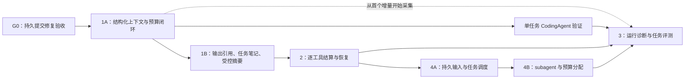

# Harness 后续开发路线图：上下文、工具恢复、运行诊断、任务编排

日期：2026-10-15。参考提交：`81a2f05`。状态：**开发计划，尚未实施**。

本文将四个升级方向排成可独立验收的增量，不把计划当作已有能力。上下文工程的详细任务书见 [上下文工程实施计划](context-engineering-implementation-plan.zh-CN.md)。

## 1. 前置条件与交付顺序

当前工作区正在修改 `runtime/default_harness.py`、进程测试夹具，并新增 `tests/test_runtime_commit_boundaries.py`。这些属于正在进行的 [持久提交修复](harness-durable-commit-fix-plan.zh-CN.md)，不是本路线图的实现；接手时必须重新核对状态，不能覆盖。

编号对应升级方向，实际开发允许“3”的最小诊断能力随“1”一起落地；无需等工具恢复全部完成才观察运行。

G0 的门禁：真实 `DefaultHarness + SQLite` 路径证明派发前状态已提交；提交失败不派发；暂停、终态、预算、transcript 不重复。未通过时可以编写上下文纯算法与测试，不把依赖持久化的集成能力标为完成。

## 2. 共同架构约束

- 继续只有一套 Core Runner。上下文准备、逐工具结果与任务输入都通过明确事件/动作接入，不复制模型—工具循环。
- Gateway 继续拥有 intent/receipt 与审批执行契约。新增状态只记录调度事实与回执引用，不新增第二份操作账本。
- 原始会话、模型请求投影、公开诊断分别有明确用途。投影和摘要不能取代业务授权、审批或执行证据。
- 每轮先冻结可观察行为，再修改实现。公开 API、持久格式、事件词汇的改变必须记录版本与兼容路径。
- 标准库基础安装保持可用；tokenizer、外部观测后端、向量检索与远程调度均通过可选适配器接入。

## 3. 方向一：上下文工程

### 1A：先把请求准备做正确

工作：

1. 明确字符、字节、token 的单位；引入可替换的完整请求计量适配器，复用既有 `ContextWindow` / `ContextPolicy`。
2. 以工具调用依赖和完整会话片段为单位选择历史，保护当前输入与必要系统/工具声明。
3. 将原始完整历史与模型请求视图分开，接通真实 Harness、Core、Provider 路径。
4. 请求投影及其来源、策略、预算在派发前可核对；上下文不足有结构化结果。

交付：无需摘要模型即可工作的结构化投影器、准备接口、真实 wire 集成测试，以及模型请求诊断。

验收：不出现孤立 tool result、不丢失有效工具撤销、不把字符当 token；必需上下文超限时不发请求；开启投影后运行历史仍完整。

### 1B：再提高长任务的信息效率

工作：大工具输出的原文引用、带来源的任务笔记、可选摘要、摘要预算与陈旧结果拒绝、恢复后的投影重建。

验收：摘要失败/超时不会破坏原始历史；旧来源摘要不会覆盖新输入；恢复不重复追加历史；能够解释每段上下文为何被保留或移除。

详细阶段 C0–C6、接口建议和验收矩阵均在 [专项计划](context-engineering-implementation-plan.zh-CN.md)。

**实施状态（2026-10-15）**：C0–C6 已按该计划落地，第一篇验收记录在 [上下文准备基线](context-preparation-baseline.zh-CN.md)，证据矩阵在 [验证记录](verification.md) 的 T25–T31。已交付的能力与仍**未**验证的事项都在那里逐条登记：未执行的是真实模型质量评测、远程 CI、3.10/3.11 与其他平台；`unknown → executed/failed` 收敛当时仍是独立 P0，现已在方向二的内置账本路径落地（见下文与 [当前 Harness 架构](current-harness-architecture.zh-CN.md)）。方向三、四尚未开始。

## 4. 方向二：逐工具结算与恢复

目的：缩小“整批尚未返回，因此 Core 不知道部分结果”的进度盲区。

**详细实施计划（2026-10-16）**：[逐工具结算与恢复实施计划（DeepSeek 接手）](per-tool-settlement-recovery-implementation-plan.zh-CN.md)。包含 T0–T6、调用身份、账本核对与原子准入、部分提交、真实进程恢复、兼容和验收矩阵。

**实施状态（2026-10-16）**：T0–T6 已按该计划落地，提交 `5cd274f`（T0–T3）、`efb4ae9`（T1 账本能力）、`2f0608a`（T4 恢复）、`8b60eed`（T5 兼容）与本轮交付提交。已交付：逐调用观察与有界批次会话、调用级持久提交、账本的 `absent/open/receipt/unavailable` 只读核对与原子准入、`unknown → succeeded/failed` 证据收敛（含账本提升）、真实进程的部分批次恢复与保守屏障、跨进程示例 `examples/07_partial_batch_recovery.py`。证据在 [验证记录](verification.md) 的 T32–T38 与 `tests/test_runtime_partial_settlement.py`、`tests/test_runtime_partial_recovery.py`、`tests/test_tools_ledger_recovery.py`、`tests/test_runtime_recovery_compat.py`。

仍未验证/未支持（不得写成已完成）：生产多进程竞争下的准入压力测试（只有两连接竞争与单进程故障窗口）、真实远程 CI 与 Python 3.10 运行、宿主自有账本的自动恢复（需要宿主实现同等 `RecoverableLedger` 能力）、RUNNING 孤儿记录的配置/策略漂移核对（没有记录的基线指纹），以及“任意钩子恰好一次”。

### T0：冻结现有工具批次契约

记录 start/preflight 源顺序、end 完成顺序、结果消息源顺序、串行覆盖、审批暂停与 batch terminate 规则。复用当前测试，不借本轮改变对外语义。

### T1：增加调用级调度事实

- 使用稳定的模型动作引用 + tool_call_id 关联单次调用，明确各 attempt 的执行权。
- 执行器向 Runner 提供有界的调用级完成输入，reducer 更新调用状态、结果/receipt 引用和批次剩余工作。
- 已结算调用及时提交。工具真实副作用状态仍由 Gateway 确认，不能用“协程返回/取消”代替 receipt。
- 正常批次仍在结果齐备后交给模型；增加调用级记录不自动允许模型读取不完整批次。

### T2：按证据恢复批次

- 复用已确认结果；仅执行有充分依据且符合 replay 策略的剩余调用。
- 一项卡住、失败或取消时，其余已结算结果保留；unknown 不自动重试。
- lease 丢失后停止新派发，晚到结果按身份与账本证据处理。

主要落点：`core/tool_execution.py`、`core/execution.py`、`core/transitions.py`、`core/runner.py`、`runtime/batch.py` 与 Harness 的提交/恢复接线。

验收：真实进程在部分调用完成后退出，另一个进程仍读到已确认结果；并发上限和结果顺序不变；重复结果不重复提交或触发下一模型请求；不同 namespace/run/attempt 不串状态。

## 5. 方向三：运行诊断与任务评测

### O1：先能解释一次运行

- 串起 run、attempt、模型动作、工具调用、operation/receipt、context projection 的稳定引用。
- 基于现有事件与 cursor 提供只读诊断接口/CLI，展示继续、停止、等待、限额和恢复拒绝的原因。
- 展示模型/工具/上下文准备/摘要的耗时，区分估算 token、实际 usage 和缺失数据。
- 公开报告不包含密钥、原始私有签名、完整代码和工具输出；需要原文时走有权限的读取路径。

### O2：再衡量真实任务

- 建立可重复的小型仓库任务集：定位错误、修改、运行检查、审阅 diff、中断恢复。
- 固定仓库基线、模型配置、工具版本、策略、预算与随机性条件；允许多次运行记录分布。
- 结果分开报告：协议/恢复正确性、任务验收结果、成本/耗时、人工介入次数。
- 模型宣称完成不算任务成功；测试通过也不自动等同于所有需求完成。验收脚本和人工复核标准分别登记。

验收：能从记录定位一个失败任务的具体边界；离线回放只重建状态，不执行工具；同一任务的新旧实现有可解释的比较结果。

## 6. 方向四：持久输入与任务编排

### Q0：定义任务与输入边界

区分 conversation/session、task、run、attempt 和当前内存消息队列。先定义取消、重复提交、延迟输入、父任务结束后的子任务归属等契约。

### Q1：持久 inbox 与原子消费

- 宿主提交具有稳定 input_id 的输入；同 ID 同内容幂等，不同内容冲突拒绝。
- 接纳、消费确认与执行状态迁移通过明确事务或可验证恢复协议连接，不用内存 pop 代表持久确认。
- worker 的唤醒、领取、lease、取消与积压上限有明确所有者；已结束任务不因旧输入自动复活。
- 保留原 steering/follow-up 的处理时机，显式区分持久入口与原进程内 API。

### Q2：多任务调度

基于现有 Harness.start/resume 调度独立任务；增加并发上限、公平性、优先级与全局资源预算。先做简单队列，不先引入通用 DAG 语言。

### Q3：subagent 与结构化等待

- 父任务通过显式动作启动、等待、取消与验收子任务；每个子任务复用同一 Core 实现。
- 子任务有独立身份、上下文、工作区与受限权限配置；预算预留/结算和取消传播可持久恢复。
- 子任务结果作为带来源的数据回到父任务，不能授予新权限或直接替代人工审批。
- 检测重复启动、等待环、孤儿任务与父任务取消；已发生副作用按证据结算。

验收：父子任务在新进程恢复后不重复启动；父取消停止新派发并保留已完成结果；子任务不能突破宿主配置；全局预算不会被多 attempt/子任务重新初始化。

## 7. 阶段完成后的决策门禁

| 阶段 | 应提供的证据 | 下一步 |
| --- | --- | --- |
| G0 | 真实提交边界的先红后绿测试 | 接入上下文的持久准备路径 |
| 1A | 真实请求投影、预算拒绝、历史完整性 | 运行单任务 coding agent 验证 |
| 1B | 压缩/摘要失败与跨进程恢复证据 | 根据任务结果决定压缩策略 |
| 2 | 部分完成批次的真实故障恢复 | 支持更长工具任务 |
| 3 | 可复现任务集与可读诊断 | 用证据选择下一项优化 |
| 4A/4B | inbox 原子消费与父子任务恢复 | 再评估更复杂编排 |

不要以新文件数、接口数或测试总数作为阶段完成依据。每个阶段更新实际命令、结果、限制与代表性任务记录。
