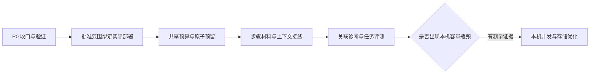

# Harness 后续开发实施方案：P0 收口、执行范围、共享预算与步骤上下文

日期：2026-10-29，Asia/Shanghai。

状态：**O0–O2 已完成；条件阶段 S0 尚未触发**。R0–R3、E0–E3、B0–B4、C0–C3 也已完成；Linux/Windows 运行环境缺口已登记。实际实现、命令和验收证据见[实施进度](harness-next-stage-progress.zh-CN.md)，O0–O2 接入边界见[关联诊断时间线指南](diagnostics-timeline.zh-CN.md)和[交付报告](harness-next-stage-o0-o2-delivery-report.zh-CN.md)；R2 独立复核见[复核报告](harness-next-stage-independent-review.zh-CN.md)。S0 仅在真实负载显示容量需求时启动，当前没有这类证据。

## 1. 基线、目标与交付顺序

核对工作区：`codex/plan-dag-harness`，HEAD `c034c0e80d6f53e97b44ba2c0fa221e85be190a4`。基础包版本仍为 `0.4.0a1`，Python 要求为 3.10+、基础运行时无第三方依赖。已发布版本的验证属于其发行提交，不能覆盖当前 Plan 分支。

当前工作树还包含未提交的 Plan P0.6 源码、示例、测试和文档，以及用户原有的方案文件与索引改动。实施前必须重新记录状态，不得通过 reset、clean 或整体覆盖文件获得干净基线。已有事实见 [Plan 进度](plans-progress.zh-CN.md)、[Plan 交付记录](plans-delivery-report.zh-CN.md)和 [0.4.0a1 发行记录](release-0.4.0a1.zh-CN.md)。

上轮记录为 Plan 专项 157 passed，源码完整套件 1,592 passed / 22 skipped / 2 failed；失败位于两个未修改的 Core 取消测试。离线 CI 返回非零，树外复制套件也重现这两个失败。这些是历史运行证据，本方案编写时没有重新执行测试，也没有证明失败在开工基线上已经存在。R1 必须重新归因。

目标是让宿主能够把已批准的 Plan 映射到实际执行配置，在多步骤和子任务间共同约束消耗，为每个步骤准备可追溯的上下文，并解释整个计划的执行结果。

| 交付批次 | 阶段 | 目标 | 前置门禁 |
| --- | --- | --- | --- |
| 第一批 | R0–R3 | P0.6 收口、失败归因、独立复核与兼容验证 | 重新记录当前工作树 |
| 第二批 | E0–E3 | 已批准执行范围与宿主实际部署绑定 | R3 通过 |
| 第三批 | B0–B4 | Plan 共享预算、原子预留与恢复 | E3 通过；B0 可提前做设计 |
| 第四批 | C0–C3 | 步骤上下文与带版本事实引用 | B4 通过 |
| 第五批 | O0–O2 | 关联诊断、代表性任务评测 | C3 通过；O0 词汇设计可提前 |
| 条件批次 | S0 | 本机多进程容量与竞争评估 | 真实使用出现容量需求 |

每批独立评审、提交和验收。第一批通过后，可以仅交付执行范围绑定；不要求一次发布全部后续能力。暂不排日历工期，以阶段退出证据控制推进。



## 2. 架构边界与复用落点

Core Runner 继续拥有唯一模型/工具执行循环，Gateway 继续拥有工具权限和操作账本，Task 控制存储拥有调度和 fencing，Plan 控制存储拥有定义、批准和步骤绑定。新增能力通过既有提交端口和可选能力接入。

| 现有落点 | 当前职责 | 后续接线 |
| --- | --- | --- |
| `core/runner.py`、Core reducer | 动作推进、模型/工具边界 | 复用提交和派发端口；不存放 Plan 图或宿主授权策略 |
| `runtime/default_harness.py` | Run 持久化、恢复、arrangement 漂移校验 | 保存执行绑定与上下文 manifest 的引用；在既有派发点接入校验与预算 |
| `tasks/scheduler.py::LocalWorker` | 有界调度、claim、start/resume | 在已有工厂装配流程接入解析后的执行绑定 |
| `tasks/inbox.py`、`plans/storage.py` | Task/Plan 原子控制、Memory/SQLite | 预算所有权、跨范围预留、绑定提交与 CAS |
| `tasks/budgets.py` | root Task 预算、dispatch reservation、结算 | 保留旧入口，逐步支持额外 Plan 范围 |
| `tools/gateway.py`、`tools/policy.py`、操作存储 | 工具策略、审批、intent/receipt | 复用实际 handler 前的准入和恢复判断 |
| `context/controller.py`、`context/notes.py`、`context/artifacts.py` | 投影、来源笔记、原文工件 | 加入步骤材料 manifest，沿用现有预算和摘要路径 |
| `diagnostics/`、`evals/` | 只读报告、离线任务与比较 | 关联多来源事实、增加多 Step 案例 |

现有大模块应在新增能力需要时按事务域提取内部组件；先冻结合同、再纯移动、最后改变行为，分别提交。不得以文件长度为由重写 Run 恢复或复制存储实现。

本方案不增加 TUI/IDE/Web、通用 shell、Coding 工具、生产沙箱、worktree 生命周期、通用工作流 DSL、自动审批、自动长期记忆、分布式 Worker 或自动追目标守护进程。宿主配置可以声明这些能力的引用，但引用不能证明隔离或授权已经实施。

## 3. R0–R3：先完成 P0 的可发布基线

### R0：状态与证据归档

记录 HEAD、分支、工作树、解释器、extras、依赖 wheelhouse 和当前数据库 schema。为已有 P0.6 工作建立路径清单，区分本轮输出和用户既有文件；逐文件确定提交归属，不把未跟踪文件整体加入提交。

将“已发布版本”“当前开发候选”“历史计划”放在文档入口的明确位置。旧任务书正文作为历史保留，可在开头增加当前实施记录链接。更新路线图和当前架构页的入口状态，禁止重写旧失败与旧验证归属。

退出证据：可重现基线记录、P0.6 变更清单、文档状态冲突清单。当前脏工作树不是删除用户文件的理由。

### R1：取消测试失败归因与修复

重点调查：

- `tests/core/test_core_loop_result.py::test_cancellation_between_turns_is_reported_as_cancelled`。
- `tests/core/test_core_tool_execution.py::test_cancellation_before_any_hook_yields_an_aborted_result`。

先单独复现，再在隔离的既有发行源码和当前候选上使用相同解释器/依赖对比。核对令牌取消发生在模型请求前、模型结果返回后还是工具准入前，不能只看测试名称判断。

冻结可观察契约：请求前已取消则不新增模型/工具派发；已有真实返回与已提交 receipt 不因取消丢失；取消后尚未发生的结果不能补造。若测试前提错误，修正触发时点并保留它原本要覆盖的窗口；若实现错误，用最小修复恢复契约。禁止跳过测试、放宽成恒真断言，或为了保留 final_text 而在预取消后发请求。

退出证据：最小 RED/GREEN、归因说明、相邻取消/期限/恢复回归结果；不能未经对比就把失败标为“基线问题”。

### R2：Plan 独立复核与修复

复核者依据提交和探针审阅定义摘要、可信 principal、审批撤销、claim/pause/replan 竞争、验收证据漂移、跨进程 unknown、跨 revision 执行次数、普通 Task 绕过防护及只读诊断。审查至少穿过真实 SQLite、Worker、DefaultHarness 与 Gateway，不以自验映射代替独立结果。

发现项逐项记录严重度、复现、所有权、修复提交和复验。具备授权的独立审查者可以承担此阶段；方案本身不触发其他会话或子 agent。

### R3：兼容与发行候选收口

在当前 Plan 候选上重新执行 Python 3.10/3.11/3.12 Linux，macOS/Windows Python 3.12 的适用 CI；覆盖 base 与所需 extras。已有发行版本的绿色矩阵不认证这次 Plan 改动。平台无法执行时如实登记缺口，不以静态语法检查替代解释器运行。

完整套件、离线 CI、wheel 和 sdist 树外安装分别验收；wheel 的通过不能推导 sdist 也通过。原有示例和新增 Plan 示例都要从安装环境运行。完成后整理 P0.6 提交与新候选记录；发布、合并或切换宿主版本按用户实际授权执行。

退出门禁：两条失败已关闭；独立复核阻断项已关闭；所声明平台的完整门禁退出 0；安装来源和制品摘要可核对。未通过时仅可继续下一阶段的设计和纯模型工作。

## 4. E0–E3：批准范围与实际执行配置绑定

### E0：冻结引用解析与绑定契约（已冻结）

P0 `ExecutionEnvelope` 中 profile/workspace/policy/deployment/budget 是带版本引用。E0 将下列对象冻结为 Python 公开契约，完整字段、校验规则、摘要算法和拒绝边界见[执行绑定契约](execution-binding-contract.zh-CN.md)：

| 对象 | 冻结合同 |
| --- | --- |
| `ExecutionBindingRequest` | namespace/session/Plan/revision/step/确定性 binding ID、definition/envelope digest、有效 profile/workspace/policy/deployment/budget 引用、宿主可信 principal 引用。 |
| `ExecutionDeploymentDescriptor` | 实际 profile、工具可见性、policy、deployment、budget 指纹；workspace 稳定身份/version；宿主声明且可执行的 capability 标识。 |
| `ResolvedExecutionBinding` | 请求快照、resolver ID/version、部署描述、受支持 capability、schema 版本和域分离 SHA-256 digest。仅为不可变 plain data。 |
| `ExecutionBindingResolver.resolve(request)` | async、只读、有界；只解析已批准引用，不得调用模型、工具 handler、创建 workspace 或在事务内等待。无法解析时抛结构化 `ExecutionBindingRefused`。 |
| `ExecutionBindingGuard.check(binding, actual, boundary)` | async 结构化准入结果；在实际 model/tool dispatch 边界复查撤权、版本和实际部署覆盖关系。拒绝携带稳定 code 与有界说明。 |

确定性 `step_binding_id` 与现有 Plan Store 的 identity 公式保持一致，使解析可以在 admission 事务前完成且绑定 ID 可在事务内复核。step profile/workspace override 优先于 envelope 同名引用，其余引用直接来自已批准 envelope。解析结果只声明宿主能力，不会凭 capability 标签创造隔离或授权。

凭据、路径、连接、活动对象和未脱敏环境值由宿主进程持有；持久化只保存经过宿主筛选的引用、版本、摘要和稳定资源身份。宿主授权 principal 由可信入口提供；模型传入的 profile 名称不能解析成额外权限。宿主工厂属于可信装配边界，库无法证明任意 Python 工厂不会伪造自身描述。

引用解析可在控制事务外 await；控制事务内重新验证 Plan revision、批准、控制版本、可信 principal 引用和解析快照摘要，并与 step binding、Task、INITIAL 输入及 claim 一起提交。该事务不与宿主外部授权服务形成全局事务，不能声称撤权与 claim 原子一致。类型和摘要合同已实现；实际门禁见进度记录 E0–E3。

### E1：准入与恢复接线（已完成）

执行顺序：宿主解析批准引用并提供不可变部署描述 → 控制事务重验批准并一起提交执行绑定、Step binding、Task、INITIAL 输入与 claim → `harness_for(task, attempt_id)` 根据已提交绑定装配 → 核对实际 Harness/Gateway 指纹 → 同一 Run 路径提交执行事实 → 既有 Runner 派发路径再校验有效性。外部解析和工厂装配不能在 SQLite 写事务内 await。

部署描述可以先于 Task 生成，实际工厂对象在 Task 准入后核对，避免要求尚未存在的 Task 参与预检。工厂失败或装配不匹配时保留已提交身份和失败原因，按既有失败/恢复规则处理，不能通过另建 Step Task 绕过原绑定，也不能视为已验收。

新绑定在任何外部派发前持久化，并参与 Run arrangement 对比。绑定持久化失败必须阻止派发。相同 Task/Run 的恢复沿用已记录绑定；配置缺失、指纹改变或未知绑定 schema 均结构化拒绝，不能用当前配置回填历史批准。

暂停、取消、reconcile 和读取既有 receipt 属于收敛动作。配置漂移可以阻止新派发，但不应阻止读取事实、持久结算或发送取消意图；需要外部调用的恢复动作仍走实际授权与预算判断。

### E2：Gateway 预览和资源版本（已完成）

先审计既有 ToolDefinition/ToolIntent/ApprovalBinding，列出已经覆盖的参数、预览和版本字段，只补缺失契约。若需要通用预览对象，至少包含资源稳定引用、目标版本、变化类型、有界摘要、大内容工件引用；预览摘要算法必须版本化。

目标版本或 validated args/preview/policy/deployment 改变时，按既有 Gateway 规则重新审批或拒绝；真实 handler 前验证，不只测试预览字符串。workspace 实际解析与资源范围强制由宿主适配器执行；不支持隔离或版本条件写入时返回能力缺口。路径字符串前缀匹配不能作为沙箱证明。

已确认 receipt 的重放不新增 handler；open/unknown 沿用原证据恢复规则。撤权不能回滚已发生副作用，也不能承诺瞬时中止已发送的远端调用。每次新 dispatch 在其拥有者处复查权限；外部授权变化与网络发出之间仍有竞态，宿主后端需要更强保证时必须提供实际执行时的条件校验。

### E3：中性宿主参考装配（已完成）

提供一个显式宿主装配示例：批准 profile A → 绑定只读工具和 workspace version → 进程退出 → 配置改变后恢复被拒绝 → 原配置/新 revision 按合法路径继续。必须经过真实 Gateway 和 SQLite，覆盖独立旧 Run、普通 Task、Plan Task 三种入口。

退出门禁：无法扩大批准范围；漂移阻止实际 handler；拒绝原因可诊断；旧入口没有被迫安装新适配器。

## 5. B0–B4：Plan 级共享预算

### B0：统一预算所有权与计量语义（已完成）

现有预算所有者是 root Task。Plan 不能借用一个不存在的 root Task。新增显式 Plan 预算所有者，并保留旧 Task API 的真实 root 语义。

建议增加 `BudgetOwnerRef(kind, namespace, owner_id)` 与不可变 `BudgetPolicySnapshot`，支持 `task_root` 和 `plan` 两种 owner。Plan owner 稳定绑定 namespace/plan_id，跨 revision 保持同一累计账户；每次执行关联批准时的预算策略版本。记录 session 归属以验证访问边界，但不以 session 重建账户。

| 计量 | 首轮保证 | 限制 |
| --- | --- | --- |
| 模型请求数、工具准入数 | 精确整数硬限额 | 每次真实重发请求都消耗；receipt 重放不算新 handler |
| 输入/输出 token | 有可执行上界时硬预留，否则仅记录已知用量 | 必须说明 tokenizer/Provider 上界能力，估算不能包装为硬保证 |
| 费用 | 宿主提供可信上界、币种、价格版本和后端约束时可预留 | 不读取在线价格表；缺能力时仅观测或拒绝要求硬限额的策略 |
| 时限与并发 | 复用 Plan deadline、Task deadline 和持久准入限制 | 不把每个 Worker 的本地 slots 当成跨进程全局并发 |

计数、token、金额不能混用无单位 float。新记录使用整数计数/最小金额单位或规范十进制定点，并记录单位和尺度；旧 float API 保留兼容入口，转换必须检测非有限、负数及不可精确转换值。转换规则与持久 schema 在 B0 冻结。

实际冻结的 owner、typed limit、hard/observe 能力标记、摘要和 TaskBudget 显式转换边界见[预算策略合同](budget-policy-contract.zh-CN.md)。B0 不改旧 Task ledger 表；B1 为父子 grant 增加 `task_grant` owner，并以独立 schema 持久化 typed reservation。

### B1：一个 reservation、多范围覆盖（已完成）

一次真实 dispatch 可能同时受 Plan 总额、root Task 总额和子任务 grant 约束。采用**一个规范 dispatch reservation + 多个预算范围覆盖记录**，在同一控制事务内检查并预留所有适用范围。任一范围不足整笔回滚；禁止依次预留后靠补偿修复。

范围覆盖表达同一支出的不同限额视角，实际 usage 只记录一份，诊断不能把 Plan 和 Task 两行相加成双倍费用。复用既有 request-instance/operation 身份，不新建一套工具副作用账本。

业务身份至少绑定 owner scope、Task/Run、真实 request instance 或新 operation dispatch、unit；相同 request ID 内容相同幂等，不同数量/范围/单位冲突拒绝。恢复重发同一逻辑模型动作是新的真实请求，应产生新 request instance 和新预留。

推荐的事务不变量：

```text
used(scope, unit) = settled_actual + active_reserved + unresolved_reserved
available = max(0, limit - used)
reserve(all applicable scopes) → commit → external dispatch
```

完整范围集合由已提交绑定和父子关系确定，模型和调用方不能通过少传一个 scope 绕过限额。Memory 临界区与 SQLite 事务必须具有同等语义；无法原子覆盖的自有后端明确拒绝此能力。

实际接口与存储不变量见[B1 预算覆盖合同](budget-reservation-contract.zh-CN.md)。`TypedBudgetStore` 不接收调用方 scope 列表；它从 Task root、已提交 Plan binding 和完整父子链推导 scope，在同一临界区/SQLite `BEGIN IMMEDIATE` 中检查所有 hard limit 并提交一个 reservation 与 coverage 行。SQLite typed budget schema 独立版本为 v1，显式启用；旧 Task `budgets` 表不变，旧只读库不会自动迁移。

B1 已覆盖真实 Plan Task、子任务 grant、scope 不足零写入、内容/单位冲突重放、一个 actual 覆盖多 scope、币种/price-version 冲突、unknown 持续占用、实际超额关闭新准入、插入中途故障回滚、SQLite 重开恢复、旧只读库能力拒绝及两个独立进程争用最后一份额度。真实 Provider/Gateway dispatch 接线、迟到 usage 和跨进程派发故障窗口属于 B2。

### B2：真实派发、结算与故障恢复

接入现有模型/工具 dispatch budget 端口，并审计摘要模型等辅助请求，避免旁路消耗。Provider 适配器内部自动重试若会产生第二次计费请求，必须逐次暴露实际 dispatch identity 并预留；不具备此能力的重试模式不能声称受请求数硬预算约束。

状态最少保留 reserved、settled、released、unknown。只有可证明未进入外部派发窗口时才能 release；取消、超时、进程退出和“没收到结果”都不足以退款。迟到 usage 以规范 reservation/report 身份幂等补记。

实际用量超过预留上界时保存真实超额并关闭新准入，不截断事实来维持账面额度。该情况同时证明所用适配器未提供预期硬上界，诊断必须标明。缺 usage 不填 0；unknown 保留覆盖额，避免可用额度增加。

故障注入覆盖：预留提交前、预留提交后未派发、网络发出后未返回、receipt/usage 已落盘但 Run 未观察、结算事务后回复前。跨进程恢复必须沿用原 reservation；有证据说明未派发才能释放，无法证明则保持 unknown。

### B3：重规划、子任务与额度变更

Plan 新 revision、retry、attempt 更新和普通进程重启都不能创建新总账户。Plan Step 生成的子任务继承 Plan scope；子 grant 只划分 root 范围，不能增加 Plan 总额。普通子任务 API 不能删除该继承关系。

规划 Run 的 `proposal_run_ref` 是来源引用，不自动追溯计费。若规划成本需要纳入总额，宿主必须在该 Run 第一次 dispatch 前显式绑定预算 owner，并持久化关系；不能事后凭来源链接伪造原来存在的硬限制。

增加额度需要可信控制动作、CAS、幂等键、策略新版本与审计；改变已批准预算范围应走新 Plan revision 和重新批准。不得原地修改已批准的预算快照。降低限额可立即关闭新准入，但不消除已有预留和实际支出，不阻止结算或取消。首轮可以不提供在线额度编辑，只提供跨 revision 的显式新策略。

### B4：预算诊断与迁移

报告每个 scope/unit 的限额、已知实际、活动预留、unknown 覆盖、超额和硬限制能力；费用未知时保留覆盖说明。Plan 和 Task 报告共享 dispatch 引用，避免重复总计。

预算 schema 与 Plan/Run schema 独立。旧 reservation 按其真实 root Task 迁移，不能推断它曾受 Plan 共享额度约束。只读旧库明确报告不支持新视图；迁移仅在明确启用新能力的可写模式执行，失败回滚整个迁移。

退出门禁：两个进程竞争最后额度最多一个新增 dispatch；跨 revision 和子任务仍共同计量；unknown 不释放；旧 Task 预算合同不变；缺预算上界能力时不声称 token/cost 硬约束。

## 6. C0–C3：步骤上下文与事实引用

### C0：有界材料模型

先实现宿主显式提供的材料，不建设自动事实抽取系统。建议 `StepMaterialRef` 包含 namespace/scope、来源类型、source ID/version/digest、授权引用、内容或 artifact_ref、有效性及字节/项数限制。模型推断标为 unverified，accepted 输出仍是带来源的数据，不获得工具权限或系统指令地位。

`StepContextManifest` 记录 Plan revision/definition digest、Step/binding、accepted predecessor 引用、材料版本、assembler/policy/estimator 版本、保留/丢弃原因、预算和内容摘要。manifest schema 独立版本化。

| 材料 | 强制性 | 首版处理 |
| --- | --- | --- |
| 当前 Step 目标、必要约束和验收项 | 必须 | 放不下则结构化拒绝 |
| 当前 Run 对话和工具结果 | 按现有完整片段规则 | 保留调用与结果配对、有效指令变化 |
| 直接依赖的 accepted 输出 | 按 Step 明确声明的必要性 | 读取当前合法 binding/acceptance 与版本化摘要/原文引用 |
| 全 Plan 简介和其他步骤状态 | 可选且有界 | 保存选取原因，不塞入全部历史 |
| 宿主显式项目事实/用户偏好 | 按宿主 scope 与来源规则 | 版本失效就拒绝或显式丢弃；不能默认当成当前事实 |

候选 Plan 自由文本、工具输出和模型推断不得进入可信 system 指令。材料“强制保留”只表示上下文完整性要求，不表示更高信任级别。

### C1：装配与来源复查

增加小型可选 `StepContextAssembler`，复用 ContextController/TaskNotes/ArtifactStore。只读解析器必须有超时、数量、单项字节和总字节上限；超大原文先持久化再提供授权工件引用。读取权限在实际 source resolver 上检查，namespace 相同不代表能读全部资源。

材料选择基于当前 revision、最新 binding 和已提交 acceptance；旧 revision、被重试替代的 binding 或缺失/过期的必要证据不能静默带入。跨存储读取保存各来源版本向量，并在发布 manifest 前复查；无法获得全局一致快照时如实报告覆盖边界，不能声称跨库原子快照。

### C2：Provider 请求与恢复接线

通过既有 PrepareRequest → RequestPrepared → state_sink → SendModelRequest 接线。实际 request_view 和 manifest 关联在发出请求前提交；提交失败时网络请求次数为 0。完整 transcript 保持独立，manifest 不成为审批或验收权威。

用可捕获真实请求 body 的本地 Provider 传输验证最终内容，覆盖系统提示、工具声明、输出预留和全部材料的计量。必需材料超限拒绝派发；可选材料裁剪有理由；不得单独数材料字节后宣称整个请求满足 token 窗口。

恢复沿用已有 Run 的投影/摘要额度事实；重新装配不刷新辅助模型额度。来源改变后重新准备并记录新 manifest；涉及执行授权或已批准输入语义改变时交回宿主控制流程，不能仅更新摘要绕过重新批准。

### C3：三步骤案例

示例：读取资料 → 生成候选变更 → 宿主 verifier 核验。第三步只接收声明所需的版本化材料。覆盖资料变化、工件缺失、权限撤销、超大输出、跨进程恢复和恶意输出文本。

首轮不自动跨 revision 复用已完成步骤。将来单独交付 carry-forward 时，必须同时满足定义、输入/资源版本、可解析证据、重新验收及明确来源记录。

退出门禁：真实请求体与 manifest 一致；跨 scope 材料不泄漏；陈旧必要事实不进入请求；摘要或解析失败不破坏原历史。

## 7. O0–O2：关联诊断与任务评测

### O0：事实来源和查询边界

关联 Plan/revision/Step/binding、Task/attempt、Run/request instance、operation/receipt、审批和 acceptance。保留各来源的权威记录，不将所有事件复制进 Plan 控制库。

分页使用固定读取水位与 source cursor 向量。来源内按 sequence 排序，来源间按显式因果引用和确定性显示规则排序；墙钟仅用于显示，不证明跨库全局先后。源不可读、截断、缺关系、重复引用均报告覆盖缺口。回放只重建事实视图。

### O1：只读查询、指标与根因

在已有 Inspector 上增加可选关联读端口和 JSON/Markdown 输出，不引入执行入口。记录白名单 ID、摘要和状态，复用脱敏/转义；不输出 prompts、凭据、原始环境或完整证据载荷。

指标至少包含 accepted/rejected/inconclusive、从 ready 到 admission 的等待、人工决定次数、恢复耗时、unknown 持续时间、预算用量覆盖和重试次数。只有具备同一时钟/已记录端点的量才能计算持续时间；跨进程墙钟跨度不能冒充单调耗时。

根因先使用确定性类别：approval、dependency、deployment_drift、budget、context、provider、tool、operation_unknown、storage_conflict、acceptance、cancellation。模型质量与计划合理性属于另标 inferred 的分析，不能覆盖底层事实。

### O2：代表性任务评测

复用现有 eval case/suite、夹具摘要与独立 verifier，增加至少六类冻结案例：正常多 Step、并行争用最后额度、审批后资源漂移、部分副作用崩溃、陈旧依赖上下文、拒绝后重规划。固定策略、预算、故障位置、初始状态和成功判据。

确定性离线结果衡量协议/恢复正确性；真实模型任务单独运行并记录 Provider/model/config、重复次数、成功率、成本覆盖与人工决定。缺凭据或未获运行授权时标记 not_run，不能用固定 Provider 输出证明模型能力。

退出门禁：同一冻结问题可解释比较；重复副作用和错误接受为零；失败、基础设施错误、未运行和未知费用分开报告。不得用总体通过数抵消一个安全或恢复合同失败。

## 8. S0：按证据启动的容量评估

先在单机多进程 SQLite 上测量：1/2/4/8 Worker、不同 Plan 宽度、普通 Task 混合、持续 reconcile/outbox、claim 失效与取消竞争。记录机器、SQLite 配置、连接数、样本数、p50/p95/p99 等待/准入延迟、吞吐、锁冲突、重复 dispatch 和饥饿情况。

只优化测出的瓶颈，例如索引、扫描游标、事务长度与背压；每项优化保留合同。只有明确的跨主机需求和本机容量证据后，再单独设计分布式一致性、远程执行和部署运维，不在此阶段加入消息中间件。

## 9. 建议代码组织和公共 API 策略

以下为建议落点，E0/B0/C0/O0 冻结时可调整。每个公开类型必须有真实消费者和合同测试。

```text
plans/bindings.py              # 不可变执行绑定、摘要和验证
plans/execution_ports.py       # 宿主解析/校验的可选端口
tasks/budget_scopes.py         # 统一 scope/owner 与覆盖关系
tasks/budgets.py               # 保留旧 API，适配多范围 reservation
plans/context.py              # Step 材料选择与 manifest
diagnostics/timeline.py        # 有界只读多来源关联
evals/                        # 扩展已有案例，不另建评测引擎
```

控制存储内部按身份、绑定、预算和迁移等事务域抽取，避免再把全部逻辑放入单个新文件。先提取内部实现再扩展行为；Memory 与 SQLite 的共享契约必须在整个过程中成立。

新能力默认关闭；可选端口用明确 capability 检查；旧 Run/Task 调用和自有后端不因未实现新接口而破坏。启用新能力但后端缺保证时，在接纳工作前拒绝，不能运行到一半才发现不支持。

拒绝码优先复用现有词汇。预计需要表达执行绑定缺失/漂移、能力缺失、预算不足/来源未知、scope 冲突、材料过期/越界和读水位失效；最终名称及对应异常层级在各阶段契约中冻结，不直接照本文字符串新增重复错误类。

## 10. 持久化、兼容与升级门禁

Plan 定义、执行绑定、预算存储、上下文 manifest 和诊断格式分别版本化；新增内部表不自动要求升级 Core ExecutionState。确实改变 Run 的持久格式时，必须增加相应版本、迁移/拒绝规则和旧记录探针。

每次 schema 变更提供：旧库正常路径、显式可写迁移、迁移中失败回滚、只读不写不建表、未知未来 schema 拒绝、自有后端能力不足拒绝。旧记录没有新绑定或新预算事实时如实标 legacy/unsupported，不能根据当前部署推造过去的批准和用量。

同一逻辑升级不能更改既有 namespace/Task/Run/operation 身份。幂等键应绑定实际请求内容；事务提交后回复前崩溃，重投返回原记录。状态、相关审计和 outbox 同事务写入，外部派发只能发生在提交之后。

## 11. 验收矩阵

下表是各阶段必须落实的验证义务。NX01–NX40 的实现证据已记入[进度报告](harness-next-stage-progress.zh-CN.md)和[验证记录](verification.md)；NX41 按阶段持续回归；S0/NX42 仅在出现容量需求证据后启动，当前未触发。每个阶段完成时继续补充实际测试名、参数后端、命令、退出码和证据路径。

| ID | 场景与通过条件 | 阶段 |
| --- | --- | --- |
| NX01 | 保护用户已有改动，基线、P0.6 路径和归属可追踪 | R0 |
| NX02 | 两条取消失败在相同环境中完成隔离对比与归因 | R1 |
| NX03 | 预取消无新派发；已有结果不丢失；相邻恢复合同通过 | R1 |
| NX04 | Plan 独立复核阻断项逐项关闭 | R2 |
| NX05 | 当前候选 Python/平台矩阵、base/extras 明确通过或登记缺口 | R3 |
| NX06 | wheel、sdist 分别树外安装并执行原有和 Plan 示例 | R3 |
| NX07 | 模型候选中的 profile/principal/approval 无法提升权限 | E0–E1 |
| NX08 | 缺执行绑定、未知 schema、错误 namespace 均在派发前拒绝 | E1 |
| NX09 | 绑定提交失败，Provider 和 handler 调用均为 0 | E1 |
| NX10 | 两连接 claim 与 pause/replan/批准撤销竞争仍保持控制原子性 | E1 |
| NX11 | 恢复配置漂移拒绝新派发，既有事实仍可读取结算 | E1 |
| NX12 | 参数、目标版本、预览或策略漂移在真实 Gateway 阻止 handler | E2 |
| NX13 | receipt 重放不调用 handler；unknown 不被配置更新清除 | E2 |
| NX14 | 不支持工作区隔离时报告缺能力，不宣称已隔离 | E3 |
| NX15 | 零/负数/非有限值/单位冲突/精度溢出按合同接受或拒绝 | B0 |
| NX16 | Plan 和 Task scopes 同事务预留，任一不足整笔回滚 | B1 |
| NX17 | 两进程争用最后一份额度最多一个新 dispatch | B1 |
| NX18 | 同请求重投幂等；同键不同 scope/数量/单位冲突拒绝 | B1 |
| NX19 | 多范围使用同一 actual 记录，汇总无双倍费用 | B1/B4 |
| NX20 | 真实模型重发/传输重试逐次预算；receipt 重放不重复消费 | B2 |
| NX21 | 五个预留/派发/usage 故障窗口跨进程保持预算覆盖 | B2 |
| NX22 | unknown/超时/取消不自动退款；迟到 usage 只结算一次 | B2 |
| NX23 | 实际超额完整记录并关闭新准入，缺 usage 不填零 | B2 |
| NX24 | retry/replan/新 attempt 不刷新 Plan 总账户 | B3 |
| NX25 | 子任务和辅助摘要请求继承适用范围，无法走旁路 | B2–B3 |
| NX26 | 额度策略更新有新版本/CAS/可信主体，降低额度不抹去消费 | B3 |
| NX27 | 旧 Task 预算迁移保持事实，旧只读库不写入 | B4 |
| NX28 | 没有 token/费用可执行上界时，不展示硬限额保证 | B4 |
| NX29 | 必要 Step 材料超限时网络调用为 0 | C0–C2 |
| NX30 | 来源类型、授权、namespace、版本和单项/总量边界被实施 | C1 |
| NX31 | 被替代 binding、过期 acceptance、缺失工件无法作为当前必要材料 | C1 |
| NX32 | 恶意候选或工具文本不进入可信 system/审批控制路径 | C1–C2 |
| NX33 | 真实请求 body 与提交的 manifest/预算事实相符 | C2 |
| NX34 | manifest 提交失败不发请求；恢复重新投影不刷新摘要额度 | C2 |
| NX35 | 解析/摘要失败保留原 transcript，跨 scope 无内容泄漏 | C3 |
| NX36 | 固定水位跨来源分页重读无跳项，源缺失/截断明确可见 | O0 |
| NX37 | 墙钟显示顺序不冒充因果或单调时长，usage 不重复汇总 | O1 |
| NX38 | Timeline 只读不建库、不迁移、不执行，输出遵守白名单 | O1 |
| NX39 | 六类冻结 eval 有独立 verifier，失败/infra_error/not_run 分开 | O2 |
| NX40 | 同一 case/config/digest 可比较，真实模型结果不由固定 Provider 代替 | O2 |
| NX41 | 所有新行为覆盖 Memory/SQLite，原 Run/Task/MCP/extension 回归通过 | 各阶段 |
| NX42 | 多进程容量报告包含配置、样本、延迟分位及重复派发检查 | S0 |

## 12. 实施步骤、提交与交接

每个阶段遵循：读取 AGENTS/RTK → 核对源码和基线 → 冻结该阶段契约 → 有意义的失败用例/探针 → 最小实现 → 聚焦回归 → 更新证据和文档 → 单独提交。仓库有 `.codegraph/` 时，定位/理解代码先用 CodeGraph。

| 建议提交组 | 内容 | 禁止混入 |
| --- | --- | --- |
| R | P0.6 收口、取消问题修复、独立复核修复与验证记录 | E/B/C/O 行为 |
| E0、E1、E2、E3 | 合同、绑定、Gateway 差异、参考装配 | 预算与自动事实抽取 |
| B0、B1、B2、B3、B4 | 所有权、存储、派发、继承、迁移诊断 | 第二套 operation ledger |
| C0、C1、C2、C3 | 材料模型、选择、真实请求、案例 | 自动长期记忆和跨 revision 默认复用 |
| O0、O1、O2 | 关联合同、查询、任务评测 | 观测服务部署与 UI |

纯移动提交与行为修改分开。每一批至少交付专项契约、实现、共享合同测试、故障注入、离线示例、接入页、进度记录、独立复核/自验身份和交付报告。每条证据写明源码提交与工作树状态；后续文档编辑导致快照变化时，重新生成 manifest 并验证一致性，制品哈希仍归属于实际构建时的源码。

建议进度记录为 `docs/harness-next-stage-progress.zh-CN.md`，由真正开工时创建，避免把尚未开始的任务写成实施进展。验收与交付报告同样在实施阶段建立。

## 13. 验证命令与发行纪律

以下为执行模板，不是本轮已运行结果。实际新增测试文件按阶段落地后再调用；不要为尚未实现的文件写虚假通过记录。

```sh
# 聚焦阶段合同，具体文件随 E0/B0/C0/O0 冻结
python -m pytest -q tests/test_plans_contract.py tests/test_plans_store.py
python -m pytest -q tests/test_plans_scheduler.py tests/test_plans_acceptance.py tests/test_plans_replanning.py
python -m pytest -q tests/test_public_api.py tests/test_public_snapshot_whitelist.py tests/test_import_fence.py tests/test_python_floor.py

# 完整候选门禁
python scripts/export_public_snapshot.py --refresh-manifest
python -m pytest -q tests
python scripts/ci_check.py --prepare-wheelhouse build-wheelhouse
python scripts/ci_check.py --offline --wheelhouse build-wheelhouse

# 单独保留制品安装报告时，workspace 必须换成专用空目录
python scripts/verify_release.py --offline --wheelhouse build-wheelhouse --workspace /tmp/yanxu-next-release --out /tmp/yanxu-next-artifacts --keep
```

wheelhouse 按解释器和平台准备；3.12 的扩展轮子不能替代 3.10 依赖。网络依赖准备与 offline 验证分别记录。可选 extra 的 skip 不能当作已验证，源码测试不能替代安装制品测试，历史绿色 CI 不能替代新候选。

版本号在准备新发行候选时确定，不修改已经发布的 `0.4.0a1` 产物或重打旧标签。合并、发布和宿主升级不是实施者根据本文自动获得的授权。

## 14. 开工任务说明

先执行 R0–R3，保护当前未提交 P0.6 与用户方案文件，完成取消失败归因、独立复核和兼容门禁。R3 通过后，仅推进 E0–E3；E3 通过后再推进 B0–B4。各阶段以实际源码与对应专项契约为准，发现事务或授权边界不能成立时先修正文档和验收义务，不用临时默认值绕过。

保留唯一 Runner、Gateway 操作账本和现有事实所有权；所有外部派发先经过持久提交、实际授权和适用预算；事实读取、取消与结算保持可恢复。完成当前批次后交付可审阅的提交、真实命令结果、未验证项和下一批入口。
