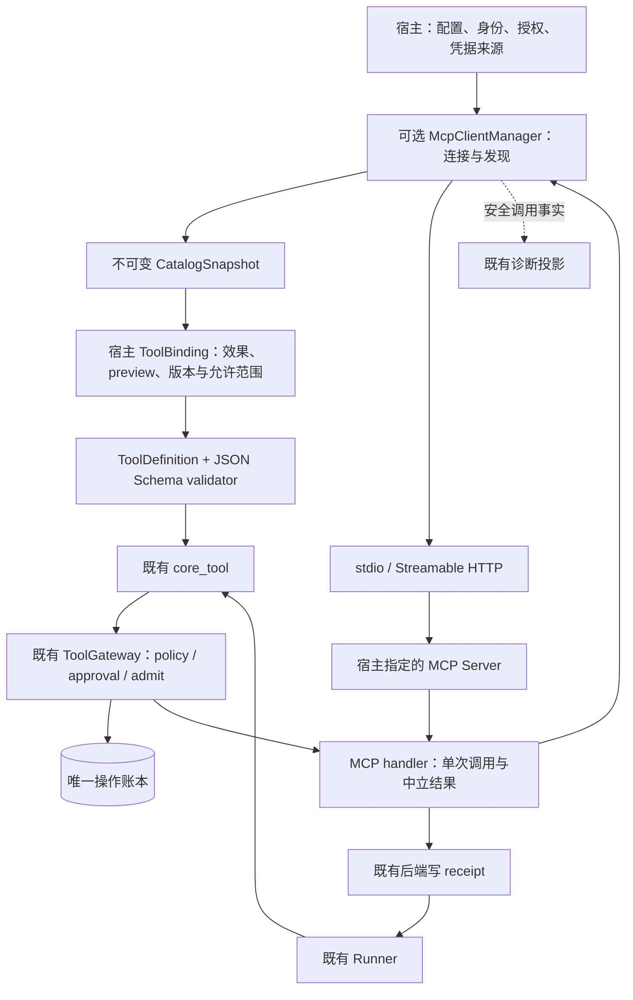

# MCP Client 接入实施计划（Luna 接手）

日期：2026-10-18（Asia/Shanghai）。核对基线：`20731b1d0a5476588fc0a4662ec6d50a03b2b6db`，版本 `0.2.0a1`，编制开始时工作树干净。状态：**待实施，MCP00–MCP08 均未开始**。

本文件是实施任务书，文中的新增文件、类型、命令选项均为建议，不能当作已有 API。接手者先重新核对 HEAD、工作树与适用规范；后续代码与本文不同时，先记录差异和兼容决策，再实施。按阶段更新进度，最终以实际源码、验收矩阵和交付报告说明交付内容。

交接入口：[Luna 交接说明](mcp-client-luna-handoff.zh-CN.md)。现有架构：[当前架构](current-harness-architecture.zh-CN.md)、[适配器指南](adapters.md)、[恢复语义](recovery.md)。

## 1. 目标与交付范围

让宿主显式配置的 MCP 工具经过现有 ToolGateway，获得相同的可见性、参数校验、授权、审批、操作回执、逐调用提交和恢复语义。MCP Client 负责连接和协议适配，不拥有模型循环、权限授予或第二份操作账本。

| 本轮必须交付 | 边界 |
| --- | --- |
| 可选 `mcp` extra | 基础包保持零第三方运行依赖、Python 3.10+；安装 extra 才启用适配器 |
| stdio 客户端 | 宿主给定 executable/argv/cwd/env 引用，真实子进程、资源上限与有界清理 |
| Streamable HTTP 客户端 | 宿主给定端点和凭据引用，真实 loopback HTTP、期限、取消和重连 |
| 工具发现与冻结快照 | 分页有界、名称映射、JSON Schema 校验、宿主筛选、版本和漂移检查 |
| 工具调用 | TextContent 与 JSON structured content；明确区分成功、远端错误、协议错误和效果未知 |
| 审批及恢复 | 写调用审批先于远端派发；回执复用、断连 unknown、证据收敛和旧调用身份保留 |
| 诊断、示例与安装验收 | 安全的连接/调用事实、真实服务故障夹具、独立探针、源码树外安装验证 |

本轮不交付：MCP Server 对外暴露 Harness、旧 HTTP+SSE 独立传输、Resources/Prompts 主动读取与上下文接线、图像/音频/blob 处理、自动服务安装、交互式 OAuth 登录与 token 刷新、sampling/elicitation、MCP Tasks 扩展、自动工具重试、分布式 worker。返回 resource link 只可作为有界惰性引用展示，不自动读取 URI。

Yanxu 已有宿主接入与实测。本轮新增的是 MCP 边界的验收，不把已有实测重列为“尚未开始”。可复用已有宿主案例，但不修改 Yanxu 的生产配置、固定发行物或真实资料。后续宿主升级单独交付。

Luna 负责分阶段实现、回归、兼容说明及完整交付报告。实施期间保留 `0.2.0a1`；最终版本升级、正式发行物构建及宿主采用在独立复核后单独处理。本计划不授权上传包、推送 tag 或调用真实付费模型。

## 2. 已核对的实际接点

| 现有源码 | 当前行为及本轮接法 |
| --- | --- |
| [tools/definition.py](../src/yanxu_harness/tools/definition.py) | 可执行定义必须有真实 validator；JSON Schema 本身不等于校验器。写工具必须有同步 preview；本地名称只接受小写稳定 ID，最长 120 字符 |
| [tools/core_bridge.py](../src/yanxu_harness/tools/core_bridge.py) | `core_tool` 经 Gateway 调用；结果依 receipt/status 投影。普通返回字典中的 `isError` 不会自动成为失败回执 |
| [tools/gateway.py](../src/yanxu_harness/tools/gateway.py) | 可见性→验证→policy→approval→admit→execute→settle；工具与版本进入现有绑定；调用身份含 model_action_id |
| [tools/execution.py](../src/yanxu_harness/tools/execution.py)、[storage/operations.py](../src/yanxu_harness/storage/operations.py) | 既有 receipt 和 observe/admit/promote 负责效果证据；普通 handler 返回值被当作 SUCCEEDED，需要明确扩展中立结果表达 |
| [runtime/context.py](../src/yanxu_harness/runtime/context.py) | 已有 `RunIdentity.for_operation()`；适配器所需稳定 operation 由宿主/Gateway 提供，不能从模型参数生成 |
| [runtime/default_harness.py](../src/yanxu_harness/runtime/default_harness.py) | 已有真实提交、原 arrangement 漂移比较、受限恢复与 unknown 屏障；MCP 工具复用这些路径 |
| [diagnostics/](../src/yanxu_harness/diagnostics/) | 只读来源事实报告，不让诊断重连或调用 MCP |
| [tests/test_import_fence.py](../tests/test_import_fence.py)、[scripts/ci_check.py](../scripts/ci_check.py) | 冷启动扫描会导入每个子模块；extra 安装的 SDK 即使依赖 Web 库，也不能因包导入而泄漏到基础运行路径 |

本轮允许增加中立结果类型和必要的 operation context 接线，不向 Core reducer 塞 MCP SDK 类型、socket、连接对象或厂商错误。不重写 Runner、状态机、调度器或账本。

## 3. 协议与依赖基线

编制时核对官方 Python SDK **v2.3.0**：包元数据声明 Python >=3.10，依赖包含 httpx2、jsonschema 等。采用 `mcp==2.3.0` 作为首个验证候选，在可选 extra 内声明直接依赖的 JSON Schema 库；MCP00 生成精确的可重现约束和哈希清单，不使用 main 分支或 `pip install -U` 作为实施基线。[固定版本元数据](https://github.com/modelcontextprotocol/python-sdk/blob/v2.3.0/pyproject.toml)、[发行说明](https://github.com/modelcontextprotocol/python-sdk/releases/tag/v2.3.0)。

首版必须分别测试 `2025-11-25` 与 `2026-07-28` 的 Tools 路径；其他协议版本明确拒绝，不宣称支持。发现连接必须实际核对协商结果，不能仅设置版本字符串便假定服务支持。两代协议的握手/发现、结果形态和取消方式不同，由版本适配层处理，Core 不分叉。[官方版本说明](https://py.sdk.modelcontextprotocol.io/protocol-versions/)。

SDK 高层调用可能包含重新列工具、修正请求或重试行为；v2.3.0 的发行说明明确包含 HeaderMismatch 后的一次重试。**本轮工具执行采用 one-shot 语义：一次 Gateway 准入最多一次 tools/call。** MCP00 须找到可验证的公开单次调用入口，必要时使用 SDK 的公开低层接口。不得 monkeypatch 私有实现，也不得把 SDK 默认行为当成安全证明。协商和只读发现可以有界重试，工具执行不能。

SDK 候选若不满足 one-shot、边界限制或 Python 安装要求，先提交 ADR 记录复现、可选方案及影响；可以在保持本计划外部契约的前提下选择另一个明确固定版本，并更新验证矩阵。不得悄悄缩小协议/传输支持面后宣布全部完成。

## 4. 结构与生命周期



建议新增 `src/yanxu_harness/integrations/mcp/`：`config.py`、`types.py`、`client.py`、`transports.py`、`catalog.py`、`schema.py`、`tools.py`、`results.py`、`sdk.py` 和显式导出。目录划分可按实际复杂度合并，职责不可混在 Core 中。

建议宿主面（名称可调整，行为必须覆盖）：

| 对象 | 契约 |
| --- | --- |
| `McpServerConfig` | 本地稳定 server_id、transport、协议允许集、端点/命令、凭据引用与 scope revision、Limits；不接受模型或服务端反向覆盖 |
| `McpLimits` | 连接、发现、单调用、关闭期限；页数/工具数/帧大小/总量/并发/stderr 上限，正数且有限 |
| `McpClientManager` | async 生命周期；连接/探测/发现/单次调用/失效/关闭；不持久化 SDK session 或恢复半截协议流 |
| `CatalogSnapshot` | 不可变服务与工具描述、协议版本、定义摘要、分页完整性、排除项及原因；不保存秘密 |
| `McpToolBinding` | 宿主明确允许的工具、效果、preview、target_version、执行模式、结果策略和 policy revision |
| `McpCallFacts` | 调用实例 ID、server_id、工具定义摘要、协议、连接代次、耗时与结果来源；不复制 intent/receipt 权威 |

宿主在调用 Run 前显式打开 manager、发现并构造定义；在同一事件循环及 async 所有者中关闭。禁止 import 时连接、构造普通配置时起进程、每次 handler 新起一份服务，或在全局单例共享不受限凭据。连接复用按 namespace、宿主授权 scope、server_id 和配置 revision 隔离；child 只获得宿主显式允许的绑定子集。

### 4.1 传输和资源限制

- stdio 使用 executable + argv，禁止 shell 拼接和隐式安装服务；cwd、环境白名单和密钥引用由宿主提供。只管理自身启动的进程；协议 stdout 与有界 stderr 分离。
- HTTP 首版支持宿主预置 header/Bearer 凭据引用，不自动启动登录。远端 HTTPS；loopback HTTP 必须显式允许供本地服务及测试使用。拒绝 URL 内凭据、携带秘密的 query、跨 origin 重定向与 HTTPS 降级；首版关闭 tools/call 的自动重定向，拒绝后让宿主配置最终端点。[SDK 传输参考](https://py.sdk.modelcontextprotocol.io/client/transports/)。
- 默认建议：connect 10s、discovery 15s、call 30s、close grace 5s；每服务并发 4、每授权 scope 总并发 8；16 页、256 个工具、目录累计 2 MiB、单 schema 64 KiB、单协议消息/SSE event 1 MiB、stderr 保留 64 KiB。host 可显式调整，limits 不由服务端建议扩大。
- call 实际期限与 Run 剩余期限取小，排队获取并发槽也计入期限。取消单个调用不能关闭共享连接并破坏其他仍有效调用；连接整体失效时逐一记录在途调用的未知状态。
- 帧/SSE/stdio 单消息限制必须尽量在解码及完整分配前生效；后置字符串切片不算内存有界。MCP00 查明 SDK 能力，必要时增加有界传输包装，但复用 SDK 的 JSON-RPC 实现。协议读取、目录聚合和模型输出分别设限。
- close 有界，清理自身任务、管道和进程；不能证明远端工作已停就记录未知，不把取消应答当作副作用撤销。平台能力不足须明确说明，不无限等待。[官方取消说明](https://py.sdk.modelcontextprotocol.io/handlers/cancellation/)。

## 5. 工具目录、Schema 与漂移

### 5.1 本地名称和冻结版本

远端工具名保留精确大小写；别名建议 `mcp.<server_slug>.<tool_slug>.<digest12>`，总长 <=64，满足现有小写稳定 ID 规则并兼顾模型接口。不同原名经小写化或截断发生碰撞时，摘要区分；重复 server_id、本地别名冲突明确拒绝，禁止后项覆盖前项。serverInfo.name 不作为宿主服务身份。

定义版本采用带版本号的 canonical fingerprint，覆盖：宿主 server_id/服务配置 revision/授权 scope revision、transport、实际协议版本、原始工具名、输入/输出 schema、模型可见说明、annotations（仅数据）、绑定效果/preview 规则/policy revision。凭据值、连接代次、request ID、时间戳不进入逻辑身份；密钥轮换由宿主按授权语义决定是否更新 scope revision，不能序列化密钥或其散列。

首轮派发前，绑定版本必须进入现有 arrangement/工具清单。恢复时重新连接、核对当前发现和宿主绑定，与**原提交版本**比较；缺工具、定义变化、授权撤回或协议改变时零 tools/call、零后续模型请求，给出结构化拒绝。不得重连后静默更新定义并继续旧审批。

运行中目录变化只令当前快照失效，等待宿主在安全边界重新装配；不在同一批次热替换工具。下一次派发检查连接/快照代次。已经在途的效果照实记录，目录刷新不能改变其旧绑定。首版不承诺发现响应与服务端执行之间有远端原子版本锁；无条件写工具的目标 CAS 仍需远端和宿主契约提供。

### 5.2 参数和输出校验

用真实 JSON Schema validator；至少支持默认 2020-12 与显式 draft-07、嵌套对象/数组、required、enum、additionalProperties、oneOf/anyOf、同文档 `$ref`。远程 `$ref` 禁止网络解析，未知 dialect/非法 schema/超复杂结构在注册前明确拒绝，不把未识别规则删掉后接纳。设置输入 JSON 深度/节点/字节与 schema 复杂度上限；不声称可在同线程强行中断任意验证器。

输入必须是 mapping，按原 schema 校验，不默默补 defaults、改类型、删参数或改变 canonical args hash；参数无效远端调用为 0。schema 中包含身份、凭据、endpoint 等字段也不会取得权威，宿主绑定可拒绝这类定义。[官方 Tools 定义参考](https://modelcontextprotocol.io/specification/2026-07-28/server/tools)。

分页检测重复 cursor、重复原名、页数与总量；不完整目录不能标 complete。单个非法工具可排除并记原因，合法工具仍可发现；宿主显式请求绑定的工具被排除时，装配失败。`x-mcp-header` 由版本适配层校验处理，禁止用它覆盖 Authorization/Cookie/Host 等宿主权威 header；声明不支持的定义须排除，不悄悄忽略后调用。[官方 header 参数说明](https://py.sdk.modelcontextprotocol.io/advanced/header-parameters/)。

## 6. Gateway、审批和结果语义

### 6.1 宿主授权

默认目录不是可执行工具集，必须经过宿主显式 allowlist 与绑定。READ 只能由宿主确认；未分类工具默认不暴露。服务端 `readOnlyHint`、`destructiveHint`、`idempotentHint`、描述和 instructions 都不能授予权限、取消审批或承诺幂等。服务端 instructions 不自动写进 system prompt。

写工具必须有宿主同步 preview，可先使用“将调用哪个服务/工具、完整参数摘要、目标及影响说明”的调用预览；不能冒充远端真实 diff。需要内容差异的宿主提前准备可信预览，不在同步 preview 内临时发网络请求。target_version 必须来自宿主事实，且远端实际写入须支持对应 CAS 才能宣称并发保护。没有 CAS 就明确显示较弱保证；不虚构目标版本。

幂等默认 NONE/replay never。不把本地 operation_id 注入模型 schema，不修改远端参数假装服务支持幂等。本轮不增加通用远端幂等重放；已有业务幂等工具也通过宿主证据与原 Gateway 恢复，不能直接绕过 unknown 屏障。

### 6.2 中立结果接线：必须先修通

建议在 `tools/execution.py` 增加中立 `ToolExecutionResult`，包含 `state`、可持久化的 result、detail、白名单 details、可选 external_id；首版允许 SUCCEEDED/FAILED/UNKNOWN，其他既有结果仍经原异常/审批路径表达。它不依赖 MCP；既有普通返回值仍按原语义成功。既有内存及 SQLite 执行实现复用同一归一函数，将中立结果变为带原 intent.operation_id 的 ToolReceipt。不能把远端任意字典识别为这个强类型，也不能允许它替换本地调用身份。

Gateway 在 execute 前，利用现有 `RunIdentity.for_operation` 将权威 operation_id 传给符合 RunContext 契约的 handler；原 namespace/session/run/attempt、Principal、取消和 services 保持一致。对既有宿主自定义 context 保持兼容；delegated ownership 不追加第二次准入、审批或回执写入。新增接线要有普通工具和 host-owned backend 回归。

MCP handler 返回中立结果；Core 消费既有 ToolInvocationResult。SDK CallToolResult/Pydantic model 不进入持久记录。嵌套 JSON 明确序列化；2026 的 structured content 可不是 object，不能只接受字典。

失败正文的接线也要验证：现有 bridge 对失败主要投影 reason。适配器应把有界、脱敏的错误摘要放进中立 detail，让模型确实看到错误；完整受限错误结果留在 receipt。确需丰富统一失败投影时增加通用字段规则，不写 MCP 专属 Core 分支，也不只在 receipt 中保存正文后便声称模型已收到。

| 观察 | 既有状态和处理 |
| --- | --- |
| 完整合法 terminal 成功 | SUCCEEDED；结果仍是远端返回来源，不升级为额外业务权限 |
| 完整合法 terminal `isError=true` | FAILED，保留有界错误内容且 Core `is_error=true`；表示远端报告失败，不表示没有局部副作用或业务已回滚；不自动重试 |
| 宿主拒绝/无效参数/未批准 | DENIED / INVALID_ARGS / AWAITING_APPROVAL；远端 tools/call 为 0 |
| 本地准入后、可证明尚未发送的连接/配置失败 | 明确失败或未派发取消，记录 not_sent；不得用一般网络异常猜测未发送 |
| 请求可能已到达，超时/断连/帧超限/无法解析 | UNKNOWN，暂停核对；写成功后回包丢失不得变成 FAILED 后自动重试 |
| 已发送后输出 schema 不符/内容无法表示 | 对 mutating 工具 UNKNOWN；宿主确认只读工具可报失败；不能因展示失败断言写入失败 |
| Run/任务取消、期限到达 | 停止新派发并传播控制信号；Run 按现有 cancelled/usage_limited 结束，在途效果无证据者账本仍 UNKNOWN |
| 非 terminal 结果、请求更多交互或 task handle | 明确 unsupported，不自动回填答案/再次 tools/call；可能执行过则 UNKNOWN，不伪造成功或可恢复审批 |
| 旧操作有确认 receipt | 复用原回执，不重连调用该操作；需续跑其他工作时仍检查部署基线 |

JSON-RPC code 本身不足以证明没有副作用。只有经过已冻结语义证实的 pre-execution rejection 才能按未执行处理；未知错误保守归类。SDK 自动 output-schema 校验抛错也须依据派发事实归类，不统称 invalid_args。

结果必须同时保留内容、structured content 和错误标志的语义。纯 structured content 生成确定性的 TextContent 表示，避免现有 bridge 将无 content 的 mapping 变成空结果；普通文本保持有序。结构化完整结果存在有界私有 receipt，模型视图可按现有上下文/工件机制缩短，不截坏 JSON 冒充完整数据。不能支持的媒体返回明确结果；URI 不自动下载。空合法成功也需有满足 ToolReceipt 契约的非 None 表示。

## 7. 恢复、调用事实与隐私

沿用本地唯一 ledger：intent→单次远端调用→receipt。连接 ID、SDK session 和协议 request ID 是传输事实；逻辑操作仍是现有 namespace/session/run/model_action/tool_call_id。断线重连只建立新连接，不授予重发旧操作的权利。

在既有 receipt.details/事件白名单内接入最小 facts：server_id、local/remote 工具引用、定义 fingerprint、协议、调用实例 ID、传输类型、连接代次、派发可确认范围、duration、远端报告分类和 receipt 来源。远端工具名等自由文本须有界并转义。派发前必须持久化的是原 operation 身份和冻结的工具版本/绑定；提交失败零远端调用。连接代次、实际开始时间等观测随回执或既有事件记录，进程退出导致缺失时明确 unknown，不用恢复进程的信息倒填。

首版优先利用已有工具版本、Run arrangement、receipt.details 和计量事件，不为观测新增第二份持久账本。确需扩展 intent/事件字段则新增显式可选元数据并版本化，测试旧库读写和宿主后端能力；不得把 transport facts 塞入 raw_arguments 从而改变原业务参数或审批 hash。MCP00 的 ADR 固定必需绑定与可缺失观测的实际字段表。

诊断默认不显示原始 endpoint、argv/env、headers、token、SDK 私有对象、原始协议帧、参数/结果全文和服务端日志。只公开宿主允许的稳定引用及枚举；已知凭据值做最后防线脱敏，不能只靠键名黑名单。正文内容留在原有受控历史/回执/工件边界。

reconcile 使用宿主业务证据：工具参数中的业务目标、目标版本、业务操作记录或远端明确支持的回执查询。单纯 ping 成功、服务重新上线、工具自称幂等、list_tools 未变化均不是旧写入未执行的证据。证据先按现有 promote 提升 ledger，再提交 Run；两者间崩溃后按 ledger 补齐。缺证据继续 unknown，不造一条“失败”帮用户跳过去。

已存在 Task/child 的模型额度与期限继续遵守原契约。MCP 本身不新增模型请求；本轮硬约束连接/调用并发、期限、消息与输出容量，记录实际调用次数，成本没有宿主计量就 unknown。不新增随 manager 重建而重置的伪“逻辑运行总额度”；宿主业务调用总额度仍须接其持久预算。不能把 SDK 内部重试漏记或把 MCP 调用次数当作模型 tokens。Task root 预算产品接入缺口仍归 Yanxu 原计划，不借本轮冒称完成。

## 8. 分阶段实施和退出门禁

每阶段先写可观察行为断言、记录 RED，再实现 GREEN；缺文件导致的 collection ImportError 不作为完整红测证据。先提供最小可导入骨架，再证明行为缺口。正常路径、恢复路径和异常清理同步覆盖。阶段以小提交交付，不删断言、加 xfail、放宽边界或改测试超时掩盖缺陷。

| 阶段 | 工作及主要落点 | 退出门禁 |
| --- | --- | --- |
| MCP00 | 核对基线、依赖与协议 ADR；建立真实服务夹具；证明 SDK one-shot、取消、帧限、两版本连接与 import 隔离方案 | ADR 记录锁定版本/依赖/Python/协议/传输；单次工具请求计数可独立观测，MCP 依赖无混入原 venv |
| MCP01 | 中立 ToolExecutionResult、归一函数、operation context；普通/host-owned 工具兼容 | 失败不是成功回执；typed/普通返回、空成功、取消及原 Gateway 全链路回归通过 |
| MCP02 | manager、授权 scope 隔离、stdio 生命周期、限流/期限/关闭；可选依赖懒加载 | 真实子进程发现/调用/失败/退出；并发隔离、stderr/消息上限及无残留资源 |
| MCP03 | Streamable HTTP、预置凭据、协议版本适配、one-shot 与重连 | loopback 服务两协议验证；401/403/404/重定向/断流及凭据不外泄；不补发旧工具调用 |
| MCP04 | bounded discovery、Schema、名称映射、CatalogSnapshot、绑定和漂移 | 非法参数零调用、分页/碰撞可解释、缺失/变化/撤权在原 Run 恢复前拒绝 |
| MCP05 | 通过 core_tool/Gateway 真正执行；审批、结果 codec、错误/unsupported、期限 | 真实 Harness + Gateway + SQLite + MCP 服务；成功/失败/unknown/审批/取消状态及消息一致 |
| MCP06 | 故障恢复、业务证据提升、facts 与只读诊断 | 真实进程窗口、回执领先、unknown 屏障、重复恢复和秘密哨兵全部通过 |
| MCP07 | 固定场景、独立探针、stdio/HTTP 示例；复用既有任务/子任务契约 | 所有首版 AC 有真实 test node/命令/记录；示例无需真实模型和真实凭据 |
| MCP08 | 文档/兼容/清单、基础与 extra 双环境、wheel/sdist 树外安装及交付报告 | 本节门禁齐全，MCP 环境不得因缺 extra 静默 skip；可供独立复核，版本仍保持实施基线 |

建议新增测试族：`tests/mcp/test_contract.py`、`test_stdio.py`、`test_http.py`、`test_catalog.py`、`test_schema.py`、`test_gateway.py`、`test_recovery.py`、`test_diagnostics.py`、`test_installed.py`。服务夹具在 `tests/mcp/support/`，避免与现有评测夹具混用；离线独立探针建议 `scripts/probe_mcp_acceptance.py`，示例建议 `examples/11_mcp_stdio.py` 和 `examples/12_mcp_http_recovery.py`。

进度写入建议 `docs/mcp-client-progress.zh-CN.md`；最终 `docs/mcp-client-delivery-report.zh-CN.md`。MCP00 的 ADR 与锁定依赖可分别位于 `docs/mcp-client-sdk-baseline.zh-CN.md`、`constraints/mcp-py310.txt` 等实际环境命名文件，未创建前不要生成失效 Markdown 链接。

## 9. 首版验收矩阵（MCP-AC01–32）

实施者为每行填 **未开始 / 部分 / 通过 / 失败**、真实 test node、命令/退出码及证据。所有行必验，不能用总测试数替代。

| AC | 必须证明的行为 | 最低证据 |
| --- | --- | --- |
| 01 | 基础安装无 MCP 依赖；遍历导入所有子模块不连接、不启进程、不加载第三方 SDK | 全新 --no-deps 环境 + import fence |
| 02 | extra 的版本/依赖可重现，Python 最低版本未被静默抬高 | constraints/hash + Python 3.10 实跑；环境缺失明记阻塞 |
| 03 | 两个协议版本与两种传输各有实际成功路径，未知版本明确拒绝 | 四格真实服务矩阵，不用返回值替身 |
| 04 | executable/argv/cwd/env 均来自宿主；stdin/stdout/stderr 分离，退出清理有界 | 真实 child + stderr 噪声/非协议输出 + 进程句柄检查 |
| 05 | HTTP 凭据引用有效且不进持久/公开面；越界重定向和降级拒绝 | loopback 两 origin + 秘密哨兵 |
| 06 | 目录分页完整，循环 cursor/重复名/超限不会死循环或伪装完整 | 控制页响应及边界断言 |
| 07 | 原名大小写、长度截断、跨服务同名均映射稳定且无覆盖 | 精确映射与反查测试 |
| 08 | JSON Schema 真验证且不补值/改参数；非法参数远端零调用 | 嵌套/oneOf/本地 ref/draft-07/2020-12 正负例 |
| 09 | 远程 ref、未知 dialect、过深/超大 schema、非法 header annotation 明确拒绝 | 额外 HTTP 监听断言无隐式 fetch |
| 10 | 目录不等于授权；远端 hints/instructions 不升级权限 | 恶意 readOnly/idempotent/instructions 夹具 |
| 11 | 未批准写工具零远端调用，批准后一次；过期、参数/preview/目标变更重审 | 真实 ApprovalStore + 服务计数 + 业务版本 |
| 12 | 服务/定义/schema/效果/授权/协议漂移在恢复派发前拒绝 | 原 Run、原 arrangement + zero-call/zero-model 断言 |
| 13 | 一次准入最多一次 tools/call，包括 SDK HeaderMismatch/重连/429/5xx 场景 | 协议请求与业务执行分别计数；不只数 handler 成功 |
| 14 | TextContent、structured-only、数组/scalar/null 与空合法结果可持久并进入下一模型请求 | 真实 provider 桥脚本 + SQLite 重开 |
| 15 | 完整远端错误是失败工具结果，不是 succeeded receipt；不暗示业务回滚 | receipt/state/is_error/后续请求内容一致 |
| 16 | 错误/非 terminal/媒体不支持不会静默变空成功，不触发 sampling/elicitation/URI fetch | 协议夹具与负向网络计数 |
| 17 | 消息、目录、stderr、并发、获取槽位、总期限有界 | 峰值/保留量/超限记录；持续大输出，不能只测切片 |
| 18 | operation/run/action/call 身份贯穿 gateway/receipt/facts，跨 turn 同 call id 不碰撞 | 两轮复用 call id + 重开原库 |
| 19 | 原 intent/facts 提交失败不发送工具请求 | 注入提交失败 + 服务请求数 0 |
| 20 | 业务已写、回包前断连后 UNKNOWN；自动恢复不重发 | 真实服务写持久业务记录后精确断流 |
| 21 | client 在 intent 后退出，第二进程不把 open 当 absent | 真实 os._exit + 新进程 + 本地 ledger/远端业务日志 |
| 22 | receipt 已落、Run 未更新，恢复复用回执且不调用 handler | 精确故障钩子 + 新进程补齐 |
| 23 | 主动取消/运行期限传播，零后续派发；已发生效果仍保留 | Run cancelled/usage_limited + ledger unknown/真实回执 |
| 24 | late response、旧 attempt/lease 失效不能覆盖新事实或终态 | 控制屏障 + 两连接/两个进程 |
| 25 | 宿主证据收敛 unknown，ledger 提升后/Run 前再退出仍可恢复 | 真实业务记录 + promote + os._exit |
| 26 | A 已结算、B 未知、C 未发；恢复先阻塞，证据后 C 一次 | 复用现有 partial batch 模式 + 三项业务日志 |
| 27 | 并发调用取消一项不破坏另一项；共享服务不串项目或凭据 scope | 两 namespace/授权 scope + 单项取消 |
| 28 | host-owned ledger 仍唯一；普通工具、审批、上下文和既有恢复行为不退化 | 既有回归 + delegated 一次性账本断言 |
| 29 | child 仅能使用委派子集，未知结果和等待不刷新父子额度/期限 | 真实 ChildCoordinator/TaskBudget/Runner 集成，非新编排循环 |
| 30 | 诊断重开为只读，零网络调用；秘密/私帧/原始配置不公开 | 读前后数据库字节/行与网络计数 + 哨兵扫描 |
| 31 | 两个离线示例与独立探针实际可运行，真实服务而非 Client mock | 命令、exit、业务效果与无残留资源 |
| 32 | 基础和 extra 两环境、wheel/sdist 安装外运行、旧格式兼容、清单均通过 | 安装来源/版本/hash + 两产物报告及未执行范围 |

所有进程故障窗口由事件/文件/提交钩子精确同步，不以随机 sleep 撞窗口。短暂等待仅用于明确的租约到期，必须记录原因和上限。脚本模型用于协议验证，不伪称真实模型效果；既有 Yanxu 实测按其实际来源归档。

## 10. 验证与打包要求

### 10.1 编制时已有的命令

以下入口已存在；实施完成时用实际解释器执行并记录，不能照抄基线数字：

```bash
.venv/bin/python -m pytest -q tests
.venv/bin/python -m pytest -q tests/test_import_fence.py tests/test_python_floor.py
.venv/bin/python scripts/probe_orchestration_release_review.py
.venv/bin/python scripts/probe_orchestration_rf_acceptance.py
.venv/bin/python scripts/ci_check.py --offline --wheelhouse build-wheelhouse
.venv/bin/python scripts/export_public_snapshot.py --refresh-manifest
git diff --check
```

隔离测试依赖：不要为研究 SDK 而把原有 `.venv` 隐式升级。使用本轮专用 venv 与 wheelhouse；所需依赖可以预先下载，正式 gate 离线运行。网络不可用或最低 Python 不在环境中时如实记录，不放宽约束也不生成“全平台通过”。

### 10.2 必须新增的 gate

在现有构建脚本上增加显式 extra 选择和 MCP wheelhouse 需求解析，实际 CLI 由 MCP08 固定并写入报告。不要只全局安装 SDK 后继续调用原命令，导致源码外测试漏装或静默 skip。

必须分别执行：

1. 基础包无 SDK 的全新安装、普通示例与冷导入；MCP 启用报清晰缺依赖错误，不要求 import 子模块就报错。
2. 安装精确 MCP extra 的开发环境：MCP 全矩阵与原完整套件。缺 MCP 导致的 skip 计为 gate 失败；协议/传输四格都要有结果。
3. wheel 和 sdist 各自在源码树外新 venv 安装 `[mcp]`，确认 import 来自 site-packages，运行复制后的 MCP 套件、示例、独立探针和诊断；服务脚本/测试不能依赖 checkout 路径。
4. 基础 import fence 仍在已安装 SDK 的环境中运行，证明只是装了可选依赖而没有因导入泄漏；只给 `sdk.py` 中真正 lazy import 的准确豁免，不扩大白名单到整个目录。
5. Python 3.10 为必须补齐的最低版本 gate；3.12 为当前主环境。其他平台按实际运行单列，缺平台不影响诚实交付代码，但相应 AC/发布支持范围必须保留未完成。

新增持久字段/结果 codec 必须说明 written/read 版本、无 MCP 的旧记录读取结果、未知未来版本拒绝和 pending 审批旧工具绑定的恢复结果。不要更新旧记录指纹让其“通过”。

更新 README 中英文、adapters、contract、recovery、verification、当前架构、MCP 使用文档、CHANGELOG 的未发布说明与 SNAPSHOT。保留既有失败记录和 pi 来源声明。现有 0.2.0a1 产物不可覆盖为新功能包。

## 11. 交付与独立复核入口

交付报告至少包含：

- MCP00–08 的提交、实际 API 和模块职责，与建议名称的差异。
- SDK/协议/传输/Python/依赖锁定表，四格服务矩阵，one-shot 的原始请求计数证据。
- MCP-AC01–32 逐项状态、node、命令、exit 和证据文件；失败、部分、环境阻塞分别列出。
- 普通工具及 delegated backend 的兼容变化，中立结果和私有/公开数据字段清单。
- 真实故障前后 Run、operation 和远端业务事实摘要；证据收敛与零重复派发记录。
- 基础/extra/两安装产物的当次测试结果，任何 skip 的原因与范围。
- 未支持的能力、跨平台范围、远端版本/CAS/幂等保证的实际边界。

Luna 完成实施后停在可独立复核状态，不因测试总数增加而自行认定正式发布。独立复核先运行探针与高风险故障矩阵，再审读 one-shot、审批、unknown 与 import fence 接线，最后决定版本升级和发行。用户负责将交接材料发送给 Luna，本次仅制定计划，没有启动其他实施会话。

## 12. 官方参考与项目决策的区别

官方资料用于核对协议和 SDK 事实，不授予远端执行权限，也不要求本项目采用其所有默认行为。本计划的 one-shot、宿主绑定、工具快照冻结、unknown 屏障和资源上限是项目自己的实现约束。

- [SDK v2.3.0 固定发行](https://github.com/modelcontextprotocol/python-sdk/releases/tag/v2.3.0)：自动重试相关行为要实测约束。
- [SDK v2.3.0 包元数据](https://github.com/modelcontextprotocol/python-sdk/blob/v2.3.0/pyproject.toml)：Python 和依赖基线；不能让 extra 变成基础依赖。
- [官方 Python Client](https://py.sdk.modelcontextprotocol.io/client/)：连接与 typed results 参考；SDK 对象不能直接作为持久 DTO。
- [协议版本](https://py.sdk.modelcontextprotocol.io/protocol-versions/)：两代连接差异，接手时核对固定版本 API。
- [2026-07-28 Tools](https://modelcontextprotocol.io/specification/2026-07-28/server/tools)：工具和结果形态参考；本轮仅实现明确列出的子集。
- [2025-11-25 Tools](https://modelcontextprotocol.io/specification/2025-11-25/server/tools)：旧代协议互通对照。
- [传输](https://py.sdk.modelcontextprotocol.io/client/transports/)、[取消](https://py.sdk.modelcontextprotocol.io/handlers/cancellation/)、[header 参数](https://py.sdk.modelcontextprotocol.io/advanced/header-parameters/)：边界与故障测试依据。

资料核对日期为 2026-10-18。在线文档可能继续变化，MCP00 在交付证据中保存实际使用的 tag/版本与关键 API 来源，不能用后续文档倒推本轮实现已支持。
