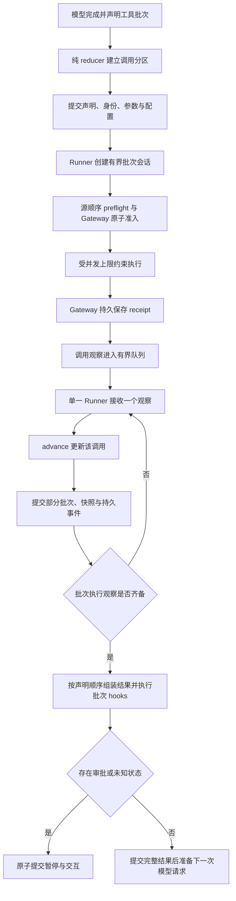
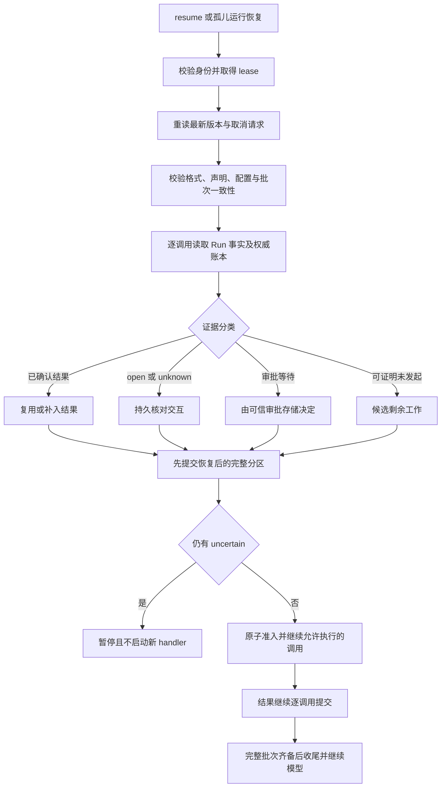

# 逐工具结算与恢复实施计划（DeepSeek 接手）

日期：2026-10-16。核对基线：`6270dff`。状态：**方案，待实施**。

本文细化[后续路线图](harness-evolution-roadmap.zh-CN.md)方向二。实现前先核对接手时的代码、适用规范和未提交改动，不覆盖其他工作。本轮只编写计划，没有实现或验证下述新增能力。

编写期间工作树已出现摘要修复相关的 `context` 与 `runtime/default_harness.py` 修改；这些属于并行进行的实现，本计划未验收其结果。下文的基线分析以核对时的 `6270dff` 为准，接手时须重新确认差异，尤其是取消、计量保存和准备回调。

## 1. 交付目标

让一个工具的结果在同批其他工具仍执行时就进入 Core 状态并真实提交；进程重启后，按调用身份、操作账本与审批证据恢复这一批，复用已确认结果，只执行可以证明允许执行的剩余调用。

示例：模型声明 A、B、C 三个调用。A 已完成并提交，B 已发起但结果未知，C 尚未发起。重启后应读到 A 的完整结果，保留 B 的核对问题；B 有业务证据收敛后，继续 C。不能再调用 A，不能把 B 当成没执行过，也不重新请求模型来“猜出”这三个调用。

**逐工具提交不等于模型逐工具继续。** 正常路径仍在完整批次齐备、审批与未知状态均已处理后，把结果按声明顺序交给模型。

本轮交付包含：调用级进度输入、单一 Runner 的增量处理、真实提交、账本只读核对、原子执行准入、部分批次恢复、证据收敛、旧格式兼容和真实进程故障测试。不建设任务队列、subagent、自动补偿、通用工作流或任意外部副作用的“恰好一次”系统。

## 2. 当前实现与缺口

以下来自当前代码核对，表示结构与行为边界，不是本轮新增故障复现报告。

| 当前落点 | 已有能力 | 本轮需要补齐 |
| --- | --- | --- |
| [core/tool_execution.py](../src/yanxu_harness/core/tool_execution.py) | 串行/并行执行、并发上限、逐调用 start/end、源顺序结果消息 | 并行路径 `gather` 完成后才返回整批；需要有界的逐调用进度出口 |
| [core/runner.py](../src/yanxu_harness/core/runner.py) | 单一驱动器；`advance → state_sink → action` | `_run_batch` 只返回一个 `ToolBatchSettled`；等待批次时主驱动器无法提交单个结果 |
| [core/execution.py](../src/yanxu_harness/core/execution.py)、[transitions.py](../src/yanxu_harness/core/transitions.py) | 已有 `BatchCallState`、`model_action_id`、状态 codec 与去重 | 批次分区主要在整批结束时建立；缺少增量观察与身份校验 |
| [runtime/default_harness.py](../src/yanxu_harness/runtime/default_harness.py) | 派发前真实提交；暂停批次与执行快照一致性检查 | `_recover_orphan` 对非终态快照保守暂停；无 recorded batch 时不能继续；恢复调用的进展也需逐项提交 |
| [runtime/batch.py](../src/yanxu_harness/runtime/batch.py) | 完整声明、结果、审批与核对交互、配置指纹 | `record_batch` 面向整批结果，需要从部分执行状态生成一致记录 |
| [tools/gateway.py](../src/yanxu_harness/tools/gateway.py)、[tools/execution.py](../src/yanxu_harness/tools/execution.py) | Gateway 拥有 intent、receipt 和执行契约 | 执行后端协议没有可用于恢复的权威只读核对接口；旧 `begin` 返回值无法区分新准入和已有 open intent |
| [storage/operations.py](../src/yanxu_harness/storage/operations.py) | SQLite intent/receipt、open operation 查询 | `receipt(None)` 不能证明 intent 不存在；需要按单个操作原子核对、准入及受控结算 |

已经实现的 Gateway 逐调用 receipt 要保留。新增 Run 状态只记录调度事实、模型可见结果和账本引用，不能建设第二份副作用真相源。

## 3. 不变量与执行契约

1. 继续只有一个纯 reducer 和一个 Core Runner；reducer 不做 I/O，不读数据库，不访问执行函数。
2. 工具声明、稳定调用身份、恢复所需参数与配置必须在首次派发前提交。
3. 每次调用观察经同一个 `advance → state_sink` 路径处理；提交成功才确认已接纳。提交失败立即停止新派发，不把内存候选状态当成已提交事实。
4. 协程返回不等于副作用成功；`ToolExecutionEnd` 通知不等于 Run 提交；Run lease 不等于外部系统的执行 fencing。
5. `unknown`、open intent、查询失败、缺少恢复能力都不能变成可重试的 `unstarted`。幂等声明不自动豁免这一规则。
6. 同一调用相同事实重复到达无新增动作；同一身份的冲突结果拒绝。旧 attempt 的回调不能更新新 attempt 的 Run；新驱动器可以通过可信账本读取旧 attempt 已产生的有效回执。
7. 结果持久保存可以按完成顺序，最终工具结果消息仍按声明顺序，一项调用只占一个消息位置。
8. 并发上限、串行工具覆盖、参数校验、审批绑定、取消、截断响应和 batch terminate 规则都要有明确测试，不借重构悄悄改变语义。
9. 标准库基础安装和 Python 3.10 保持可用；使用可选协议扩展宿主能力，不能让旧适配器在普通执行路径无故失效。

## 4. 目标执行结构



图中“执行观察齐备”包括等待审批、拒绝和未知等返回状态，不表示所有副作用成功。状态转移不得混淆“执行器已返回”“业务结果已证明”“完整批次可供模型使用”三件事。

### 4.1 Runner 接线建议

推荐将工具执行拆为 Runner 持有的短生命周期批次会话：

- `RunToolBatch` 只创建一次任务集合、并发控制与有界结果通道，接着等待一个进度输入。
- reducer 接收一个调用观察，更新状态，输出“等待下一项进度”的动作；该动作只读取当前会话，不重建或重新启动批次。
- 执行器全部返回后，通过明确的 drained 输入进入批次收尾；再运行现有批次 hooks 并生成 `ToolBatchSettled`。
- 所有输入仍回到 `_drive` 的同一个 `advance / commit` 位置。会话对象、Task、队列、锁不得写入 `ExecutionState`。
- 队列容量、活动任务数与提交确认都要有界；下游存储缓慢时施加背压。partial update 的已有任务列表也应核对，不能因新增通道再引入无界队列。
- 并发创建采用固定 worker 或惰性调度，不能为了限制 handler 并发却一次创建无限数量的等待 Task。批次声明大小本身也受现有请求边界约束。

以上动作名称是建议，最终可按现有命名风格调整。若采用异步迭代器，亦必须做到每个 yield 先经主驱动器提交，再继续接纳进度；不能在执行器回调里另外调用 reducer 或直接写 RunRecord。

`execute_tool_calls(...) -> ToolBatch` 可保留为兼容包装器，收集同一执行引擎的增量结果；不要保留两套长期分叉的串并行实现。

## 5. 身份与状态模型

### 5.1 稳定身份

逻辑调用引用由 `namespace / session_id / run_id / model_action_id / tool_call_id` 组成，批次引用至少绑定同一模型动作。使用结构化编码或有版本的指纹，避免分隔符拼接歧义。

- `attempt_id`、lease/fencing token 表示本次执行权，不加入逻辑操作去重身份。
- `model_action_id` 跨恢复保持稳定，不能因为重建 Runner 重新编号；同一 run 的不同模型动作即使使用相同 tool_call_id，也不能误读上一批回执。
- 默认 Gateway operation_id 必须在派发前可确定并与桥接层实际使用值一致。已有显式 operation_id 保持原值，校验其归属与参数绑定；同一 operation_id 不允许绑定到冲突调用。
- Runner 到 GatewayBindings 的调用上下文必须带上该批次引用，不能让共享控制器上的可变“当前批次”承担身份传递。审批若采用新的逻辑调用引用，同步升级绑定与迁移测试；不能让不同批次因复用 call_id 而意外复用审批。
- 旧记录已写入的 operation_id 不重新生成。旧记录缺失且存在多个可能映射时拒绝猜测。
- 审批绑定与 operation 映射一并核对，不能靠恢复时换 operation_id 绕过原审批或 open intent。

### 5.2 分开调度进度与业务结果

扩展现有 `BatchCallState` / `BatchCall`，不新增同义的业务状态体系。建议字段如下，是否内嵌取决于 codec 的最终版本设计。

| 字段 | 用途 |
| --- | --- |
| batch/model action 引用、声明索引、tool_call_id | 唯一定位、源顺序与跨批次校验 |
| tool 名称、参数及摘要、工具版本、operation_id | 恢复绑定；参数可从已提交 assistant 声明取得，避免双份可变副本 |
| 调度进度：declared / dispatching / observed | 说明驱动器到了哪里，不能单独证明副作用 |
| 现有 `CallOutcome`、gateway status、effect state | 保留 settled / awaiting / uncertain / unstarted 的业务分类 |
| finalized result、receipt/evidence 引用及摘要 | 模型可见结果与可核对来源；成功不能只保存一个不可读取的摘要 |
| 观察标识、内容摘要、来源 attempt | 幂等、冲突检测与旧回调拒绝 |
| 审批绑定、resolution、配置/策略指纹 | 暂停、证据收敛和部署漂移拒绝 |

派发中的调用不是 `replayable`。`pending_work` 要暴露已确认、待审批、待核对和可证明未发起的分区；字段升级时同步公开投影，不能只改内部 codec。

### 5.3 新输入及 reducer 行为

建议用 `ToolCallObserved` 表达单个执行观察：携带调用身份、最终模型结果、状态、receipt 引用与来源；`awaiting` / `unknown` 也可进入这个输入，因此不要把名称或状态等同于副作用成功。

- 校验运行/批次/模型动作/调用/attempt、当前 phase、声明参数与结果归属。
- 同身份同摘要重复输入忽略，不重复提交事件、追加消息或触发模型；异摘要冲突报结构化契约错误。
- 更新调用分区与可持久化结果，不立即把完成顺序的结果追加进 transcript。
- drained 必须证明已接收本会话所有应有观察；不允许缺结果却声称完成，取消导致未发起的调用要有明确分类。
- 批次收尾从已接纳状态生成源顺序结果。最后一个观察本身不直接触发模型；先通过 hooks、暂停判定与最终提交。
- 不允许新旧路径同时把同一结果写两遍。`ToolBatchSettled.results` 与增量状态不一致时拒绝，不能以整批结果覆盖已提交事实。

## 6. 操作账本：权威核对与执行准入

### 6.1 增加可选恢复能力

在 Gateway / backend 边界定义独立的只读恢复能力，由唯一账本所有者实现。恢复代码不能读取任意私有 `_backend` 属性，也不能通过 `invoke` 或 `begin` 假装查询。

单操作核对结果至少区分：

| 观察 | 含义 | 恢复决策 |
| --- | --- | --- |
| absent | 权威账本确认该绑定无 intent | 仅作为可准入候选，仍需原子准入、审批与执行权检查 |
| open | intent 已存在，无可证明 receipt | uncertain，禁止自动再次执行 |
| receipt | 存在回执，含明确 effect state 与身份绑定 | 复用或进入核对；`unknown` receipt 仍为 uncertain |
| unavailable / unsupported | 查询失败或宿主不提供能力 | 保守阻塞并说明原因，不能当 absent |

SQLite 必须用一致读取返回 intent 元数据和 receipt，验证 namespace/session/run/call、工具版本与参数摘要。不能把 `receipt() is None` 作为 absence 证明，也不采用先读全表再猜单个操作状态的实现。

宿主拥有账本时通过适配器提供同等证据；不复制其 intent/approval。仅基础 Core 工具、内存账本或不支持核对的旧适配器，继续可正常使用，但明确不具备本轮的持久自动恢复保证。

### 6.2 原子准入不可省略

只读检查与派发之间有竞争窗口。内置后端应增加可区分以下结果的原子准入能力：新调用已获准、已有 open、已有 receipt、同 ID 绑定冲突。

只有“新调用已获准”者能运行 handler。已有 open 不能返回与新准入相同的信号后再次运行。SQLite 在同一事务中完成插入/读取和绑定检查；跨进程不能依靠内存锁。

旧 `begin(intent) -> receipt | None` 的兼容方式要明确：新增可选协议并让内置 Gateway 优先使用，或进行有版本的 API 升级。自动恢复路径要求强契约；旧宿主缺少强契约时保守暂停，不能悄悄退回旧 `None` 语义。

settle 同样需要幂等和冲突检查：相同回执重交无害；迟到的 unknown/失败不能覆盖已确认成功。可信 reconciliation 的状态提升使用单独的证据校验与版本控制，不能开放任意覆盖。

Run lease 只保证过期 worker 不能提交 Run。外部请求已经发出后仍可能完成；原子准入防止第二个执行者重复启动同一操作，但不代表撤回旧请求。外部系统支持幂等键或 fencing 时沿用该能力，未支持时保持未知边界。

## 7. 持久提交与批次收尾

### 7.1 一个 Run 事务内的一致事实

每个被接纳的调用观察通过现有 `commit_transition` 同时提交：

- 新执行快照与调用分区；
- 与其一致的 `RunRecord.batch`（或该版本明确规定的等价批次投影）；
- 模型可见结果/受控原文引用、receipt 引用、当前 attempt 与版本；
- 对应持久进度事件与 cursor。

建议从同一执行状态构建恢复批次，复用纯转换函数，避免执行快照与 RunBatch 各自更新。原 `pending_suspend` 不能在暂停时用旧整批副本覆盖新调用进展。新格式的部分运行批次与暂停批次都必须通过一致性检查。

Gateway receipt 与 Run 可以处在不同数据库；不声称共享事务。若 receipt 已提交、Run 尚未提交，重启通过权威核对补入结果。若 Run 有结果但账本绑定冲突，保留证据并拒绝，不能随意选择一份。

### 7.2 通知、hooks 与原文

- 保持正常 start/preflight 的源顺序、end 的完成顺序、并行结果消息的源顺序；串行消息顺序保持原契约。
- 既有进度通知可早于 Run 提交，不能当作持久确认。新增持久事件在提交后发布，发布失败用 cursor 重放，不重新执行工具。
- 原始 receipt、可信执行事实与 `after_tool_call` 的展示覆盖区分存放；hook 不能通过改写 details 把 unknown 变成功。
- 调用级 finalized result 已提交后恢复直接复用，不重跑 `after_tool_call`。receipt 已存在但展示 hook 尚未完成的窗口，默认桥接可确定性重建；任意有副作用或不可重放的自定义 hook 无法安全重建时暂停并说明，不盲目再调一次。
- 批次 hooks 沿用 `on_tool_batch_complete → should_suspend_after_batch` 顺序。持久记录已完成的收尾边界；进程死在不可重放的宿主 hook 中间时仍需显式阻塞策略，不承诺任意 hook 恰好一次。
- 大结果沿用已有 artifact 契约，不在本轮另造输出存储。只有内容、归属、完整性与生命周期均可验证的引用才可替代内联原文；压缩后的请求视图不能冒充原始执行证据。

完整批次只追加/替换一次工具结果消息。已有审批 placeholder 按原 tool_call_id 替换，不能重复追加；恢复后重新准备请求视图，旧来源投影不直接继续使用。上下文/摘要的既有运行预算不得因恢复重置。

## 8. 恢复流程与证据收敛



### 8.1 接通真实 orphan 路径

不能仅新增一个批次恢复辅助函数而保留 `_recover_orphan` 一律转人工暂停的接线。对新格式、已提交声明且具备账本恢复能力的 `RUNNING_BATCH` 快照，实际 `resume` 必须能进入上图。

恢复前先领取 lease，再重读记录与取消请求；不要持有旧版本开始派发。配置、工具、策略、可见工具集与审批绑定漂移继续按现有契约拒绝或重新请求有效审批。恢复模型请求窗口、其他 phases 和未知旧快照不属于本轮自动修复范围，保持明确拒绝理由。

新 attempt 复用逻辑调用与 operation_id，仅更新执行权。恢复已有工具批次不新增一次模型 turn；之后的新模型请求继续受原绝对 turn cap 约束。

需要一个受控的“从已校验执行状态继续批次”入口，由同一个 Runner 驱动；可以是内部方法，不必增加公开 Harness API。它加载原 model_action_id、调用分区和剩余任务，只为允许派发的项建立会话。不能把部分 transcript 直接传给现有 `run_agent_loop_continue_result` 来替代批次恢复：该入口会重建执行状态，部分历史还可能以 assistant 结尾，也不能保证保留原动作和调用进度。已暂停审批批次的恢复同样复用这一执行机制，避免继续在 `_resolve_blocking_calls` 内维护另一套长期分叉的工具调度。

### 8.2 各类结果的处理

- 已有完整且可信的 finalized result：直接复用。若需要读 receipt，读取失败不能反过来把已确认结果降为未执行。
- receipt 已确认，但 Run 尚无结果：核对绑定后重建默认桥接结果，并逐调用提交；不调用 handler。
- open 或 unknown：建立对应调用的 reconciliation interaction；缺少证据时一直保持 uncertain。
- awaiting approval：只信任 ApprovalStore；resolution 参数不是授权。审批有效时仍经 Gateway 与相同 operation_id 执行；拒绝则形成可见拒绝结果。
- absent：仅在权威账本完整、稳定 operation_id 已知、旧驱动器无合法 Run 执行权且通过原子准入时才能执行。
- 缺参数、缺身份、版本未知、引用无法读取或绑定冲突：结构化拒绝，保留当前证据，不重新询问模型来重造原调用。

恢复阶段先分类全部调用。存在 uncertain 时，本轮采用保守屏障：先保存已确认事实并暂停，不新增 handler；业务核对完成后再继续。该规则要明确写进恢复文档和兼容测试，不改变正常批次已经获准的并发调度。仅有审批等待时保留现有审批批次的处理规则。

### 8.3 unknown 收敛

本轮必须覆盖有真实 recorded batch 的 `unknown → succeeded/failed` 收敛，而非只把 UI 文本改成成功。

1. 由可信宿主 reconciler 返回绑定到该 operation、参数与调用身份的业务证据；模型文本、调用者的裸 `proven=True` 或普通 resolution 字典不能直接授予权威。
2. 唯一账本所有者记录/确认收敛后的事实与证据引用。内置实现使用受控的版本比较更新；宿主适配器提供等价确认。
3. 将相应 RunBatch、执行快照、结果消息、剩余交互和持久事件原子更新。对 succeeded 与 failed 都有集成测试；失败是已确认结果，不自动重试原操作。
4. 账本先更新、Run 提交前崩溃时，再次恢复可读取已确认结果。旧 unknown 回调不能覆盖证据收敛后的事实。
5. 新终态与同操作不同内容的冲突证据拒绝；重复相同证据幂等。无法证明具体业务输出时保留注明来源的核对结果，不能伪造工具原始输出。

## 9. 取消、失败和 lease 丢失

| 情况 | 必须发生的行为 |
| --- | --- |
| 一个工具正常报错 | 保存该结果；其他工具按既有策略运行；只有原业务分类决定暂停或继续 |
| 运行取消 / 运行期限 | 停止新准入，清理本地任务；保留已确认结果；已发起且无结果者保持 uncertain；不请求下一次模型 |
| 部分结果提交失败 | 停止新派发并传播存储错误；其他已发生效果通过其账本证据恢复，不误报整批完成 |
| lease 过期 / CAS 冲突 | 旧 worker 停止新派发，不越过 fencing 提交；迟到 receipt 留给新 owner 核对 |
| 快照已终态或终态已提交 | 重复回调、恢复不得复活运行；只读证据仍可查询 |
| 无本地驱动器时收到取消 | 沿用持久 cancel request；恢复先处理取消，不能先启动剩余调用 |

Task.cancel、timeout 或断开连接不能证明外部副作用未发生。本地任务清理有界、不遗留继续发布 Run 结果的后台任务；运行终态可以是 cancelled/usage_limited，同时保留未证明操作的证据，不能将所有调用统一涂成 cancelled。

## 10. 崩溃窗口验收表

| 故障注入点 | 新进程应看到什么 | 允许的恢复动作 |
| --- | --- | --- |
| 声明事务提交前 | 未获得工具派发权 | 不执行该批次工具 |
| 声明已提交，准入前 | 完整声明；权威账本 absent | 通过原子准入后执行 |
| intent 已提交，handler 前或 handler 中 | open，无可靠 receipt | uncertain，不自动重跑 |
| receipt 已提交，调用观察提交前 | 账本已确认，Run 可能落后 | 读取回执补入结果，不跑 handler |
| A 观察已提交，B 仍运行 | A 的完整结果和 B 的派发窗口 | 复用 A，按证据处理 B |
| 最后一个观察提交后，批次收尾前 | 完整调用结果，收尾未完成 | 确定性组装；按 hook 重放契约处理 |
| 完整结果提交后，下一模型请求前 | 源顺序结果已在 transcript | 不重复追加；按原预算进入后续请求 |
| reconciliation 已确认，Run 更新前 | 账本新事实可查询 | 补齐 Run，拒绝旧 unknown 覆盖 |
| 持久事务已提交，通知发布前 | 业务事实与事件已在存储 | cursor 重放通知，不重跑工具 |

不使用 `sleep` 猜测故障位置。父子进程通过明确标记或管道握手，在指定持久边界终止子进程；父进程等待退出，以新连接读取 SQLite，再启动全新恢复进程。lease 按受控时钟或到期规则处理，不能在生产逻辑里把死进程 lease 强行当成空闲。

## 11. 兼容、版本与交付顺序

### 11.1 版本策略

- 冻结现有正常执行和审批恢复测试，记录有意改变的恢复屏障行为。
- 持久格式按字段语义升级版本；显式支持旧 execution、RunBatch、operation 记录。旧记录缺调用级进度时按保守规则读取，不能默认全部未发起。
- 有完整旧批次与已记录 operation_id 时保留既有审批恢复。缺失可验证映射的旧 orphan 仍可人工核对，不能宣称全部历史记录自动恢复。
- 未知未来版本拒绝；新记录被旧二进制读取时不能误当旧格式继续执行。SQLite 如需迁移，保留 schema 版本、事务性迁移与升级/拒绝测试。
- 新只读恢复与准入协议通过明确能力声明接入；基础 Core、内存模式和 host ownership 模式各有测试。高级能力不可用时解释原因，不能默默创建第二份账本。

### 11.2 分阶段任务

| 阶段 | 实施内容 | 可独立验收的证据 |
| --- | --- | --- |
| T0：契约与红测 | 顺序、并发、hooks、取消、身份；增加 A 已完成/B 阻塞的缺口测试 | 基线测试表明 A 的部分结果尚未进入真实 Run 存储；既有行为冻结 |
| T1：身份与账本能力 | 稳定调用引用、只读观察、原子准入、幂等结算 | 新/已有 open/已有 receipt/冲突可区分；两个进程同操作最多一个获准执行 |
| T2：Core 增量处理 | 调用输入、纯 reducer、Runner 会话与兼容包装 | B 未结束时 A 观察进入状态；重复/旧事件不触发新动作 |
| T3：真实提交 | 部分 batch 与 execution 一致生成、逐项事务、持久事件 | 独立 SQLite 连接在 B 阻塞时读到 A 结果；提交失败停止新派发 |
| T4：恢复与证据 | 接通 orphan/resume、补齐 receipt、剩余调用、unknown 收敛 | 新进程复用 A；B 未证明不重试；证据收敛后继续 C |
| T5：兼容与集成 | 旧记录、宿主模式、hooks、上下文、取消、lease | 不重置预算、不重复 transcript、不串身份；能力不足明确阻塞 |
| T6：交付 | 真实故障矩阵、完整门禁、示例与文档 | 提交号、命令、真实输出与未支持边界齐全 |

依赖为 `T0 → T1/T2 → T3 → T4 → T5 → T6`。按依赖形成小提交；T1/T2 可分别实现，不要求同时改完整 Harness。摘要取消与预算修复见[专项修复计划](context-summary-fix-plan.zh-CN.md)，它与本轮共用 `default_harness.py` 和取消路径，合入前需整合并通过其回归，不能覆盖或重新引入已知问题。

## 12. 测试矩阵与命令

| 组 | 必须覆盖的场景 |
| --- | --- |
| 纯状态 | 单调用更新、任意完成顺序、重复同事件、同 ID 异内容、未知 call、不同批次/动作/attempt、codec 往返与旧版本 |
| 调度契约 | start/preflight 源顺序、end 完成顺序、结果消息源顺序、串行覆盖、并发上限、所有 terminate 才结束、截断参数不执行 |
| 账本 | absent/open/receipt/unavailable/unsupported、绑定冲突、重复准入、两个进程竞争、重复 settle、冲突 settle、晚到 unknown |
| 部分提交 | A 完成 B 阻塞时新连接读到 A；存储失败；同事务 batch/execution/events 一致；fanout 失败只重放事件 |
| 恢复 | 已提交结果复用；仅 receipt 已提交时补齐；open 不重试；真正 unstarted 执行；恢复后再次中断仍不重复 |
| 审批与证据 | 同 operation 的批准/拒绝/过期/漂移；unknown 成功和失败证据；伪造/冲突/重复证据；账本与 Run 之间崩溃 |
| 取消与租约 | 已完成+进行中+未发起组合；直接取消、Harness.cancel、运行期限、离线取消；旧 lease 晚到；已终态不复活 |
| 身份与预算 | 不同 namespace/session/run 不串；同 run 不同模型动作复用 call_id 不碰撞；新 attempt 不重置 turn/摘要额度 |
| 兼容与结果 | 普通 Core 工具、内存/SQLite/host backend；旧审批 batch、旧 orphan；hook 中途退出；大结果引用和私有字段不外泄 |

优先扩展已有测试；可新增聚焦的 `tests/test_runtime_tool_settlement.py`、`tests/test_runtime_partial_recovery.py` 和纯 reducer 测试文件。这些名称是建议，尚不存在，不是现有验证证据。

实现后先运行现有相关测试与实际新增测试：

```bash
.venv/bin/python -m pytest tests/core tests/test_runtime_resume.py tests/test_runtime_recovery.py tests/test_runtime_commit_boundaries.py tests/test_runtime_execution_snapshot.py tests/test_runtime_isolation.py tests/test_tools_gateway.py tests/test_tools_execution.py tests/test_storage_sqlite.py tests/test_context_durability.py
```

确保真实进程故障测试已被 pytest/既有脚本入口实际发现并运行；仅添加夹具文件不算验收。定向测试通过后运行一次完整本地门禁：

```bash
.venv/bin/python scripts/ci_check.py --offline --wheelhouse build-wheelhouse
```

离线依赖不可用时按仓库流程准备并记录实际方式，不跳过安装产物检查。Python 3.10、其他平台与远程 CI 未执行时如实列出，不能从本机结果推断通过。

## 13. 最终交付要求

新增一个最小跨进程示例或扩展现有示例，演示 A 已完成、B 待核对、C 未发起；恢复后 A 不重跑、B 先经证据收敛、C 执行一次，最终模型只收到一组按声明顺序排列的结果。

交付报告给出实际提交号、接口/格式变化、每个阶段证据、真实故障窗口结果、完整门禁输出、兼容策略与剩余限制。不要用文件数或测试总数代替行为验收。

同步更新 [recovery.md](recovery.md)、[当前架构](current-harness-architecture.zh-CN.md)、[路线图](harness-evolution-roadmap.zh-CN.md) 和 [验证记录](verification.md)；接口变化时同步契约文档。只有实际通过的能力可以改为已实现，尤其不要继续将“所有 unknown 都能自动处理”写成保证。

### 可直接交给 DeepSeek 的任务

> 请按 `docs/per-tool-settlement-recovery-implementation-plan.zh-CN.md` 实施逐工具结算与恢复。先核对当前提交、适用规范、未提交修改与摘要修复进度，再按 T0–T6 分阶段推进。重点接通单调用观察到真实持久提交，以及实际 orphan/resume 的证据恢复路径；内置账本必须区分 absent/open/receipt 并提供原子准入。保持单一 Runner、纯 reducer、Gateway 唯一账本、Python 3.10 和源顺序结果契约。完成真实进程故障测试、旧格式及宿主兼容、unknown 成功/失败证据收敛和完整门禁。提交可运行示例与交付记录，如实说明未支持边界；不要扩展为新的 agent loop、任务编排或通用分布式事务系统。
