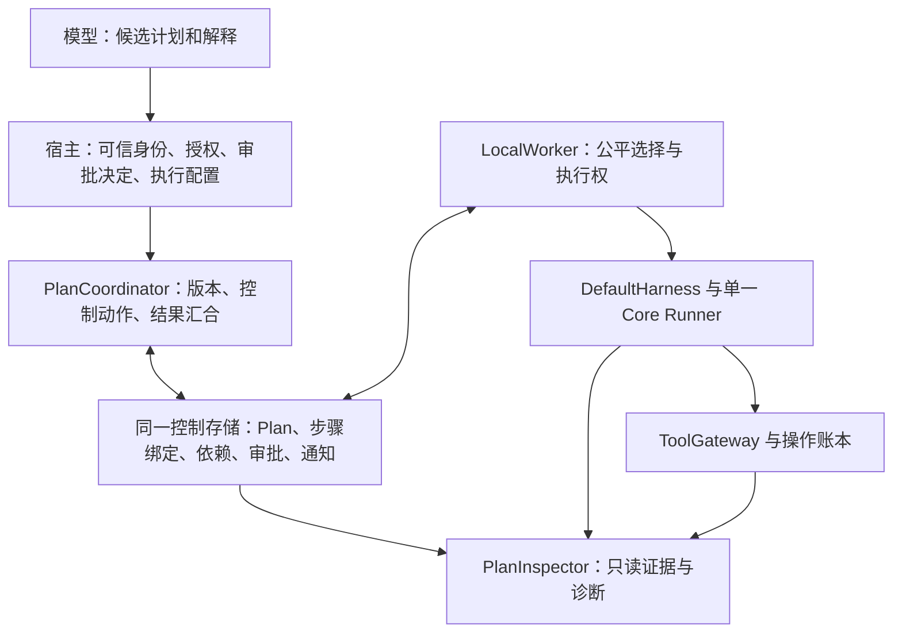

# Harness 下一阶段方案：Plan、任务 DAG 与宿主接入（DeepSeek 执行任务书）

日期：2026-10-21（Asia/Shanghai）。核对基线：仓库 `8b92d50`，包版本 `0.4.0a1`。

**状态：设计与实施任务书，尚未实施。本文新增的类型、接口、文件与行为均为建议契约，不是现有 API。**

本文仅覆盖 `yanxu-harness`。TUI、IDE、Web 界面以及 yanxu code 的产品流程均不在范围内。实施者按阶段交付，每阶段留下真实验证记录，不将整份路线图一次实现，也不因文档列出后续阶段就提前增加其框架。

## 1. 目标与交付边界

### 1.1 要解决的问题

当前 Harness 可以可靠执行和恢复单个 Run，也可以持久接纳、调度和等待 Task。下一步要让宿主能够：

1. 保存带版本的执行计划，并知道用户批准的究竟是哪一版。
2. 将计划中的步骤连接到现有 Task/Run。
3. 由确定性依赖规则决定哪些步骤具备执行条件。
4. 用已提交证据验收步骤，而不是采信模型的完成声明。
5. 在审批等待、任务失败、进程崩溃和重规划后继续解释与控制执行。

首轮目标闭环：

```text
宿主提交候选计划 → 校验 → 审阅 → 批准指定版本
  → 原子领取就绪步骤 → 现有 Worker / Harness / Runner 执行
  → 读取已提交结局 → 验收 → 解锁下游
  → 暂停 / 重规划 / 取消 / 恢复 / 完成
```

### 1.2 五个工作方向与优先级

| 方向 | 已有基础 | 本次补充 | 优先级 |
| --- | --- | --- | --- |
| Plan / Goal 编排 | Task、Run、输入、审批与操作账本 | 版本化 Plan、审批、步骤绑定、重规划 | P0 |
| 任务 DAG | 调度、claim/fencing、父子任务、预算、通知 | 显式依赖、就绪判定、原子准入、验收后推进 | P0 |
| 工具与执行边界 | ToolGateway、策略、精确审批绑定、逐工具恢复 | 通用预览与执行环境声明、宿主策略接线 | P1 |
| 上下文调度 | 请求投影、预算、原文工件、TaskNotes、受限摘要 | 当前步骤上下文装配、带版本事实引用 | P1 |
| 可观测性与开发者体验 | RunInspector、TaskInspector、事件、CLI、示例 | PlanInspector、关联时间线、迁移指南、接入样例 | P0 最小闭环；P1/P2 扩展 |

Goal 首版是 Plan 的目标字段，暂不另建独立的 Goal 状态机、守护进程或自动追目标循环。

### 1.3 本方案不包含

- TUI 布局、审批弹窗、聊天命令、IDE/Web 组件。
- Coding 工具实现、文件扫描器、项目索引器、shell 解释器、生产沙箱或 worktree 生命周期管理。
- 分布式 worker、跨主机租约、远程 subagent 协议、消息中间件。
- 通用工作流 DSL、条件分支、循环、动态插边、跨 Plan DAG、模型自动审批。
- 向量数据库、自动长期记忆抽取、自动读取用户目录、在线价格表。
- 新的模型—工具执行循环或第二份操作账本。

基础安装继续只依赖标准库，保持 Python 3.10+；新能力显式启用，旧单 Run 与旧 Task 调用方式继续可用。

## 2. 实施前必须核对的现有能力

以源码、[公开契约](contract.md)、[任务契约](tasks-contract.zh-CN.md)、[0.4.0a1 发行记录](release-0.4.0a1.zh-CN.md)为当前依据。旧实施计划中的“未开发”属于历史，不作为重复建设的理由。

| 落点 | 当前职责 | 本次处理 |
| --- | --- | --- |
| `core/runner.py`、Core reducer | 单一模型与工具执行路径、持久提交前派发屏障 | 继续复用；不放入 Plan 图、调度队列和审批对象 |
| `runtime/default_harness.py` | Run 生命周期、持久化、恢复与核对 | 继续拥有执行事实；不得由 Plan 状态覆盖 |
| `tasks/types.py`、`tasks/ports.py` | Task、输入、claim、控制存储契约 | 按需扩展可选编排能力，不强迫旧后端实现全部新方法 |
| `tasks/inbox.py` | SQLite / Memory 控制存储，原子输入与 Run 提交 | 复用事务和锁；新增 Plan 控制记录与绑定 |
| `tasks/scheduler.py::LocalWorker` | 有界选择、claim、start/resume、Task 结算 | 接入持久就绪过滤与编排准入；保持公平性和恢复规则 |
| `tasks/children.py` | 父子授权、预算、结果与 join | 保留；依赖边不替代父子关系 |
| `tools/gateway.py`、`tools/policy.py` | 策略、审批、参数/版本/预览绑定、执行账本 | 继续拥有工具操作准入；Plan 批准不绕过 Gateway |
| `context/controller.py`、`context/notes.py` | 请求准备、预算、来源标注、证据引用 | 装配 Plan/步骤材料，避免再建上下文引擎 |
| `diagnostics/reader.py`、`diagnostics/tasks.py` | 只读解释 Run / Task | 增加 Plan 视图、关联索引与覆盖限制 |

开工时先记录工作树、解释器、可选 extras、当前提交及相关测试基线；保护他人改动。仓库存在 `.codegraph/`，理解或定位源码先用 CodeGraph，不能用旧文档推测当前实现。

## 3. 架构与所有权



| 对象 | 权威所有者 | 规则 |
| --- | --- | --- |
| Plan 内容与 revision | 编排控制存储 | 已发布 revision 不可原地改写 |
| Plan 控制状态 | 编排控制存储 | 仅由带前置版本的可信控制操作迁移 |
| Task 调度状态 / claim | 现有控制存储 | 保持现有状态机、fencing 与终态规则 |
| Run 执行状态 | 现有 Harness / Run 存储 | Plan 不复制或伪造 Run 状态 |
| Step 验收结果 | 带来源与版本的验收记录 | 与 Task completed 分开；只引用执行证据 |
| 工具副作用与 unknown | Gateway 及其账本 | Plan 不能提升、清除或覆盖 |
| 用户与宿主权限 | 宿主及既有策略 | 字符串、prompt、profile 名称与模型建议不授予权限 |
| Plan / Task / Run 展示视图 | Inspector / 上下文投影 | 可重建派生物，不成为新的执行权威 |

重要限制：依赖满足仅表示“满足已声明、已验收的前提”，不能承诺计划完整、资源无冲突或业务结论正确。

### 3.1 Plan Mode 与执行模式

Plan Mode 包含两件事：形成候选定义，以及批准后执行。P0 的 PlanCoordinator 不直接调用模型生成计划；宿主可通过现有 Run/Provider 生成结构化候选，再交给 Coordinator 校验。候选也可以由用户或程序直接构造。

- 若宿主提供模型规划 Run，使用宿主装配的受限 profile，只暴露明确允许的查询工具；不因 prompt 写了“只读”就认为安全，也不默认允许任意 shell。
- 规划 Run 自己保留现有 Run、usage、工具账本与恢复规则，可通过 `proposal_run_ref` 关联到 Plan 来源。规划成本与后续 Step 成本分开记录，不虚构共享预算。
- Coordinator 接受的是数据，不执行模型返回的代码、工具名或审批决定。非法候选返回结构化验证错误，由宿主决定是否再问模型；没有隐式无限修复循环。
- 第一轮离线示例至少展示一次固定 Provider 输出候选 → 解析 → 校验 → 审批 → Step 执行；另可展示直接构造定义的最短接入路径。
- 运行 profile 的权限切换由宿主与 Gateway 完成；Plan 状态改变不能把原规划 Run 的工具权限直接升级。

## 4. P0 数据模型

以下名称为建议。P0.0 可以根据现有词汇调整名称，但必须先形成一份字段、状态、拒绝码与事务边界契约，然后再实现。

### 4.1 PlanDefinition：不可变的计划内容

| 字段 | 要求 |
| --- | --- |
| `schema_version` | 独立版本，未知版本明确拒绝 |
| `namespace / session_id / plan_id / revision` | 稳定身份；revision 单调递增 |
| `title / goal` | 简短标题与明确目标，均有非空约束 |
| `constraints` | 有界约束列表；说明是声明性约束还是由哪一宿主策略强制执行 |
| `acceptance_criteria` | Plan 级结构化验收项；首版只支持已注册的确定性/宿主验收器 |
| `steps` | 有界 `StepDefinition` 集合 |
| `execution_envelope` | 宿主选定的 profile/workspace/策略/预算引用与版本；不是授权本身 |
| `risks / expected_changes` | 可选有界描述；预计文件范围默认是预览，除非宿主明确实施路径限制 |
| `created_by / created_at / source` | 来源可为 host/user/model；模型来源不变成可信控制身份 |
| `proposal_run_ref` | 可选的规划 Run 来源引用，不是 Step 的执行绑定 |
| `supersedes_revision / replan_reason` | 新版与旧版关系，初版允许为空 |
| `definition_digest` | 版本化规范化算法的内容摘要 |

规范化规则覆盖所有影响执行、依赖、验收和批准范围的字段；拒绝非 JSON 值、重复键语义、非法数值和超限结构。摘要算法必须命名并版本化，不能依赖 Python `hash()` 或对象 repr。`steps` 按 step_id 规范排序，`depends_on` 按集合语义去重校验并排序；具有语义顺序的其他列表保留顺序。服务端分配的审计时间不参与请求内容摘要，防止同内容重投因时间变化而冲突；批准仍精确绑定身份、revision 与完整执行定义。

revision 与存储 CAS 版本分开：**修改计划内容创建新 revision；执行进度、审批、暂停与控制事件推进 `control_version`。**

draft/reviewing 尚无执行绑定时，可通过带 CAS 的修订操作发布下一 draft revision，并保留旧审阅历史；有执行绑定后必须走第 6.4 节的重规划路径。进入 reviewing 后不能修改当前 revision 的字节内容。

### 4.2 StepDefinition：执行要求与依赖

| 字段 | 要求 |
| --- | --- |
| `step_id / title / instruction` | 当前 revision 内唯一的步骤 ID、标题及执行指令 |
| `depends_on` | 当前 revision 内的步骤 ID 集合；首版仅 `all_accepted` |
| `acceptance_criteria` | 有界验收规则与 verifier 标识/版本，不能只有“模型说完成” |
| `input_refs / required_context_refs` | 宿主可解析的固定材料或依赖输出；不能是任意自动读取路径 |
| `execution_profile_ref / workspace_ref` | 必须在已批准 envelope 内，由宿主解析实际权限与部署 |
| `output_contract` | 预期工件/数据形状，可选；按已支持的小型规则校验，不自建完整 Schema 引擎 |

首版执行粒度：一个需要执行的 Step 绑定一个当前 Task，一个 Task 仍只绑定一个逻辑 Run。重试历史可有多个 TaskBinding，但同一步骤至多一个未结算的活动绑定。模型回合、工具调用不各自生成一个 Task。

Plan 不需要伪造一个“根 Task/根 Run”；预算所有权若依赖现有根任务，需要显式契约适配，不能借虚假的执行身份绕过。

### 4.3 PlanRecord：控制记录

建议字段：身份、`current_revision`、`control_version`、`status`、`reason_code`、`active_approval_ref`、`created_at`、`updated_at`、暂停/取消/重规划请求引用。

不保存所有子 Run 状态的镜像。步骤运行视图通过绑定、Task、Run、验收记录联合读取。可缓存 ready/blocked 结果，但缓存必须可重建、带版本，不能单独授予执行权。

### 4.4 PlanApproval：计划审批

至少绑定：

```text
namespace / plan_id / revision / definition_digest
execution_envelope_digest / approval_policy_version
decision_id / decision / decided_by / decided_at
expires_at（可选）/ reason
```

规则：

- 由宿主验证实际操作者身份和权限，再调用控制 API；不得信任模型提供的 `decided_by`。
- 同一 `decision_id` 同内容重投返回原事实；异内容拒绝。
- 审批历史追加保留，撤销不是删除原批准。
- P0 的一次批准覆盖该 revision 中全部步骤的“新执行准入”；不提供按步骤部分批准或通配未来 revision。
- 计划批准不等于工具审批。ToolGateway 仍独立核对操作参数、目标版本、预览和策略。
- 新步骤准入时批准必须有效；到期/撤销后停止新准入。已获准执行的绑定按第 6 节处理，不能宣称已派发请求被追溯取消。
- 首版无 `auto_continue` 权限总开关。宿主驱动 worker 不需要每个步骤重新批准计划，但工具审批继续按宿主策略执行。
- 同一 revision 到期/撤销后的续批可以在 paused 中追加新的审批事实；只有显式 resume 并核对条件后才重新打开控制门，不把已有执行计划退回无绑定的 draft。

### 4.5 StepTaskBinding 与 AcceptanceRecord

绑定记录包含 `binding_id`、Plan/revision/step 身份、`task_id/run_id`、执行规范摘要、`approval_ref`、准入时 `control_version`、前置验收集合摘要、部署 envelope 摘要、创建时间、历史重试关联。

任务 ID/Run ID 由宿主显式提供或由稳定的版本化身份生成器生成；不能直接用无分隔拼接字符串避免碰撞检查。对同一绑定键同内容重投收敛到原 Task/Run，不重复创建 initial 输入。

验收记录至少包含：

```text
acceptance_id / namespace / plan_id / revision / step_id / binding_id
verifier_id / verifier_version / criterion_digest
result = accepted | rejected | inconclusive
evidence_refs / source_snapshot_digest / decided_by / decided_at / reason_code
```

证据引用要指明所有者、身份、版本/摘要与种类，例如 Run 结局、receipt、测试输出工件、文件版本或宿主验收事实。不可把大输出和整份 receipt 再复制进 Plan 表。

`inconclusive` 不解锁下游。存储/验收器不可用不伪装为业务拒绝；保留未验收状态和结构化错误，可在恢复时重新读取证据。

同一 binding 的 accepted/rejected 是最终验收决定，互相不能覆盖；rejected 后更改工作结果须新建 retry binding 或新 revision。inconclusive 可在材料可读取后重新判定。并发提交相矛盾的验收决定时由 CAS/唯一约束拒绝其中一个，不能用两个不同 acceptance_id 绕过。accepted 证明记录中的特定来源版本，不自动声称共享工作区之后一直不变；下游若要求当前资源版本，需要显式 input/version 前置条件。

## 5. 状态机与步骤视图

### 5.1 Plan 状态

P0 建议状态：`draft / reviewing / approved / executing / paused / replanning / cancelling / completed / failed / cancelled`。

| 从 | 到 | 条件 |
| --- | --- | --- |
| draft | reviewing | 定义、DAG、envelope 和验收规则合法 |
| reviewing | approved | 可信审批绑定当前 revision 与摘要 |
| reviewing | draft | 驳回或撤回；再次修改内容创建新 revision |
| approved | executing | 首个步骤原子准入成功 |
| approved / executing | paused | 宿主暂停、批准失效或确定性阻塞；同时关闭新准入 |
| paused | approved / executing | 等待事实已可靠保存，当前批准有效；按已有绑定判断恢复目标 |
| approved / executing / paused | replanning | 关闭新准入，记录原因与在途集合 |
| replanning | draft | 旧执行已达到第 6 节的静止边界，新 revision 原子发布 |
| approved / executing | completed | 所有步骤 accepted 且 Plan 级验收通过 |
| 非终态（除 cancelling） | cancelling | 记录取消意图，关闭新准入，传播到活动 Task |
| cancelling | cancelled | 活动执行及未知操作已结算，无需继续处理的在途事实 |
| approved / executing / paused / replanning | failed | 已知无法继续，且活动执行/未知操作已结算 |

`completed / failed / cancelled` 为终态，不复活。新请求或终态后的修改创建新 Plan，可引用旧 Plan。取消请求与正常完成竞争时按先提交的有效事实处理；不能抹去已提交完成。取消期间允许按真实结果结束为 completed/failed，但必须有明确原因与完整结算证据。

审批拒绝留在可修订的 draft 并保留审阅记录；不把用户修改意见当执行失败。一般步骤失败先使 Plan 暂停并说明阻塞，宿主可以重试、重规划或结束为 failed，避免过早终态化。

### 5.2 步骤视图

`blocked / ready / running / waiting / awaiting_validation / accepted / rejected / failed / cancelled / superseded` 是用于诊断的步骤视图，不能成为一套独立于 Task 的可写运行状态机。

推导优先级必须固定并测试：历史 revision 标 `superseded` 并可展开原状态；有效 accepted 优先；有活动绑定则读 Task/Run；Task completed 但缺验收则 `awaiting_validation`；未绑定者按当前控制门与依赖得到 ready/blocked。

区分阻塞原因：`plan_unapproved`、`plan_paused`、`approval_expired`、`dependency_pending`、`dependency_rejected`、`dependency_failed`、`evidence_unavailable`、`operation_unknown`、`budget_exhausted`、`deployment_drift` 等。未满足依赖的步骤无需创建一个永远 waiting 的 Task。

## 6. 调度、暂停、取消与重规划的精确定义

### 6.1 谁决定执行顺序

- 纯 DAG 判定决定 ready 集合；只接受已记录的验收事实。
- LocalWorker 在 ready 集合中继续按并发上限、公平性、优先级和 aging 选择。
- 模型可以建议步骤和重规划原因，不能直接设置 ready、approved、accepted 或任务终态。
- 首版依赖仅限同 namespace、同 Plan revision；缺节点、自依赖、重复身份、环和超限图在进入 reviewing 前拒绝。
- `parallel()` 不作为 P0 API；多个步骤同时 ready，且宿主允许并发时自然可以并行。
- 并行就绪不保证共享资源安全。P0 默认串行执行；宿主显式允许并行时负责工作区/业务资源隔离，Harness 不能用 expected_changes 文本证明没有冲突。

**未创建 Task 的 ready 步骤也必须进入选择路径。** 增加有界的 `read_ready_steps` 读能力，产生只含 Plan/revision/step、namespace、priority、ready_since 与版本引用的候选；它不是 Task，也不含虚构 Run。LocalWorker 显式启用编排支持后，将这些候选与既有可恢复 Task 候选合并，使用统一的并发/公平策略选择，再由 `claim_plan_step` 原子创建/领取。

`ready_since` 取使当前步骤满足批准与前置验收条件的持久事实时间，不能每次查询用当前时间重置 aging。候选查询是提示，claim 时必须重判；已有活动绑定不再产生一个可重复创建 Task 的未绑定候选。旧 Worker 没有编排能力时只运行非编排任务。

### 6.2 原子准入与绕过防护

不能采用“Coordinator 内存里判断 ready，然后调用普通 admit/claim”的两步授权。

建议增加可选 `OrchestrationStore` 能力，提供同事务的 `claim_plan_step`：

1. 校验请求幂等键与内容摘要、namespace、预期 revision/control_version。
2. 重读 Plan 控制门、有效审批、envelope、deadline 与所有前置 acceptance。
3. 检查已有绑定、既有 Task/Run、活动 claim、预算准入和取消意图。
4. 幂等创建绑定、Task 和 initial 输入，领取既有 fencing 执行权；同事务保存准入事实和通知。
5. 首次成功准入时将 Plan 从 approved 迁移为 executing。
6. 提交后才允许 Worker 驱动同一个 Harness/Runner。

实现上可将 Task 准入与 claim 拆成存储内部操作，但暴露给调用者的执行准入必须具有上述原子语义，不能在外部 await 之间形成可执行窗口。

普通 `claim_task` / `read_schedulable` 必须识别编排绑定：**不能用旧 Worker 或直接 claim 绕过 Plan 门。** 对新绑定任务，普通 claim 明确拒绝或在同事务转入同一编排校验路径。能力不齐全的 Worker 在驱动前拒绝，不悄悄退化。

这是库的受支持执行路径约束，不是针对任意宿主代码的进程沙箱；宿主直接自行调用工具/Provider 的行为仍由宿主负责。不要据此宣称恶意宿主无法绕过审批。

ready 过滤应在候选分页/limit 前合理执行，或采用有界续扫机制。不能让前 64 个被阻塞节点永久遮住后面的 ready 节点。记录扫描限制与继续位置；不存在 busy-loop。

### 6.3 批准是执行准入，不是瞬时停止远端工作的能力

为避免模糊承诺，P0 明确采用以下边界：

- 一旦 `claim_plan_step` 成功提交，绑定即属于“已准入、可能开始外部执行”的集合；不据此声称工具或模型已经执行。
- pause/revoke/expiry 阻止之后的新步骤准入；已准入工作可按原授权到达已有持久边界或正常结束。
- claim 与 pause/revoke 在同一控制事务序列上竞争：pause 先落定则不准入；claim 先落定则属于在途工作。
- 即使进程在 claim 后、Run 创建前退出，也保留该绑定和准入身份；恢复同一 Task/Run，不生成替代执行来冒充恢复。
- 对已准入绑定的重新领取必须核对同一不可变规范、原批准事实、取消意图和部署基线。不得顺便领取新的步骤。
- 如果批准已到期或被撤销，默认只允许读取、核对和结算；若恢复还需要新的外部派发，先由宿主为同一 revision 记录新的有效批准。不能借“恢复”绕过撤权。
- 控制门关闭后的维护型 reconcile 不能直接调用可能继续派发的普通 `Harness.resume`。需要驱动执行型恢复时，先通过 resume/reapproval 门；取消型恢复必须先应用持久取消意图，只走已有停止与核对路径。读账本、接纳宿主核对证据、结算既有事实与重新派发要在接口上明确区分。
- 需要更快停止时宿主请求取消现有 Task，由既有取消/期限语义处理；不承诺强制终止不协作的 handler 或远端请求。

说明文档必须同时陈述“阻止新准入”与“在途可能继续”，不能用“暂停后零工具调用”这类无法保证的口号。

### 6.4 重规划采用静止边界

P0 不支持两个 revision 同时执行。固定流程：

1. `request_replan` 原子进入 replanning，关闭新准入，记录旧 revision 与活动绑定集合。
2. 给这些 Task 记录取消请求，宿主显式驱动取消/恢复/核对；未派发的可按既有规则结算。
3. 正常完成的工作保留真实完成；失败和取消保留证据；unknown 保持 unknown。
4. 只有所有旧绑定不再可能继续执行，且需核对操作已解决，才能 `publish_revision`。
5. 新 revision 原子成为 current，状态回到 draft，旧审批不自动继承，旧 revision 与所有证据保留。
6. 经过 reviewing/approved 后再执行新版。

候选新版可在静止前保存在宿主侧，但不得提前成为 active，也不能改写旧版 Task 输入。静止不等于“协程取消了”：必须遵守已有 Run 与操作账本的证据语义；没有足够读取/核对能力时返回 blocked/unsupported，而不是猜测已停止。

P0 不自动跨 revision 复用 accepted 步骤。旧证据可作为新版输入引用，但新版是否免执行需要 P1 单独设计“同规范、同资源版本、重新验收、显式来源绑定”的复用契约。这样避免首版实现隐式跳过工作。

### 6.5 重试、恢复和业务失败

- 崩溃恢复：同一 Task、同一 Run、同一绑定，attempt/fence 更新；沿用现有预算和 unknown 核对。
- 已终态 Task 的业务重试：宿主显式调用 `retry_step`，创建新 Task/Run 与绑定，保留 `retries_binding_id`，不得复活旧 Task。
- 重试必须核对批准、Plan 门、规范不变、前置验收仍适用以及预算；若改变指令/依赖/envelope，走新 revision。
- P0 不自动无限重试。`max_step_executions`、deadline 等必须有硬边界；每次重试计入。
- 前置 failed/rejected/cancelled/usage_limited 时后继保持 blocked；不把它们错误标为自身执行失败，也不默认忽略失败继续。

## 7. 完成与验收

### 7.1 Task completed 不等于 Step accepted

例如工具成功执行了一条测试命令，但退出码是 1：工具 receipt 可能证明“命令执行完成”，不能证明“测试通过”。模型最后说“已经修好”同样不是验收证据。

P0 的 Step 接受条件：

1. 当前绑定对应的 Task 与真实 Run 已正常完成，引用匹配 namespace/Plan/revision/step。
2. 该步骤相关的不确定操作均已按现有恢复规则结算。
3. 必需 evidence 可读取、摘要/版本匹配、输出契约满足。
4. 已注册 verifier 对当前 criteria 与证据快照给出 accepted。
5. `record_acceptance` 提交时重新校验绑定、来源版本/摘要和未被替代的验收基线。

首版 verifier 允许：结构化字段断言、工件摘要/存在性校验、宿主确认结果。测试执行应是正常的受控 Task/工具操作；verifier 只读取结果，不偷偷运行 shell 或发起未计费模型请求。

所有 verifier 都有身份/版本、时间/输入大小上限、取消传播；外部证据读取失败给 inconclusive。验证期间不能持有 SQLite 写事务跨网络 await：先读证据快照，再在短事务中核对本地权威版本与快照摘要；外部数据由宿主提供不可变版本/验证凭证，无法提供则不承诺强一致的“当前文件正确”。

### 7.2 Plan 完成条件

所有当前 revision 的步骤 accepted，Plan 级 criteria 通过，且无未结算执行/unknown，才提交 completed。条件相同的重复 finalize 返回原结果；完成通知与终态同事务保存。

P0 不实现 optional/skipped/any-success 等多义依赖；如果不需要某一步，重规划删除它。

## 8. 持久化、事务与恢复

### 8.1 存储布局

在现有控制存储上实现可选编排扩展。建议逻辑记录：

| 记录 | 关键约束 |
| --- | --- |
| `plans` | Plan 身份唯一，current revision 与 control_version |
| `plan_revisions` | `(namespace, plan_id, revision)` 唯一，定义不可变 |
| `plan_steps / plan_edges` | 当前 revision 内节点/边唯一，边有反向查询索引 |
| `plan_approvals` | 决定 ID 幂等，绑定摘要，历史追加 |
| `step_bindings` | Task 绑定唯一；同 step 至多一个未结算活动绑定 |
| `step_acceptances` | 验收 ID 幂等，证据与 verifier 基线不可变 |
| `plan_events / control outbox` | 控制变化与可靠通知，同事务写入 |
| `plan_limits / reservations` | 若采用独立记录，必须与准入同事务扣减/预留 |

这些是逻辑表建议，不要求机械增加全部物理表；可复用既有 outbox/事件结构，但身份、版本、查询和原子性必须成立。优先同一 `SqliteControlStore` 连接/事务；Memory 实现同一临界区，并声明 volatile。

禁止单独 Plan SQLite 数据库加上外部 Task 数据库的假原子双写。非同库宿主必须提供具有同等语义的端口；不具备时显式拒绝启用持久编排。

### 8.2 原子操作清单

| 操作 | 必须一起提交 |
| --- | --- |
| create / publish revision | 定义、节点边、current 指针、控制版本、事件 |
| review / approve / revoke / pause | 审批或控制事实、门状态、版本、事件 |
| claim step | 当前版本/批准/依赖重读、绑定、Task+initial 输入、claim/fence、额度准入、通知 |
| accept step | 验收事实、下游推进通知、控制事件 |
| request replan / cancel | 门关闭、请求事实、目标绑定集合、可靠取消通知 |
| finalize | 完成条件重读、Plan 终态、完成通知 |

已有 Task 终态与 Plan 验收不要求改为一笔跨操作账本的事务。允许 Task 完成后 Plan 暂未验收；依靠持久绑定、可靠通知和有界 reconciliation 收敛，窗口内下游保持 blocked。接受事实与其下游通知则必须原子。

### 8.3 outbox 与有界修复

- 进程内 callback 仅作加速，不是唯一推进通道。
- 宿主显式调用 `reconcile(limit, cursor)` / `drain_outbox(limit)`；无隐式后台线程。
- 重投按稳定事件/通知 ID 去重；消费成功后才确认。
- 即使通知丢失或旧部署未发送，reconcile 也能从持久绑定发现已完成 Task，并补验收/通知。
- 分页 cursor 必须基于实际扫描顺序；稀疏 namespace、空页、扫描上限、继续位置明确返回。
- 写事务失败不触发后续外部派发；提交后、回复前崩溃的重投返回原记录。

### 8.4 格式与兼容

- Plan schema、控制存储 schema、诊断 schema 分别版本化；不为 Plan 无故升级 Core ExecutionState schema。
- 旧库无 Plan 记录时旧功能照常；新功能启用时执行显式、可验证的扩展迁移。
- 新增数据所需版本高于当前实现时拒绝，不凭缺字段填默认后宣称兼容。
- 只读模式不建表、不迁移、不创建不存在的库；缺编排 schema 返回 unsupported。
- 原单 Run / Task / MCP / extension API、导入边界、标准库基础包维持回归。
- downgrade 不承诺；记录读取/拒绝策略，不尝试用旧版“忽略新表”证明可安全继续新计划。

### 8.5 预算与期限

P0 必须保证：Plan 的 `max_steps`、`max_step_executions`、绝对 deadline、宿主允许并发、每 Task 的既有预算。重试不能重置次数，恢复不能刷新 deadline，零额度不是无限额。

限额应有可覆盖的保守默认值。建议起点：最多 128 steps、1024 edges、256 KiB 定义、每节点最多 64 项 criteria、结构深度 32、每 Plan 最多 256 次 Step 新执行；零 `max_step_executions` 合法且不准入。最终值在 P0.0 明确并测试，输入计量以实际 UTF-8 字节/节点数为准，不用字符数冒充字节。

不要把多个独立 Step Task 的 `root_task_id` 随意设成一个不存在的根来复用预算。如果要在 P0 声称 Plan 级共享 tokens/cost/dispatches 硬预算，必须先扩展现有 reservation 的合法所有权，并实现同事务预留/幂等结算与 unknown 保留；否则明确仅支持上述 P0 限额，把共享动态开销预算列入 P1，绝不显示成已强制实施。

## 9. 建议 API 与代码落点

### 9.1 宿主公共接口草案

```python
# 以下是待实现的接口形状，不是可直接运行的现有示例。
coordinator = PlanCoordinator(store=control, verifier=verifier, host_policy=policy)

await coordinator.create(definition, request_id="create-1", principal=trusted_actor)
await coordinator.request_review(plan_ref, expected_version=1, principal=trusted_actor)
await coordinator.approve(approval, expected_version=2, principal=trusted_actor)

# Worker 使用编排能力执行就绪绑定，仍驱动现有 DefaultHarness。
await worker.run_once()

# 读取真实 Task/Run 结局，验收并补齐可靠通知；宿主决定调用时机。
await coordinator.reconcile(plan_ref, limit=100)

await coordinator.pause(plan_ref, request_id="pause-1", expected_version=v,
                        principal=trusted_actor)
await coordinator.request_replan(plan_ref, reason="requirements changed",
                                request_id="replan-1", expected_version=v2,
                                principal=trusted_actor)
# publish_revision 只有达到静止边界后才能成功。
```

实际 API 可按既有风格调整，但所有变更型控制动作须有可信主体、稳定幂等键与版本前置条件。命名中的 plan_ref 应显式包含 namespace 和 plan_id，不能仅凭 session 越权定位。

审批决策、取消、验收与发布新版不得注册成模型可随意调用的普通工具；需要模型入口时仅暴露 `propose_plan` / `suggest_replan` 类候选接口，由宿主控制面处理。

### 9.2 新增模块建议

```text
src/yanxu_harness/plans/
  __init__.py       # 小型、显式公开表面
  types.py          # 不可变定义、引用、状态、审批、验收
  graph.py          # 纯 DAG 校验和依赖判定
  decisions.py      # 纯控制决策/状态迁移
  ports.py          # 可选存储、验收与宿主策略能力
  coordinator.py   # 有界控制编排；不包含模型—工具循环
  codec.py          # 版本化持久映射与规范化摘要

src/yanxu_harness/diagnostics/plans.py
tests/test_plans_contract.py
tests/test_plans_store.py
tests/test_plans_scheduler.py
tests/test_plans_acceptance.py
tests/test_plans_replanning.py
tests/test_plans_recovery.py
tests/test_diagnostics_plans.py
examples/15_plan_dag.py
examples/16_plan_recovery.py
```

存储扩展可放 `plans/storage.py` 或既有控制存储的内部实现模块，避免继续把所有逻辑堆进 `tasks/inbox.py`。若抽取现有代码，先冻结行为测试，纯移动与行为修改分开提交。文件名按开工时现状选取，不为凑结构生成无消费者接口。

## 10. P1 工具策略与执行环境

### 10.1 保持机制与宿主策略分离

Harness 提供分类、预览、绑定校验与拒绝理由；宿主决定哪些操作可自动执行、哪些须人工审批。不能内置“read 永远安全”或“write/exec 一律逐次人工审批”。读取也可能涉及受限数据，执行也可能已有明确预授权。

优先复用现有 ToolDefinition/ToolIntent/ApprovalBinding 的语义，先列差异再决定是否增加字段，避免两套 effect/risk 分类。

### 10.2 预览、目标版本与执行约束

- 统一有界预览结构：目标资源引用、旧/新版本或摘要、变更类型、摘要文本、大 diff 工件引用。
- 审批绑定 preview hash、validated args hash、目标版本和 policy/deployment 版本；漂移后重新审批或拒绝。
- expected_changes 预览与强制资源范围分开：若宿主支持限制，执行时由后端核对真实路径/资源，不能只比模型描述。
- 工作区引用由宿主解析真实工作区；记录提供者、稳定引用、版本、隔离能力与生命周期所有者，不记录凭据。
- 不自动创建/删除分支或 worktree。宿主可以提供 `WorkspaceProvider` 适配器，但其具体执行实现属于宿主仓库。
- 通用命令策略接口若确有消费者，再接受结构化 argv/cwd/env 引用与审批元数据；不要在 Harness 中解析任意 shell 字符串。
- 不硬编码 pytest/ruff 为安全命令，也不把命令白名单称为沙箱。执行环境能力由后端声明，缺失能力明确标 unsupported。

### 10.3 Plan 与运行授权的衔接

宿主装配时将已批准 envelope 与实际 principal、tool visibility、policy、workspace 和 deployment fingerprints 对照。不接受模型生成的 profile 名称直接转成权限。恢复沿用已有 arrangement 漂移拒绝，不能用当前配置回填历史基线。

交付标准：变更预览与目标漂移能够在真实 Gateway 路径阻止 handler；缺执行隔离只如实报告；原有 receipt/unknown 恢复行为不变。

## 11. P1 上下文调度与事实引用

### 11.1 三类信息与已有能力衔接

| 信息 | 本次做法 |
| --- | --- |
| 当前执行材料 | 当前 Step 指令、必要用户约束、依赖的 accepted 输出、当前 Run 对话/工具结果 |
| 任务材料 | 当前 Plan/revision、验收项、已接受步骤引用、失败/重试原因、有界阻塞列表 |
| 长期材料 | 宿主显式提供的项目事实/用户偏好引用，带作用域、来源与有效版本 |

复用 ContextController、TaskNotes、ArtifactStore；完整 transcript 保留，不将 Plan 摘要覆盖原历史。Plan/Step projection 是派生视图，不授予审批或完成事实。

### 11.2 首版事实模型

如果接入需求确认需要持久事实，可增加小型 `ContextFact`：`fact_id`、namespace/project scope、kind、content/artifact_ref、source、source_version/fingerprint、observed_at、validity、evidence_refs、supersedes_ref。

规则：宿主规范、用户偏好、模型推断分别标源；模型推断默认 unverified；没有资源版本不能自动宣称当前事实；事实存储不包含 secret；查询按 scope 严格隔离，且数量/字节有界。

Harness 不负责扫描仓库生成事实库。入口文件、测试命令、禁改模块由宿主提供，用户约束如何成为强制策略由宿主实现。历史命令被保存为事实也不自动获得执行许可。

### 11.3 选择与请求接线

- 当前 Step 的目标、必要约束和验收项属于强制材料，放不下时结构化预算拒绝。
- 依赖结果优先使用有版本的摘要与原文引用，原文是否可读取、是否过期需要有界解析。
- 仅注入当前步骤所需材料，避免每个 Step 塞入全 Plan 历史与所有 diff。
- 每次请求保存材料 manifest：来源、版本、保留/丢弃理由、Plan revision、step/binding、预算事实。
- 在真实 Provider 请求路径验证实际发送内容，不止测试字符串 render。
- 摘要调用沿用现有预算与取消规则；重新投影不得刷新摘要额度。

跨 revision 已完成步骤复用单独交付：规范摘要相同、输入/资源版本相同、证据可解析、重新验收、明确 carry-forward 来源，缺一不可。默认仍重新执行。

## 12. P0 最小诊断与 P2 关联时间线

### 12.1 P0 必须提供 PlanInspector

只读 API 至少返回：Plan 当前版本/控制状态、审批覆盖范围、各 Step 的 Task/Run/验收引用、依赖与阻塞原因、活动 claim/attempt、预算限制、最近控制事件、unknown/unsupported/inconsistent 覆盖限制。

输出 JSON 与 Markdown，复用现有诊断风格。只读路径不得创建或迁移存储，不得读取原始凭据、环境变量或无授权的大输出。

控制事件与状态同事务提交，至少覆盖：created、review_requested、approval_decided/revoked、step_admitted、acceptance_recorded、pause_requested、replan_requested/revision_published、cancel_requested、finalized。事件名最终按仓库现有词汇冻结，不建立同义重复事件。

### 12.2 P2 时间线

通过引用关联 Plan、Task、Run、model request instance、operation、approval、acceptance。Plan 状态事件与 Run 执行事件保持各自权威来源，不复制全部 prompt/输出。

必须处理跨库存储没有统一全序的事实：保留各 source cursor，提供确定的显示顺序与明确的因果引用；墙钟排序只是显示，不当成真实全局执行顺序。分页使用固定读取水位/源 cursor 向量，保证重读不跳项、不重复计量；报告扫描上限与覆盖缺口。

“回放”指重建执行记录和证据视图，**不会重新执行工具、重发模型请求或恢复历史权限**。

### 12.3 根因视图

先给确定性类别：plan_validation、dependency_blocked、approval_required/denied、deployment_drift、tool_failed、operation_unknown、provider_failed、context_budget、storage_conflict、cancelled、acceptance_rejected、evidence_unavailable。

“模型幻觉”“计划不合理”属于分析推断，必须另标 inferred、引用证据和推断来源，不能写成已经证明的底层原因。没有价格表/usage 不填费用 0。

## 13. 开发者体验与文档交付

不增加一个同时包办 ask_user/read/write/exec 的巨大 Host 基类。复用现有策略、Provider、Gateway、Persistence 等能力端口，明确各端口所有者。`ask_user` 的展示与回传属于宿主；Harness 保存待处理问题/审批事实与恢复引用。

必须交付：

1. **最小接入页**：约 30 行表达 Plan 定义、可信批准、worker 驱动、读取结果；明确依赖的示例装配代码，不把隐藏的几百行配置宣传成完整 30 行实现。
2. **完整离线示例**：标准库、固定 Provider、真实 Gateway/SQLite；不要求账号、API Key 或 yanxu code 包。
3. **跨进程恢复示例**：子进程在可控窗口退出，新进程展示相同 Task/Run、原审批、receipt/unknown 与下游推进。
4. **接入指南**：分别解释候选计划、可信控制、审批、验收、恢复、暂停边界和宿主职责。
5. **迁移对照**：普通 agent loop → 单 Run Harness → 持久 Task → 可选 Plan/DAG；可逐层采用，不强制全栈迁移。
6. **API/适配器合同**：共享 contract suite 同时验证 Memory 与 SQLite，并说明自有存储缺什么能力会被拒绝。

示例使用中性的“读取资料 → 生成变更 → 验证结果”或临时目录文件流程，不引入金融/小说/coding 产品专属策略。文件变更与命令本身通过显式示例宿主工具提供。

## 14. DeepSeek 分阶段任务单

每阶段独立提交、更新进度、列真实命令和结果。P0.0–P0.6 为第一轮必须完成；P1/P2 是后续排期，不在第一轮顺手搭空壳。

| 阶段 | 工作与主要落点 | 出口条件 |
| --- | --- | --- |
| P0.0 契约冻结 | 核对代码；记录现有行为；完成 Plan/Step/Approval/Acceptance 字段、状态迁移、拒绝码、预算边界与事务表 | 所有新行为能映射到验收项；没有未决定的权限/恢复语义 |
| P0.1 纯模型与 DAG | plans/types、graph、decisions、codec；规范化、图上限、拓扑与就绪判定 | 非法图/版本/内容被拒绝；确定性测试通过；无 I/O |
| P0.2 控制存储 | 可选能力端口；Memory/SQLite；幂等、CAS、迁移、只读、outbox | 双后端共享合同；两连接竞争；存储失败零派发 |
| P0.3 调度接线 | 未绑定 ready 候选与恢复 Task 合并；原子编排准入；旧 claim 绕过防护；预算 | 真实 Harness 链式/分叉/join；原调度公平性与恢复回归通过 |
| P0.4 验收与完成 | verifier、快照核对、下游通知、Plan finalize、显式重试 | Task completed 不能自行解锁；拒绝/不可读证据正确阻塞 |
| P0.5 暂停/重规划/恢复 | 批准失效、在途边界、静止发布、取消、reconcile、跨进程故障窗口 | 两个 revision 不同时执行；unknown 不被跳过；不重复已确认操作 |
| P0.6 诊断/示例/交付 | PlanInspector、两个示例、接入文档、兼容与安装门禁、验收报告 | P0 验收矩阵完成；完整套件与树外安装通过；未测项明确列出 |
| P1.1 工具边界 | 预览规范、宿主策略/工作区声明、真实 Gateway 漂移拒绝 | 无产品命令白名单；精确审批与执行环境事实可核对 |
| P1.2 上下文调度 | Step projection、宿主事实引用、必要材料预算、显式复用契约 | wire 层验证；来源/过期/作用域/预算回归通过 |
| P1.3 接入优化 | 最小装配、迁移文档、宿主适配 contract suite、共享开销预算（若确需） | 新宿主不依赖产品代码；预算的支持范围如实声明 |
| P2 关联诊断 | 跨源时间线、证据导航、分类与安全回放 | 无漏项分页、因果范围明确、诊断零外部执行 |

第一轮不自行决定发布版本或上传 PyPI；完成源码、文档与验证即可形成可审查候选。若维护者后续决定发版，再按现有发布流程执行，不改写 0.4.0a1 的历史验证记录。

## 15. P0 验收矩阵

实现者创建 `tests/test_plans_acceptance_matrix.py` 或等价清单，使下面每项都能定位到真实测试。表内全部是待验收目标，不是已通过结果。

| ID | 场景 | 必须观察到 |
| --- | --- | --- |
| PA01 | 空目标、重复 Step、缺依赖、自依赖、环、超限 DAG | 审阅前拒绝，无 Task/Run/外部派发 |
| PA02 | 图定义、步骤列表或依赖输入顺序变化 | 语义相同的规范化摘要稳定；有语义变化摘要不同 |
| PA03 | 未批准 / 批准过期 / 已撤销的新步骤 | 原子准入失败，模型和工具调用均为 0 |
| PA04 | 更改指令、依赖、验收项、profile/workspace/策略版本 | 旧批准不适用于新规范，不回填当前配置 |
| PA05 | 模型提交伪造批准/验收/取消主体 | 不能成为可信控制事实 |
| PA06 | A → B → C | 仅前置 accepted 后后继才可准入 |
| PA07 | A→B、A→C、B→D、C→D | B/C 可就绪；D 等两者 accepted；并发仍受宿主限额 |
| PA08 | A Task completed 但缺验收 / 验收 rejected / inconclusive | B 不执行；诊断能区分原因 |
| PA09 | 测试工具 receipt succeeded，但退出码非零 | “测试通过”验收失败，不错误解锁 |
| PA10 | 错 namespace / Plan / revision / binding 的 receipt 或 Run 引用 | 拒绝验收，不能跨作用域消费证据 |
| PA11 | 验收期间来源发生版本变化、证据缺失或损坏 | CAS/摘要校验拒绝或 inconclusive，下游零派发 |
| PA12 | 同 create/approve/claim/accept/finalize 请求重投 | 返回原事实，不增加 Task、Run、initial 输入或通知效果 |
| PA13 | 同幂等键不同内容 | 明确 content_conflict，原记录不覆盖 |
| PA14 | 两连接/两 worker 同时领取同一步骤 | 恰好一个准入身份与有效 claim，另一方明确冲突/持有中 |
| PA15 | 普通旧 claim_task / 旧 Worker 尝试驱动绑定任务 | 无法绕过 Plan 批准/依赖门 |
| PA16 | 大量 blocked 节点在候选页前方 | 后续 ready 节点仍可在有界续扫中被找到；不忙等 |
| PA17 | claim 与 pause/revoke 竞争 | 事务顺序决定是否属于在途；没有“检查通过后无记录派发” |
| PA18 | pause 后已有 Task 完成 | 真实结局保存；后继不新准入；恢复需满足当前批准 |
| PA19 | claim 后、Run 创建前进程退出 | 重启仍用原 Task/Run/绑定，不双建、不丢准入身份 |
| PA20 | Run 终态已提交、Task/Plan 尚未推进即退出 | 重启读取真实结局，幂等结算与验收 |
| PA21 | acceptance 已提交、通知尚未消费即退出 | 下游最终可执行且仅一次绑定，不重复验收副作用 |
| PA22 | 工具副作用后、receipt/Run 结果保存前退出 | 沿用账本核对，unknown 阻塞，不能重复盲跑 |
| PA23 | request_replan 与旧步骤 claim/完成竞争 | 新门关闭后无新绑定；已准入旧结果保留；静止前不能发布新版 |
| PA24 | 旧版有不协作任务或 unknown | 保持 replanning/cancelling 并给出原因，不伪造已静止 |
| PA25 | 新 revision 发布、审批、执行 | 旧批准不适用；旧历史可读；无旧新同时执行 |
| PA26 | 旧 callback / 迟到通知 / 旧 fence / 旧 control_version | 无法覆盖新版或复活终态 |
| PA27 | 已终态 Task 的显式 retry | 新 Task/Run/绑定，旧历史保留；次数和预算不刷新 |
| PA28 | max_step_executions=0、deadline 到期、恢复后的已用额度 | 零准入或明确限额；不把 0 当无限，不重置 |
| PA29 | Plan cancel 与步骤完成竞争 | 保留真实副作用和结局；未结算在途存在时不虚报 cancelled |
| PA30 | 事务在绑定/输入/通知/接受写入处失败 | 原子回滚，后续模型/工具调用 0；可安全重投 |
| PA31 | outbox 重投、丢 callback、空页、稀疏 namespace、扫描限制 | 有界 reconcile 收敛；cursor 不跳项、不丢待处理项 |
| PA32 | 未知 schema / 旧库无 Plan schema / 不完整能力后端 | 清晰拒绝或 unsupported；旧非编排路径正常 |
| PA33 | read_only 诊断打开旧库或不存在的路径 | 不创建库、不迁移；覆盖限制明确 |
| PA34 | Plan 终态、缺验收、Plan 级 criteria 未通过 | 只在完整满足条件时 completed；终态不复活 |
| PA35 | 原 Task/Run/MCP/extensions/context/恢复套件 | 行为和 import fence 无回归 |
| PA36 | Python 3.10 与 wheel/sdist 树外环境 | 新公开 API、离线示例与存储合同可运行，无新增基础依赖 |
| PA37 | 所有步骤尚无 Task；同时有普通任务与 ready Plan 步骤 | Worker 能发现并驱动 Plan，且 namespace 公平/aging 不退化 |
| PA38 | 规划 Run 输出非法候选或尝试调用未授权写工具 | 候选不进入批准；Gateway 阻止写 handler；无隐式自动重试/执行 |
| PA39 | 暂停/撤权后维护型 reconcile 与执行型 resume | 维护不新增派发；同 revision 续批并显式恢复后才执行恢复 |
| PA40 | 同一 binding 并发 accepted/rejected；已 accepted 后晚到 rejected | 最终决定唯一且不被覆盖，下游不因迟到结果重复准入 |

故障测试优先复用 `tests/child_process.py`、现有 SQLite/loopback/账本夹具。并发测试用屏障/事件控制窗口，不能用固定 sleep 假定某阶段已经完成。真实子进程故障至少覆盖 PA19–PA22，不能全部替换成 monkeypatch 抛异常。

P1/P2 新增验收：preview/target/policy 漂移零 handler；事实过期/越界不注入；必要材料超限零请求；实际 wire 内容含正确 Plan/step manifest；共享 usage 不重复计费；跨源时间线有水位、分页完整；报告回放零模型/工具执行。

## 16. 验证、交付物与完成定义

### 16.1 验证顺序

遵守 [CONTRIBUTING](../CONTRIBUTING.md)：行为变化先观察相应失败用例，再实现最小变更。顺序如下：

1. 本阶段聚焦合同与故障窗口测试。
2. 触及 Task 调度/输入/预算/父子/恢复的相邻测试。
3. P0 收尾运行完整套件及仓库现有离线 CI / wheel / sdist 门禁。
4. 触及 MCP/extensions 时安装相应 extras 并实跑，不能用缺 extra 的 skip 证明通过。
5. 最低 Python 3.10 与当前主测解释器实跑；未能执行的平台如实列为未验证。

参考命令（开工时核对当前脚本参数与环境，不盲目照抄历史命令）：

```sh
.venv/bin/python -m pytest -q tests/test_plans_contract.py tests/test_plans_store.py
.venv/bin/python -m pytest -q tests/test_plans_scheduler.py tests/test_plans_acceptance.py
.venv/bin/python -m pytest -q tests/test_plans_replanning.py tests/test_plans_recovery.py tests/test_diagnostics_plans.py
.venv/bin/python -m pytest -q tests
.venv/bin/python scripts/ci_check.py --prepare-wheelhouse build-wheelhouse
.venv/bin/python scripts/ci_check.py --offline --wheelhouse build-wheelhouse
```

测试文件在相应阶段创建后再执行。本文编写阶段没有运行上述实施测试，也没有新增 runtime 行为。

### 16.2 DeepSeek 必须留下的交付物

- `docs/plans-contract.zh-CN.md`：最终字段、状态、审批、依赖、恢复和事务契约。
- `docs/plans-progress.zh-CN.md`：各阶段状态、提交、真实验证、偏离方案及原因。
- `docs/plans-acceptance-review.zh-CN.md`：PA01–PA40 的测试映射和结果，失败/未测项保留。
- 新能力的源码、Memory/SQLite 共用合同测试、故障窗口测试、两个完整离线示例。
- `docs/contract.md`、适配器指南、文档索引、相关 SNAPSHOT/公开 API 清单按实际实现更新。
- 单独的交付报告：当前提交、解释器/OS/extras、源码与树外安装命令/结果、实际限制、迁移方式。

这些文档随对应实现阶段创建，不在 P0.0 就用空报告宣称交付。没有独立审查者时，验收报告说明由实施者自验，不冒充独立复核。

### 16.3 第一轮完成定义

P0.0–P0.6 完成，PA01–PA40 有证据；批准、DAG、执行、验收、暂停/重规划、跨进程恢复和只读解释形成闭环；旧功能与安装门禁通过；任何未测项和不支持能力清晰列出。只有类型、状态枚举或成功路径示例不构成交付。

## 17. 可直接交给 DeepSeek 的开工指令

> 请按 `docs/plan-dag-harness-implementation-plan.zh-CN.md` 实施第一轮 P0.0–P0.6。先核对当前仓库、AGENTS/RTK（若存在）、CodeGraph 与公开契约，保护工作区已有改动；把本文视为设计目标而非已实现 API。冻结审批版本、Task/Run 所有权、验收、原子准入和重规划静止边界后，逐阶段实现与验证。TUI、yanxu code 产品代码、worktree/沙箱实现、P1/P2 功能不在本轮。必须复用单一 Runner、现有 ToolGateway、控制存储与恢复机制；保持标准库基础包和 Python 3.10+。按阶段提交并记录真实结果，完成 PA01–PA40、完整回归和树外安装验证，最终交付源码、示例、契约、验收映射和限制说明。不要自行上传包、改写历史发行记录或把 unknown 当成功。需要偏离本方案时先记录原因；无法满足的验收项明确保留未完成，不用降低断言或跳过测试替代实现。
