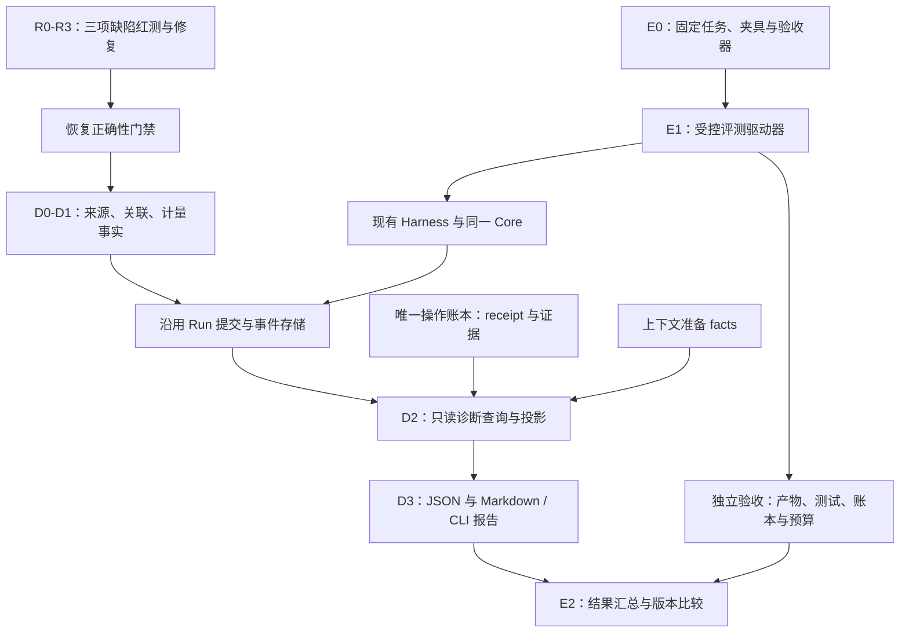

# 下一轮实施计划：恢复缺陷修复、运行诊断与任务评测（DeepSeek 接手）

日期：2026-10-16。核对基线：`2c8a324`。状态：**已实施**（R0–R3、D0–D3、E0–E2；交付报告见 [runtime-diagnostics-evaluation-delivery-report.zh-CN.md](runtime-diagnostics-evaluation-delivery-report.zh-CN.md)，未执行项在该报告 §7 与本文件 §14 逐条登记）。

本计划统一接纳[逐工具结算与恢复验收复核](per-tool-settlement-recovery-acceptance-review.zh-CN.md)中的 PTR-R1、PTR-R2、PTR-R3，以及[四方向路线图](harness-evolution-roadmap.zh-CN.md)方向三。先修正恢复事实，再让诊断准确解释事实，最后用受控任务衡量行为和效果。

接手时重新核对 HEAD、工作树、适用规范与并行改动。若缺陷已被后续提交修复，保留或补齐回归证据，不覆盖已有实现。本文件是任务书，不代表下述模块或接口已经存在。实施完成后的实际接口、提交、命令与结果以交付报告和 [verification.md](verification.md) 为准；本文件保持任务书原貌，只更新状态行。

## 1. 本轮交付与完成标准

| 工作线 | 必须交付的结果 |
| --- | --- |
| R：恢复修复 | 漂移旧配置时拒绝派发；恢复工具受期限与取消控制；已确认失败回执可正常收敛 |
| D：运行诊断 | 只读、带来源与完整性说明的运行报告；串起 attempt、模型动作、工具调用、operation、上下文与停止原因 |
| E：任务评测 | 可复现的本地任务夹具、真实 Harness 驱动、独立验收器、版本化报告及新旧结果比较 |

验收应能回答三个具体问题：

1. 这个运行为什么继续、暂停、拒绝或结束？依据哪条已提交事实？
2. 崩溃恢复时哪些工具已确认、哪些没有执行、哪些仍需业务证据？
3. 一个版本相对另一个版本，在相同任务与配置下，正确性、任务结果、耗时和可确认成本如何变化？

本轮建设本地库接口、命令行和报告，不建设 Web 控制台、远程观测平台、任务调度器、subagent、模型自动调参或完整 Coding Agent 产品。基础安装继续仅依赖标准库，最低 Python 3.10。

## 2. 基线与已有入口

基线独立验收实际结果：专项 **55 passed**，完整套件 **952 passed / 1 skipped**，离线门禁 **6/6 通过**；额外探针仍复现三项缺陷。数字仅描述该次执行，不能直接写成后续提交的验证结果。

| 现有落点 | 可复用能力 | 需要注意的边界 |
| --- | --- | --- |
| [runtime/default_harness.py](../src/yanxu_harness/runtime/default_harness.py) | 生命周期、真实提交、恢复、listener、事件发布 | 恢复工具仍有手工执行分支；三项缺陷的主要落点 |
| [core/runner.py](../src/yanxu_harness/core/runner.py)、[tool_execution.py](../src/yanxu_harness/core/tool_execution.py) | 单一驱动器、有界批次会话、逐调用观察 | 新诊断不能复制控制循环，也不能在 listener 中推进 reducer |
| [runtime/batch.py](../src/yanxu_harness/runtime/batch.py)、[core/execution.py](../src/yanxu_harness/core/execution.py) | 调用分区、模型动作引用、快照与公开 pending_work | 冻结配置来源和旧格式的可信程度需要明确 |
| [events.py](../src/yanxu_harness/events.py)、[runtime/envelope.py](../src/yanxu_harness/runtime/envelope.py) | 事件词汇、公开 payload 校验、身份 envelope | 键名黑名单不等于报告已脱敏；原始文本也可能含私有内容 |
| [storage/ports.py](../src/yanxu_harness/storage/ports.py) | 状态与事件原子提交、全局有序游标 | `StoredEvent` 没有独立 attempt 字段，不能靠当前 Run attempt 猜旧事件归属 |
| [storage/sqlite.py](../src/yanxu_harness/storage/sqlite.py)、[memory.py](../src/yanxu_harness/storage/memory.py) | 参考存储与事件分页 | 通用 `read_events` 按全局 sequence 分页，不是按 run 过滤后的连续列表 |
| [context/controller.py](../src/yanxu_harness/context/controller.py) | 投影、计量、摘要与原文引用事实 | 估算 token、实际 usage、缺失数据和摘要开销应分开 |
| [testing/contract_suite.py](../src/yanxu_harness/testing/contract_suite.py)、[tests/fault_windows.py](../tests/fault_windows.py) | 端口契约、真实子进程故障夹具 | pytest 替身与脚本化任务不构成真实模型能力评测 |

现有 `replay_run_events` 会重新通知 listener，并用当前记录的 attempt 构造 envelope。诊断不能直接调用它充当只读历史查询，也不能据此把历史事件归到最新 attempt。

## 3. 目标结构与顺序



诊断 schema、夹具和纯投影器可以提前编写；R 线没有通过前，不把“运行可正确恢复”作为后续评测的既定前提。评测观察到失败就如实报告，不能把框架错误归为任务未通过后悄悄忽略。

## 4. R0–R3：三项修复先完成

### R0：把已复现缺陷变成红测

沿用[独立复核中的可运行脚本](per-tool-settlement-recovery-acceptance-review.zh-CN.md#6-可运行复现)，将输出检查转换为明确断言，保留基线失败证据：

| 缺陷 | 基线不符合预期 | 修复目标 |
| --- | --- | --- |
| PTR-R1 · P1 | orphan 在 system_prompt 改变后仍运行 C 并 completed | C 与主模型均不调用，明确拒绝旧配置漂移 |
| PTR-R2 · P1 | 0.03 秒期限，恢复 C 等待约 0.16 秒后仍请求模型并 completed | `usage_limited / max_runtime_exceeded`；停止新派发，保留已发生效果的证据 |
| PTR-R3 · P2 | ledger 已 failed、Run 仍 uncertain，缺 reconciler 就卡住 | 读取失败回执，不重问业务证据；完整结果可继续交给模型 |

测试使用事件/管道握手和独立 SQLite 连接定位边界；期限测试采用有余量的独立兜底超时，避免依赖极小 sleep 的调度偶然性。

### R1：冻结原配置，恢复只与旧事实比较

1. 在首次派发工具前保存该批次绑定的配置、工具、指令、policy 和 exposure manifest 指纹。复用既有 Run / execution / batch 的一个权威来源，派生投影不得各自生成基线。
2. `_recover_partial_batch` / `batch_from_snapshot` 从旧持久事实重建，而非传入 `self.fingerprints()` 伪造旧指纹。当前值只用于比较。
3. lease 领取后重读当前记录，重新检查终态、取消请求、身份、快照与批次一致性；不要执行领取前读到的旧快照，也不要通过释放再领取制造不必要的空窗。
4. 相同配置能正常恢复；config、instructions、tools、policy、exposure 各维度变化都有明确拒绝或原契约中的审批过期处理。不得新增“忽略漂移继续”开关作为修复。
5. 旧记录缺少足够基线时明确保守兼容；不能回填当前指纹后宣称校验通过。持久格式改变须版本化并覆盖旧/未来版本读取。

验收覆盖 RUNNING_BATCH orphan 和 SUSPENDED resume；剩余 handler 与主模型都不能先执行后才发现漂移。

### R2：恢复工作进入同一个受限、可取消的驱动任务

1. 从 start、orphan 恢复、审批恢复分别列出所有外部 await，明确本次 invocation 的计时起点；共享一个绝对 deadline，不能每阶段重新获得 `max_runtime_seconds`。
2. 取得执行权后的账本核对、reconciler、剩余工具执行和后续模型均处于既有运行期限与取消控制范围。lease 领取/释放及最终提交有独立有界清理规则；不能为了“全程超时”丢掉最终证据提交。
3. `_resolve_blocking_calls` 不再在 `_run_task` 之前手工执行完剩余工具。将已确认结果、候选和阻塞事实送入同一 Runner 的批次恢复会话，沿用单调用提交、并发/串行、hooks 与取消处理。
4. 已确认项不重跑；未决项保守屏障；正常审批恢复也走共享执行路径。保留 operation_id、模型动作身份、turn cap、摘要预算与原消息位置。
5. 运行结束后清理本地会话与任务；取消/超时不能把可能发生的副作用改成未发起，也不能绕过 lease/CAS 写终态。

必测：C 阻塞时真实期限与 `Harness.cancel`；账本/reconciler 阻塞；恢复 C 完成、D 阻塞期间新连接可读 C 的已提交结果；并发上限、源顺序、回执复用与取消后的晚到结果。

不承诺强制终止拒绝协作取消的任意第三方协程或已发出的外部请求；适配器的超时、协作取消与结果未知契约必须写清楚。

### R3：按业务分类接受已确认失败

修正 `_converged_in_ledger` 只接受成功 status 的分支。复用现有 status → CallOutcome 分类，接纳有证明的终结结果；`UNKNOWN` 与 `DEFERRED` 仍然阻塞。

不要仅靠 `receipt.settled` 判断业务完成，因为现有词汇中的 unknown receipt 也可能已经写入账本。至少分别覆盖：succeeded/failed 在账本提升后、Run 更新前中断；重建实例无 reconciler 仍恢复；有 reconciler 时断言没有重复调用。其他已确认拒绝/取消/参数错误结果沿现有语义处理，不自动重试。

### R 线退出门禁

三项原探针符合目标；已有部分批次、账本、审批、预算、摘要和隔离回归通过。更新独立复核记录时保留修复前事实，新增提交与证据，不把历史复现改写成从未发生。

## 5. D0：诊断契约与事实来源

### 5.1 报告需要串起的身份

| 引用 | 用途 |
| --- | --- |
| namespace / session / run | 运行归属与读取隔离 |
| origin attempt 与观察者 attempt | 谁实际执行，谁后来读取/恢复，二者不可覆盖 |
| model_action_id / batch_ref / tool_call_id | 跨状态定位同一逻辑工作 |
| request_dispatch_id / span_id | 区分真实请求实例、恢复后重新发出的模型请求与其耗时/费用 |
| operation_id / receipt / evidence ref | 核对副作用，不复制第二份操作账本 |
| context source head / projection / artifact ref | 解释模型当时看到哪份有预算的视图 |
| store cursor / run revision / schema version | 判断报告取自哪个一致边界、如何增量续读 |

逻辑模型动作 ID 跨恢复稳定，但重新发出一次请求可能产生新费用；不能只用 model_action_id 去重所有真实请求。工具回执的 replay 不能被记成又执行了一次 handler。

### 5.2 最小诊断对象

建议增加独立 `diagnostics/` 包，名称按项目风格调整：

- `RunDiagnosticReport`：身份、状态/停止原因、当前等待/拒绝、调用分区、轨迹、计量、完整性、读取边界与下一游标。
- `TraceEntry`：类型、稳定引用、来源记录/版本、durable 与否、归属 attempt、可公开的摘要字段。
- `SpanObservation`：阶段、请求实例、开始/结束证据、耗时、是否中断、是否缺失。
- `UsageObservation`：计量单位、actual/estimated/unknown、来源与去重身份。

这些是报告模型，不进入 reducer 的执行决策，不创建新的 RunStatus 或副作用账本。所有对象可稳定序列化且有独立 schema 版本。

### 5.3 来源等级

报告明确区分：已提交的 Run/事件、权威操作回执、当前进程临时观测、派生解释、缺失/冲突/不支持。缺少开始点就不能制造精确耗时，缺 usage 就不能写 0。

旧事件没有原始 attempt 时标记 unknown/legacy；不能使用当前 Run 的 attempt 补成历史事实。新记录在写入时保存真实来源，并保留恢复者读取旧回执的关联关系。

## 6. D1：采集必要事实，沿用持久边界

### 6.1 记录哪些边界

覆盖模型请求准备、派发窗口、响应结束/失败，上下文准备、摘要，工具 preflight/准入/handler/观察提交，恢复分类、审批/核对等待、预算拒绝、取消、lease/CAS 拒绝和最终结果。

先对现有记录做缺口清单，能由已提交状态推导的内容不重复存储；确需新增的来源、计量与事件，纳入既有 codec 与原子提交。扩展 EventKind 和版本校验时同步 adapter 契约，不绕开公开 payload 校验写任意字典。

“派发前已提交”只能证明允许进入派发窗口，不能证明网络请求已被远端接收；“工具 start 通知”不能证明 handler 或副作用已完成。命名、计数和报告说明必须尊重这些区别。

### 6.2 耗时与 usage 规则

| 指标 | 记录与展示规则 |
| --- | --- |
| 阶段耗时 | 在 I/O 驱动边界采集单调时钟差值；reducer 只接收数据，不读取时钟 |
| 跨进程等待 | 使用持久时间点与来源，说明墙钟误差；不能跨进程相减 monotonic 值 |
| 并行工具 | 各调用耗时与批次墙钟耗时分开，不能累加成总 elapsed |
| 主模型 usage | 按真实 request instance 去重；流式累计 usage 与最终 usage 不重复相加 |
| 摘要 usage | 与主模型分开，跨取消/恢复保留；重放事实不能再次扣费 |
| 估算 token / payload bytes | 保留单位、估算器与来源，不能伪装成 Provider 实报 |
| 费用 | 仅在宿主显式提供币种、版本化价格表及匹配的 actual usage 时计算；缺失则 unknown，不在线查询或硬编码价格 |

中断可能留下开始但无结束；展示 incomplete，而非视作成功或 0ms。真实费用不可证明时报告 known subtotal、unknown 项和 coverage，不把部分已知合计称为完整总成本。

### 6.3 失败不改变业务事实

必要持久事实随原事务提交失败时遵循现有停止派发契约；可选外部 telemetry 导出失败不能回滚已提交业务事实。导出队列有界、丢弃有明确计数，不生成无界后台任务。

恢复漂移拒绝等错误要有结构化 reason 与实际比较来源。可在具有合法写权的边界记录安全审计事实；若未持久记录则向调用者标记 not_durable，不能为了记日志覆盖旧快照、刷新旧指纹或绕过 fencing。

## 7. D2–D3：只读查询、解释与命令行

### 7.1 查询端口

增加只读 reader / inspector，返回数据而非通知 listener。建议形状：

```python
report = await inspector.inspect_run(
    identity,
    cursor=cursor,
    limit=200,
    max_scan_pages=20,
)
```

签名为设计建议。库层接受经过宿主授权的读取上下文，并校验 namespace/session/run；不能把 run_id 当成跨租户读取权限。读取不得调用 start/resume/cancel、advance 后执行动作、claim_lease、Gateway.invoke、reconciler 或有副作用的用户 hooks。

操作证据由账本所有者的只读能力提供。诊断不能通过重跑参数验证/preview/handler 来“重建事实”，也不能直接依赖另一个模块私有 `_backend` 属性。能力缺失时报告 unsupported，仍可展示 Run 已知部分。

### 7.2 分页与一致性

1. 事件存储使用全局 cursor。页中没有目标 Run 事件时仍应按已扫描的全局位置续读，不能提前判定结束或丢掉后续匹配项。
2. 有界扫描、字节/条数限制、truncated 与 next_cursor 是显式结果；未知事件或旧记录缺字段应给出覆盖限制，不猜补事实。
3. 固定读取高水位及 Run revision；活跃写入下无法得到一致视图时，有限重读或标记 non_atomic/incomplete，不能无限等待或把不同时间的分区拼成同一事实。
4. 同样来源数据与查询边界得到确定性投影；重复输入不重复统计。跨 Run/namespace 的内容在输出前被排除。
5. 只读回放仅重建诊断投影。当前事件流不是完整 event-sourcing 日志，不能声称可重建任意 Core 状态，更不能借回放执行动作。

### 7.3 输出内容与接口

库和 CLI 至少展示：当前结局/等待原因、attempt 时间线、模型/工具/上下文关联、逐调用分区与证据、预算拒绝/漂移/期限/失败回执的原因、耗时与 usage 覆盖范围、缺失或冲突事实。

建议 CLI：`python -m yanxu_harness.diagnostics inspect ... --format json|markdown`。最终参数在实现时定义并写进 `--help`，不要提前添加不工作命令。明确必需与可选存储路径；不存在的库报错，不能用普通存储构造器自动创建空数据库或执行 schema 迁移。

SQLite 读取采用只读连接与明确资源释放，不改 journal 模式、不初始化表、不取得执行租约。报告输出由调用者显式选择位置；安全 JSON 是事实格式，Markdown 为同一数据的派生视图，不另维护一套统计逻辑。

### 7.4 公开边界

诊断按字段白名单输出机器状态、ID、来源摘要和计数。默认不输出原始 prompt、完整代码、工具参数/输出、私有 continuation、headers、凭据、含密钥 URL 或未经处理的异常正文。不能只做敏感键名黑名单，因为秘密可能位于普通文本值中。

需要原文时只给受控引用，由宿主另行授权读取；报告不增加无鉴权的原文导出开关。覆盖嵌套字段、异常文本、工件路径和恶意 Markdown 标签等泄漏/注入测试。

## 8. E0：任务规格与固定夹具

### 8.1 两种评测分别说明

- **离线确定性评测**：脚本化模型、真实 Harness/SQLite/Gateway、固定故障注入；验证协议、恢复和执行成本事实，是默认 CI 入口。
- **真实模型任务评测**：显式适配器、模型配置、次数与预算；衡量实际 coding 任务效果。默认不联网、不调用真实模型，不把脚本化结果称为模型能力提升。

### 8.2 最小任务规格

版本化 `EvalCase` 至少包含 case_id、任务版本/指纹、夹具版本/内容摘要、任务说明引用、工具/策略配置、初始状态、独立验收器、轮次/时长/输出预算、允许的故障注入、模型适配器与重复次数/seed。

夹具可使用仓库内小型 Python 项目，不依赖外部可变仓库。每次复制到独立临时工作区；初始文件摘要和验收器摘要随结果保存。验收器及其真值位于 Agent 不可改写的边界，不允许修改测试来获得通过。

### 8.3 第一批任务

| 类别 | 最小案例 | 独立成功标准 |
| --- | --- | --- |
| 定位错误 | 从小项目找到预置缺陷 | 报告指向已标注位置与可核对证据，不能只匹配“完成”文本 |
| 修改实现 | 修复一个有明确输入输出的函数 | 验收器的行为测试通过，允许改动范围符合任务约束 |
| 检查与审阅 | 执行固定测试并审阅预置 diff | 测试结果真实记录，识别预置问题且给出来源 |
| 审批暂停恢复 | 写工具先暂停，新实例批准后继续 | 原审批绑定有效，副作用计数符合预期，消息不重复 |
| 部分批次与失败证据 | A 已确认、B 未知、C 未发起 | B 未证明不继续；成功/失败证据分别可收敛，A/B 不重跑 |
| 恢复拒绝与期限 | 漂移部署、阻塞剩余工具 | 对应 R1/R2 的真实契约通过，拒绝/限额不能伪装成 completed |
| 长上下文与摘要取消 | 必需信息保留，大输出引用，辅助请求被取消 | 调用依赖完整、原文可读、无越限派发、额度不跨 Run 污染 |

这些案例是有独立验收条件的任务组合，不只是重复 reducer 单元测试。最小评测工具适配器可放在 testing/夹具层，经 Gateway 调用；不以评测为由实现完整产品级 coding 工具箱。

## 9. E1：受控评测执行器

1. 每个案例/重复运行生成独立身份与存储目录，冻结配置；恢复沿用同一逻辑 Run 的预算，不重新启动一个不限额 Run 伪装恢复。
2. 驱动现有 Harness 和同一 Core，不复制 agent loop。新进程恢复使用真实存储与脚本化模型，不只修改内存状态模拟崩溃。
3. 故障位置由事件/管道握手或明确提交钩子控制，记录是模拟还是实际进程终止；终止后等待退出、按正常 lease 规则恢复。
4. 验收器在运行后独立检查文件 diff、测试输出、operation/receipt、调用计数、最终状态和预算。模型声称完成只是结果内容，不决定 pass。
5. 固定命令用 argv 与明确 cwd 执行，设置超时、输出上限并回收子进程。路径约束和业务权限不等于 OS 沙箱，真实隔离仍由宿主提供。
6. 默认离线；真实模型模式必须显式提供适配器、模型、重复次数和预算。日志不得回显 secret；某模型不支持 seed 时如实记录。
7. 中断/预算不足保留已有结果，后续案例为 not_run/cancelled 等实际状态；不静默补跑、重置额度或无限重试。

评测基础设施错误单列 `infra_error` / `invalid_result`，不能作为普通任务失败混入成功率或被 skip 后当成功。框架限额/拒绝若正是该案例预期，则由案例验收规则判断，而非一律视为错误。

## 10. E2：结果格式与新旧比较

每次运行输出版本化 JSON 原始结果和同源 Markdown 摘要，包含：

- case/fixture/验收器版本、框架 commit 与 dirty 标志、Python/平台、配置指纹；
- 模型标识、已知随机参数、run/attempt/operation/report 引用与产物摘要；
- 协议/恢复正确性、任务验收、停止原因、人工决策次数与证据覆盖；
- 总 elapsed、各阶段耗时、主模型与摘要的 actual/estimated/unknown usage；
- 价格表可用时的费用及未知部分，失败/中断/未运行项的明确分类。

同一 report/cursor 重读和 receipt replay 不重复计量。人工介入从可核对的可信决定记录统计，不能把“生成审批请求数”当成真实人工操作次数。

比较器按 case_id + 任务/夹具/验收器版本和关键配置匹配。差异不可比时列出原因，不静默合并；报告每项指标的样本数、分母、缺失与 coverage。

离线确定性案例直接比较逐项验收与协议事实。真实模型多次运行报告原始分布、通过次数与成本/耗时分布；小样本不声称显著提升，也不先发明加权“竞争力总分”。质量、可靠性和成本分别呈现。

历史 `2c8a324` 可在隔离 checkout/安装环境运行同一冻结案例做对照，不能重置当前工作树。比较报告必须保留基线缺陷的失败，不能通过修改验收真值让新旧都通过。

## 11. 建议文件与兼容落点

新增文件名均为建议，实际按项目命名整理：

```text
src/yanxu_harness/diagnostics/
  types.py        # 版本化报告、来源与计量对象
  reader.py       # 只读端口、分页与来源读取
  projection.py   # 纯诊断投影与原因解释
  render.py       # JSON / Markdown 同源输出
  __main__.py     # 本地只读 CLI
src/yanxu_harness/evals/
  types.py        # 案例、验收与结果规格
  runner.py       # 调用现有 Harness 的受控执行器
  compare.py      # 同案例比较、覆盖与分布
  __main__.py     # 显式离线 / 真实模型模式
tests/eval_cases/ # 小型固定夹具、真值及版本
```

不要求新增所有文件才算完成；可合并简单模块。保持生产包不导入 pytest、不自动读取凭据、不冷导入外部观测 SDK。公共导出、CLI、持久格式、事件词汇与价格表格式分别记录兼容规则。

旧记录可生成部分诊断：未知 attempt、耗时或 usage 明确缺失；旧后端缺少只读扩展时降级展示已有事实。不能为使报表完整而修改历史事实或破坏旧正常执行接口。

## 12. 实施顺序与建议提交

| 阶段 | 交付 | 退出条件 |
| --- | --- | --- |
| R0 | 三项红测及基线证据 | 原树能显现三项失败 |
| R1 | 原配置冻结与恢复校验 | 孤儿/暂停批次各维度漂移均不先派发 |
| R2 | 统一受限恢复驱动 | 期限、取消、部分提交在恢复时也有效 |
| R3 | 失败回执收敛 | ledger 先提交窗口不重问、不重跑 |
| D0 | 来源/计量 schema 与旧记录策略 | 契约与纯对象测试明确 |
| D1 | 原子事实与边界观测 | 新进程可读原始 attempt 和必要计量，缺失如实报告 |
| D2–D3 | 查询、投影、输出与 CLI | 只读、分页、隔离、解释和脱敏测试通过 |
| E0 | 冻结任务及独立验收器 | 每个案例可确定成功/失败与基础设施错误（§8.3 首批七类任务均已落地：`locate-bug`、`fix-calc-tests`、`review-diff`、`approval-write-once`、`partial-batch-evidence`、`drift-refusal`、`deadline-during-recovery`、`long-context-summary-cancel`） |
| E1 | 实际 Harness 执行与故障恢复 | 离线任务有产物、有账本、有独立判定 |
| E2 | 结果汇总、比较、示例 | 相同输入可重现；旧缺陷不会被报表洗成成功 |
| V | 集成门禁、发行检查与交付文档 | 下述矩阵与实际命令、提交、限制齐全 |

R1–R3 各自保留独立提交，减少一次性重构的验收范围。D/E 的设计可提前，但发布结论依赖 R 线通过。先完成离线闭环，再按显式配置验证真实模型，后者不阻塞离线交付。

## 13. 必须覆盖的验收矩阵

| 组 | 关键断言 |
| --- | --- |
| R：配置来源 | 初次派发前指纹已落盘；各类漂移拒绝；旧值不能由当前值补齐；lease 后重读及并发取消 |
| R：统一驱动 | start/orphan/approval 三入口均受同一期限与取消；恢复中 C 已完成 D 阻塞时 C 已提交 |
| R：已确认失败 | failed/succeeded ledger 先提交窗口，新实例不重问；unknown/deferred/unavailable 仍保守 |
| D：历史归属 | 多 attempt 历史保留原归属；旧事件 unknown；同一动作多次真实模型请求分别计量 |
| D：只读 | inspect/回放不运行 handler、模型、reconciler、listener 或 hooks；不取得 lease、不初始化缺失库、不修改业务表 |
| D：分页一致性 | 全局多 Run 交错，第一页无匹配仍能续读；limit/扫描上限；活跃写入水位；重复 cursor 不重计 |
| D：来源与原因 | completed/failed/cancelled/usage_limited/suspended/漂移拒绝及存储冲突解释有来源，无法证明时标记缺失 |
| D：计量 | 缺开始/结束、时钟回退、并行耗时、usage 累计/最终重复、摘要取消、回执 replay 和价格表缺失 |
| D：公开边界 | 嵌套敏感字段、文本中的秘密、原文/私有签名/URL、跨租户读取和 Markdown 转义 |
| E：独立验收 | 模型自称完成但产物错误应失败；改动验收器不能通过；infra_error 与任务失败分开 |
| E：可复现 | 固定夹具、配置、seed/不支持声明；重复运行身份隔离；新进程故障窗口与不可比报告 |
| 兼容与发行 | 旧记录与自定义后端、标准库冷导入、Python 3.10 兼容、wheel/sdist 外安装后的新 CLI 与最小离线案例 |

优先扩展现有恢复、事件和存储测试；新增诊断/评测测试文件要被 pytest 和发行测试实际发现。不要仅加几个替身测试便声称整个评测平台交付。

## 14. 验证命令与最终交付

先运行原有相关回归与本轮实际新增文件。原有命令入口：

```bash
.venv/bin/python -m pytest -q tests/test_runtime_partial_settlement.py tests/test_runtime_partial_recovery.py tests/test_runtime_recovery_compat.py tests/test_tools_ledger_recovery.py tests/test_runtime_resume.py tests/test_runtime_isolation.py tests/test_runtime_commit_boundaries.py tests/test_context_summary_isolation.py tests/test_events_and_versions.py tests/test_storage_sqlite.py
```

随后运行新增离线评测与只读 CLI 的集成入口；具体命令随实现写入文档，必须实际执行。实际命令与结果：

```bash
.venv/bin/python -m pytest -q tests/test_runtime_recovery_gaps.py            # R 线目标断言
.venv/bin/python -m pytest -q tests/test_diagnostics_types.py \
    tests/test_diagnostics_measurements.py tests/test_diagnostics_reader.py  # D 线
.venv/bin/python -m pytest -q tests/test_evals_offline.py                    # E 线
.venv/bin/python -m yanxu_harness.evals run --root build/eval-samples \
    --out docs/samples/evals                                                 # 冻结案例 + 结果文件
.venv/bin/python -m yanxu_harness.evals compare <before.json> \
    docs/samples/evals/results.json --format markdown                        # 新旧比较样例
.venv/bin/python -m yanxu_harness.diagnostics inspect --runs <runs.db> \
    --operations <operations.db> --namespace N --session S --run-id R --format markdown
```功能与回归稳定后跑一次完整门禁：

```bash
.venv/bin/python scripts/ci_check.py --offline --wheelhouse build-wheelhouse
```

对新 CLI/数据文件，补源码树外安装后的只读诊断与最小离线任务检查；不要只在 editable 环境验证。离线依赖不可用按仓库流程准备，记录实际方式；平台或解释器未运行不能写成通过。

交付报告包含：

1. R0–R3 修复前后探针、实际提交与回归结果；更新[独立验收记录](per-tool-settlement-recovery-acceptance-review.zh-CN.md)。
2. 一个真实部分恢复运行的 JSON/Markdown 诊断样例，包含跨 attempt、receipt 来源、等待原因与未知计量。
3. 一套冻结的离线任务、实际结果文件、独立验收证据和同配置的新旧版本比较样例。
4. API/CLI 帮助、schema/兼容/完整性与公开边界说明，实际命令和结果数量。
5. 已执行与未执行的真实模型、Python/平台、宿主账本适配范围；不把未验证项藏在成功总数中。

同步更新 `docs/contract.md`、`docs/adapters.md`、`docs/recovery.md`、`docs/verification.md`、[当前架构](current-harness-architecture.zh-CN.md)及[路线图](harness-evolution-roadmap.zh-CN.md)。其中 contract 仍有旧“状态机未实施”段落，相关内容应按实际实现纠正；保留历史验证的日期与适用范围，不以批量改标题冒充验收。

完成本轮后，下一方向才是持久 Inbox 与任务编排；不需要为了展示评测结果提前实现调度器或 subagent。

## 15. 可直接交给 DeepSeek 的任务

> 请实施 `docs/runtime-diagnostics-evaluation-implementation-plan.zh-CN.md`。先读取适用规范和逐工具独立验收记录，核对当前工作树；按 R0–R3 将三项缺陷转为红测并修复，再完成 D0–D3 只读运行诊断和 E0–E2 可复现任务评测。保持单一 Runner、纯 reducer、Gateway 唯一账本、派发前提交、Python 3.10 和标准库基础安装。尤其检查原配置来源、恢复工作的统一 deadline/取消、失败回执收敛、历史 attempt 归属、全局 cursor 分页、actual/estimated/unknown 计量和独立任务验收。默认离线，不自动调用真实模型；不增加 Web 平台、任务调度或 subagent。完成真实 Harness/SQLite/子进程测试、源码树外安装验证和完整门禁，提供诊断样例、任务结果与版本比较，更新交付文档并如实列出未验证边界。
